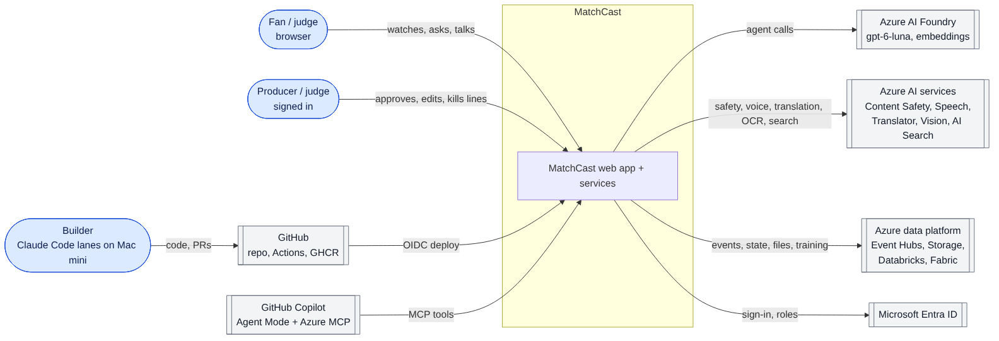
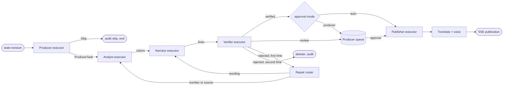
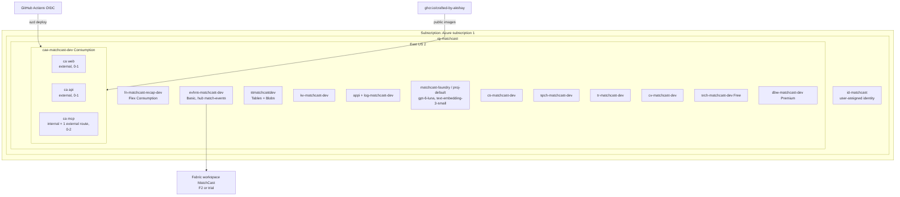

# MatchCast

[](https://github.com/Crafted-by-Akshay/matchcast/actions/workflows/ci.yml)

MatchCast turns a stream of synthetic football events into explainable match intelligence: live commentary lines that each carry the evidence behind them, a verifier that recounts every number before a line goes on air, and views that change for a data-hungry analyst, a casual fan and a producer. Built for Microsoft's "Inside the Game" hackathon, multi-agent category. All clubs, players and matches are fictional and generated by our own simulator.

> **Status (24 Oct 2026, from `/v1/status` and `docs/infra.md`):** the app runs on Azure Container Apps (East US 2) with a deployed agent api. Live: Analyst, Narrator and Verifier on the gpt-5-mini deployment (the Producer stays rules; by default only priority-1 moments call the model, and the rules take over if a call fails), the Stats Desk, Table Storage, AI Search, Speech, Translator, Vision, Content Safety and Entra sign-in on the Producer routes. Simulated: Event Hubs, which is an in-process stream today. Planned, not connected: Microsoft Fabric and Azure Databricks. `/v1/status` on the api and the **Status** button in the app list what is live, simulated or planned; that endpoint is the source of truth.

## Try it

- **Live demo:** <https://ca-web-matchcast-dev.calmbay-045566e2.eastus2.azurecontainerapps.io> (anonymous viewing; the first load can take up to a minute while the app wakes). Status and the Planned list: [`docs/judge/walkthrough.md`](docs/judge/walkthrough.md).
- **Sign-in:** nothing needs a sign-in to watch, use the Analyst view or use the Broadcast view. Approving, editing or killing a line on the Producer routes goes through Entra ID sign-in on the api; the rest of the app works without it.
- **Locally in about two minutes:** see [Run locally](#run-locally). It needs no cloud account.

Three things to click once it is open:

1. **Watch** view: start the match, switch the watch mode (Casual, Analyst, My club, Player focus, One metric) and see the same moment explained differently.
2. Press **Why?** or **How was this made?** on any line: the claim, its cited events and each agent's step.
3. Agents tab, **Seed a bad claim**: the Verifier rejects a wrong number and repairs it from the raw event log.

## The five stages

| Stage | What MatchCast does | Where |
| --- | --- | --- |
| Ingest | A seeded simulator (in the browser today; a headless runner is designed) emits passes, shots, tackles, possession changes, pressure and metadata as `matchcast.event/1` records | [`docs/architecture/06-simulation.md`](docs/architecture/06-simulation.md), `apps/unified/sources` |
| Interpret | Stats, xG and patterns computed by tested metric functions | [`docs/metrics.md`](docs/metrics.md), `packages/metrics` |
| Explain | The Analyst turns events into claims with evidence; the Narrator writes lines from the claim's inputs | [`docs/architecture/04-agents.md`](docs/architecture/04-agents.md), `packages/agents` |
| Render | Watch, Analyst and Broadcast views alongside the match | [`docs/architecture/11-frontend.md`](docs/architecture/11-frontend.md), `apps/unified` |
| Personalise | Watch modes, favourite club, player focus, one metric, modes and favourites work in the app; English, Spanish and Hindi lines are translated by Azure AI Translator and re-checked by the Verifier for numbers and names; other languages in Watch stay in-page and are labelled | [`docs/architecture/10-voice-and-translation.md`](docs/architecture/10-voice-and-translation.md) |

## Architecture







All seven diagrams, with their Mermaid sources, are in [`docs/architecture/`](docs/architecture/README.md); regenerate the images with `scripts/export_diagrams.sh`. Decisions are recorded as ADRs in [`docs/architecture/adr/`](docs/architecture/adr/).

## Multi-agent design

Four agents with separate jobs: **Producer** (picks moments, routes lines, asks for approval), **Analyst** (events to claims with evidence), **Narrator** (claim to line), **Verifier** (recounts every claim from the raw event log, repairs once or abstains). The Predictor is a deterministic tool and the Data Scientist runs on demand. Details, packet shapes and the repair path: [`docs/architecture/04-agents.md`](docs/architecture/04-agents.md). Claims and lines carry hashes and a tamper-evident audit chain (`matchcast.audit/1`).

## Evaluation

`eval/compare.py` compares a single agent against the four-agent workflow on the same frozen moments with a judge that does not use the Verifier. The numbers recorded so far come from an offline run with a seeded stand-in model, so they prove the harness, not model quality. A live run against the deployed gpt-5-mini agents is not recorded yet. See [`eval/README.md`](eval/README.md) and [`eval/results/offline.json`](eval/results/offline.json).

## Microsoft technology used

| Technology | Use | Code |
| --- | --- | --- |
| Microsoft Foundry (gpt-5-mini deployment) | Live: Analyst, Narrator and Verifier call the model through managed identity; the Producer stays rules, and the rules take over if a call fails | [`packages/agents/matchcast_agents/live/client.py`](packages/agents/matchcast_agents/live/client.py), [`scripts/smoke_foundry.py`](scripts/smoke_foundry.py) |
| Microsoft Agent Framework | Target orchestrator for the four agents; today `packages/agents` is a hand-written workflow with the same shape, and the move is designed, not built | [`docs/architecture/04-agents.md`](docs/architecture/04-agents.md) |
| MCP server | Tools for Copilot and clients, mounted by the API at `/mcp`; agents call in-process twins until the MCP client switch is built | [`services/mcp`](services/mcp), [`docs/mcp.md`](docs/mcp.md) |
| Azure Container Apps, Event Hubs, Storage, Key Vault, Application Insights | Hosting, event stream (Event Hubs is simulated by an in-process stream today), state, secrets, telemetry | [`infra/`](infra/), [`docs/infra.md`](docs/infra.md) |
| Microsoft Entra ID | Sign-in (Easy Auth) is enforced on the Producer line routes (approve, edit, kill); Viewer, Producer and Admin roles are defined, workspace roles in the Analyst view are Simulated, and match create and events are open | [`services/api/app/auth.py`](services/api/app/auth.py) |
| Azure AI Search | Live: the knowledge base is queried by keyword in Azure AI Search (the vector and hybrid query are planned) | [`packages/agents/matchcast_agents/ask/azure_search.py`](packages/agents/matchcast_agents/ask/azure_search.py) |
| Stats Desk (A2A, Azure Container Apps) | Live: the partner Stats Desk agent runs over A2A when `STATS_DESK_URL` is set; `/v1/status` shows it live | [`packages/agents/matchcast_agents/statsdesk.py`](packages/agents/matchcast_agents/statsdesk.py), [`services/mcp`](services/mcp) |
| Azure AI Content Safety | Screens every line when `CONTENT_SAFETY_ENDPOINT` is set, with the local rules as the first pass and the fallback; `/v1/status` shows whether it is live | [`packages/agents/matchcast_agents/safety.py`](packages/agents/matchcast_agents/safety.py) |
| Azure AI Speech | Voiced commentary and talk replies (clips for on-air lines at `/v1/matches/{id}/lines/{line_id}/audio.mp3`, and an `audio_url` on verified talk replies); push-to-talk through a short-lived token | [`services/api/app/voice.py`](services/api/app/voice.py), [`services/api/app/speech.py`](services/api/app/speech.py) |
| Azure AI Translator | Spanish and Hindi variants of the published lines, made for viewers who pick ES or HI and sent only after the Verifier re-checks numbers and names | [`packages/agents/matchcast_agents/translate.py`](packages/agents/matchcast_agents/translate.py), [`docs/architecture/10-voice-and-translation.md`](docs/architecture/10-voice-and-translation.md) |
| Azure AI Vision | Shirt-number OCR as a second opinion for player identification (at most 15 calls a minute) | [`services/api/app/vision.py`](services/api/app/vision.py) |
| azd, Bicep, local CI | Provisioning and deploy run from a laptop with `scripts/deploy_local.sh`; checks run with `scripts/local_ci.sh`. The GitHub Actions workflows are manual-only on purpose (cost) | [`scripts/`](scripts/), [`.github/workflows/`](.github/workflows/) |

Service states are what the deployed api reports in `/v1/status` on 24 Oct, except Key Vault and Application Insights, which that endpoint does not report. The services are provisioned in the `rg-matchcast` resource group (see [`docs/infra.md`](docs/infra.md)). Event Hubs is simulated by an in-process stream. Databricks and Fabric are planned and not connected. The architecture docs mark each one; nothing here is claimed as running that does not run.

## Azure MCP Server and GitHub Copilot

| Item | Status |
| --- | --- |
| MatchCast MCP server (`services/mcp`, tools in [`docs/mcp.md`](docs/mcp.md)) | Real, tested, deployed as a Container App |
| `.vscode/mcp.json` so Copilot Chat (agent mode) calls those tools in VS Code | Real, config checked in |
| Azure MCP Server inspecting the resource group during the build | **Planned**, not recorded yet (board task 62) |
| Copilot Agent Mode opening a PR against this repo | **Planned**, not recorded yet (board task 63) |
| 10-second Copilot clip for the video | **Planned**, recorded by hand once the cloud route is checked |

## Responsible AI

Every published line passes the Verifier and, in Producer mode, a human approval. A local screen checks text (Azure Content Safety screens lines when its endpoint is set; `/v1/status` shows whether it is live), a red-team set is kept in `eval/`, and all people and clubs are fictional. See [`docs/responsible-ai.md`](docs/responsible-ai.md) and [`docs/architecture/14-security-and-responsible-ai.md`](docs/architecture/14-security-and-responsible-ai.md).

## Run locally

Prerequisites: Node.js `^20.19.0`, `^22.13.0` or 24+, `uv`, Python 3.12 (`uv` can fetch it). No cloud credentials needed.

```sh
make install                 # npm ci and uv sync from the lockfiles
node tests/e2e/serve.mjs     # builds apps/unified and serves it at http://localhost:4173
```

Optional, for server-side agent lines instead of the in-page rules fallback, in a second terminal:

```sh
MATCHCAST_MODE=local MATCHCAST_AGENT_MODE=rules \
  uv run --locked --package matchcast-api uvicorn app.main:app --app-dir services/api --port 8000
```

then build the app with `python3 apps/unified/build.py --api http://localhost:8000` (see [`apps/unified/README.md`](apps/unified/README.md)). API configuration and endpoints: [`docs/backend.md`](docs/backend.md).

Checks, the same ones CI runs:

```sh
make lint typecheck test build   # or: scripts/local_ci.sh
make e2e                         # Playwright
```

## Repository layout

| Path | Purpose |
| --- | --- |
| `apps/unified` | The app: Watch, Analyst and Broadcast views behind one top bar |
| `services/api` | FastAPI: matches, events, SSE stream, approval and audit |
| `services/worker`, `services/mcp` | Event consumer, MCP tools (`services/simulation` is a placeholder for the headless runner) |
| `packages/contracts` | JSON Schema for events, claims and audit; generated TypeScript |
| `packages/agents`, `packages/metrics`, `packages/shared` | Agent workflow, metric functions, Azure clients and telemetry |
| `infra`, `azure.yaml` | Bicep and azd |
| `eval`, `kb`, `tests` | Evaluation harness, knowledge base, end to end tests |
| `docs` | Architecture (arc42, C4, ADRs), contracts, runbooks, evidence |

## Credits

- **three.js** (MIT) for the 3D pitch, loaded from jsDelivr.
- **MakeHuman** CC0 base meshes for the players; all motion is our own code.
- **Wyscout soccer match event dataset** — Pappalardo, L., Cintia, P., Rossi, A. et al. "A public data set of spatio-temporal match events in soccer competitions." *Scientific Data* 6, 236 (2019). https://doi.org/10.6084/m9.figshare.7770599. Licence: [CC BY 4.0](https://creativecommons.org/licenses/by/4.0/). Used only as aggregate statistics: the xG curve and per-match event rates. No Wyscout rows are stored in this repository.
- **martj42 international football results** — https://github.com/martj42/international_results, CC0. Used for goal, draw and timing rates.

## Licence

[MIT](LICENSE).
