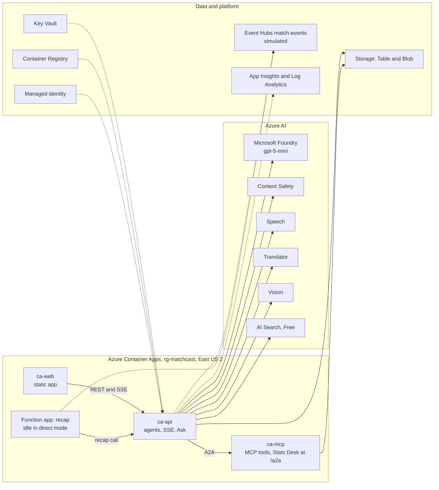

# MatchCast

MatchCast is an AI production crew for a live football broadcast. It turns a stream of synthetic football events into explainable match intelligence: live commentary lines that each carry the evidence behind them, a verifier that recounts every number before a line goes on air, and views that change for a data-hungry analyst, a casual fan and a producer. Built for Microsoft's "Inside the Game" hackathon, multi-agent category. The teams are real national teams with real past results as reference facts (ADR-0020); every player and every match event is fictional and generated by our own simulator.

**The headline: nothing reaches a screen until the Verifier has recounted it.** On the live gpt-5-mini Analyst, Narrator and Verifier (26 Oct 2026) the Verifier caught **100% of 69** planted errors for the right reason and **7 of 7** seeded bad claims, with **0** wrong claims shown; offline, on the rules agents, it caught **99.3% of 151**. The price is caution: it still rejects 15.8% (3 of 19) of honest live lines. Numbers, scope and weak spots: [Evaluation](#evaluation).

> **Status (28 Oct 2026, from the deployed api's `/v1/status`):** the app runs on Azure Container Apps in East US 2. Live: the four agents (Producer, Analyst, Narrator, Verifier) on the gpt-5-mini deployment in Microsoft Foundry, each with a rules twin; the Stats Desk over A2A; Table Storage; AI Search; Speech; Translator; Vision; Content Safety; and Entra sign-in on the Producer routes. Simulated: Event Hubs, which is an in-process stream while the api runs `direct`. Planned, not connected: Microsoft Fabric and Azure Databricks. `/v1/status` is the source of truth, and the **Status** button in the app lists the same states.

## Try it

- **Live demo:** <https://ca-web-matchcast-dev.calmbay-045566e2.eastus2.azurecontainerapps.io> (anonymous viewing; the first load can take up to a minute while the app wakes). The judge notes, including the Planned list, are in [`docs/judge/walkthrough.md`](docs/judge/walkthrough.md).
- **Sign-in:** nothing needs a sign-in to browse, watch or ask. Approving, editing or killing a line on the Producer routes goes through Entra ID sign-in on the api.
- **Locally in about two minutes:** see [Run locally](#run-locally). It needs no cloud account.

Five things to click, in about four minutes:

1. **Home, Matches and My Club.** The browse pages do not start the match engine. My Club has a Copilot panel grounded in the saved matches of the club you pick.
2. **Watch.** The synthetic match starts on load (Argentina v Brazil, the default fixture, seed 2026). Pick Fan or Analyst commentary, or one of the six feeds in the feed picker, and a language in the header (ten languages).
3. **Why?** on any line shows the claim, the events it cites and each agent's step.
4. **Analyze** has an Overview and a Full analysis (season table, match evidence, audit history). **Production Studio** has instant replay and approve, edit and kill controls for the booth lines.
5. **Ask**, in Watch or My Club. An answer carries a source chip that says where it came from. A question the data cannot answer is refused rather than guessed.

### What changed on 28 Oct

- **Browse and Watch redesign (#480).** Home, Matches and My Club are the primary tabs; Watch has Fan and Analyst commentary with one live card and an Ask-first Copilot; Analyze has one Overview and Full analysis switch; Production Studio keeps its advanced controls under one disclosure.
- **Six feeds (#482).** The feed picker no longer marks audio description, half-time explainer and news ticker as Planned. All six are selectable.
- **Labels and empty states (#474 to #477, #475, #476).** Empty Highlights controls are disabled with a reason, dead Analyst links point at Watch, the Verifier's figures carry their population and mode, and the trace page follows the match the Match centre has open.
- **Web image (#484).** `club-ask.js` is now copied into the web image; without it the live page would have asked for a file that was not there.

## The five pipeline stages

These stages still describe the data flow; the stage strip is hidden in the app to keep the viewing screens clear.

| Stage | What MatchCast does | Where |
| --- | --- | --- |
| Ingest | A seeded simulator (in the browser today; a headless runner is designed) emits passes, shots, tackles, possession changes, pressure and metadata as `matchcast.event/1` records | [`docs/architecture/06-simulation.md`](docs/architecture/06-simulation.md), `apps/unified/sources` |
| Interpret | Stats, xG and patterns computed by tested metric functions | [`docs/metrics.md`](docs/metrics.md), `packages/metrics` |
| Explain | The Analyst turns events into claims with evidence; the Narrator writes lines from the claim's inputs | [`docs/architecture/04-agents.md`](docs/architecture/04-agents.md), `packages/agents` |
| Render | Watch, Analyst and Production Studio views alongside the match | [`docs/architecture/11-frontend.md`](docs/architecture/11-frontend.md), `apps/unified` |
| Personalise | Fan/Analyst commentary styles and club favorites work in the app; lines in ten feed languages are translated by Azure AI Translator and re-checked by the Verifier for numbers, names and neutral wording (ADR-0023); a language Watch does not list yet shows English and is labelled | [`docs/architecture/10-voice-and-translation.md`](docs/architecture/10-voice-and-translation.md) |

## Architecture

How one moment becomes a line on screen, and where each Azure service sits. The diagrams are Mermaid, so GitHub draws them. The older PNG diagrams in [`docs/architecture/img/`](docs/architecture/img/) are kept as a record.

### One moment, end to end

1. **Simulate.** The simulator in the browser generates the match from a seed, so the same seed gives the same match in every browser (#463). In `direct` mode each event is posted to `POST /v1/matches/{id}/events` on the api.
2. **Pick the moment.** The api writes the events to Table Storage. The Producer picks the moment to explain. On a goal or red card the Showrunner planner spawns up to five specialists in parallel; on any other moment, at most one.
3. **Explain.** The Analyst writes claims, and each claim cites the event ids it rests on. The Narrator writes one line per voice: play-by-play, colour, and the feeds.
4. **Verify.** The Verifier recounts every number from the stored events, tries five falsifications, and allows one repair: a wrong number goes back to the Analyst, wording goes back to the Narrator.
5. **Hold or drop.** A line that still fails is dropped if it is a derived feed. A booth line is held for the producer, flagged as escalated, and can only be killed.
6. **Screen and approve.** Text that passes goes through Content Safety. In producer mode the booth lines wait for one producer's approval. The derived feeds air at once.
7. **Publish.** The line is written with its audit record and streamed over SSE to Watch, Analyst and Production Studio. The header shows the median time from a Watch event to its verified line on screen.
8. **Translate on request.** A viewer who picks another language gets the line translated by Azure AI Translator and re-checked by the Verifier for numbers, names and neutral wording. A line that fails the re-check stays in English, and the app says so.

If a model call fails or the daily cap in the cost guard is reached, the agent's rules twin answers instead, and the audit records the fallback (ADR-0014).

### Diagram: the moment flow

```mermaid
flowchart LR
  sim["Simulator in the browser<br/>seeded, synthetic events"] -->|"POST events"| api["Agent api<br/>ca-api, FastAPI"]
  api --> P["Producer<br/>picks the moment"]
  P -->|"goal or red card: up to 5, else 1"| S["Specialists in parallel<br/>replay · tactics · stats · rhythm · history"]
  P --> A["Analyst<br/>claims cite event ids"]
  S --> A
  A --> N["Narrator<br/>one line per voice"]
  N --> V{"Verifier<br/>recount, then 5 falsification tries"}
  V -->|"fails: one repair"| R["Analyst or Narrator repairs"]
  R --> V
  V -->|"still fails"| X["Dropped, or held for the producer"]
  V -->|passes| CS["Content Safety screen"]
  CS --> Q{"Booth line in producer mode?"}
  Q -->|yes| H["Producer approves or kills"]
  Q -->|"no: derived feed"| Pub["Published"]
  H --> Pub
  Pub --> SSE["SSE stream to the browser"]
  SSE --> Views["Watch · Analyst · Production Studio"]
  Pub -.-> Store[("Table Storage<br/>events, claims, audit chain")]
  V -.->|"priority 1 or asked"| SD["Stats Desk over A2A<br/>audited, does not feed back"]
  Views -.->|"viewer picks a language"| T["Azure AI Translator<br/>then a Verifier re-check"]
```



### Diagram: where it runs



The four core agents call Foundry gpt-5-mini through managed identity, each with a rules twin that takes over if a call fails (ADR-0014). Specialists and the Stats Desk make no model call of their own, and every step is written to a hash-chained audit log. Decisions are recorded as ADRs in [`docs/architecture/adr/`](docs/architecture/adr/); all seven architecture documents with their Mermaid sources are in [`docs/architecture/`](docs/architecture/README.md).

## Multi-agent design

Four agents with separate jobs: **Producer** (picks moments, routes lines, asks for approval), **Analyst** (events to claims with evidence), **Narrator** (claim to line), **Verifier** (recounts every claim from the raw event log, repairs once or abstains). They run as a Microsoft Agent Framework graph. The Predictor is a deterministic tool and the Data Scientist runs on demand. Claims and lines carry hashes and a tamper-evident audit chain (`matchcast.audit/1`).

The production crew around them, as merged on 26 Oct:

- **Specialists.** On a goal or red card the Showrunner planner spawns up to five specialists in parallel (replay, tactics, stats, rhythm, head-to-head history), at most one on any other moment. Each reports findings with the event ids (or result rows) they rest on, so the Verifier can recount them; specialists never write a line. The spawn tree shows on the Crew panel. The routing decision is still the Producer's; a separate Showrunner model call is not built.
- **Verifier gate and repair.** Recount, then an adversarial pass of five falsification attempts, then one repair (a number goes back to the Analyst, wording to the Narrator). A booth line that fails its repair on a checkable fact (a number, a player, a source, stale state) waits for the producer flagged as escalated, and can only be killed; any other line that fails is dropped from air.
- **Approval as a mode.** In producer mode the two booth voices (play-by-play and colour) wait for one producer's approval after the Verifier. The derived feeds never wait: they air once verified, or are dropped.
- **Watch commentary.** Fan and Analyst are the commentary styles on Watch. The six feeds (casual, analyst, audio description, catch me up, half-time explainer, news ticker) are all selectable in the feed picker. Each airs once the Verifier passes it, with no producer approval. The half-time explainer comes from the period boundary, and catch me up is on request.
- **Shared memory and replan.** Storylines from verified lines reach the Producer and Narrator with numbers masked; 60 s with no verified line makes the Showrunner replan once and open a player's storyline, which that player's next goal pays off once. The replan assigns the replay specialist but does not run it yet (**Planned**).
- **Failure drill.** The internal `#agents` support route retains **Cut the model** for diagnostics; the rules twins take over (ADR-0014) and each fallback is audited. **Restore the model** brings it back after the breaker's 30 s.
- **Event → on air.** A header pill shows the median wall time from a Watch event reaching the app to its verified line arriving in the browser.

**Why a multi-agent graph, and why Agent Framework.** A broadcast is already a crew: someone picks the moment, someone finds the numbers, someone writes the words, and someone else checks them before air. We kept those jobs apart on purpose. The Verifier must not be the agent that wrote the line, or it grades its own work; and a failed check has to go back to the right agent (a wrong number to the Analyst, wording to the Narrator). Microsoft Agent Framework's `WorkflowBuilder` gives us that as a typed graph: each agent is an executor, edges carry small dataclasses, the Stats Desk edge is conditional, and each step is a span in the trace. A single loop would be simpler and faster: in the live eval a single gpt-5-mini agent answered in 1.9 s against the crew's 6.3 s, and on that clean match it aired no wrong line either. What it cannot do is check itself, so it has no step to catch a planted error. Limits we accept: a new workflow is built per event (the framework refuses concurrent runs on one instance), checkpointing is our own Table store, and `MATCHCAST_ORCHESTRATOR=native` runs the same steps as plain calls, with a test that the two give identical claims, lines and audit records (ADR-0002).

Details, packet shapes and the repair path: [`docs/architecture/04-agents.md`](docs/architecture/04-agents.md).

## Evaluation

`eval/compare.py` compares a single agent against the four-agent workflow on the same frozen moments with a judge that does not use the Verifier; its recorded numbers come from an offline run with a seeded stand-in model, so they prove the harness, not model quality ([`eval/README.md`](eval/README.md), [`eval/results/offline.json`](eval/results/offline.json)). The in-app crew scoreboard runs three rules-mode arms on one fixed fixture with the same seeded wrong claims (full crew, a single agent with no Verifier, the crew with the Verifier bypassed) and grades each aired line against the simulator's truth ([`docs/architecture/16-testing-and-quality.md`](docs/architecture/16-testing-and-quality.md) §4.1); it is labelled Rules-only, and a recorded model run is shown beside it only when one exists for that fixture.

**Verifier, measured (rules mode, offline).** `eval/agents_eval.py` replays the 34 lines the workflow verified on the frozen match `match-short`, changes each one in one way (151 content mutations: a wrong number, an invented player, a player from the other club, a claim citing an event that is not in the log, and so on) and asks the Verifier again. It caught **99.3%** of them, and only a rejection for the intended reason counts as a catch; it rejected **0 of the 34 honest lines**. The seeded bad claim was injected at 7 match times and rejected for the right reason in 7 of 7, and no wrong claim reached a screen. Scope: the deterministic rules agents on one fixture, so this is the floor a model-written line is checked against, not a measure of model quality. Full table: [`docs/eval/agents-eval.md`](docs/eval/agents-eval.md).

**Live run on Foundry (26 Oct, gpt-5-mini).** The same harness against the Foundry-backed Analyst, Narrator and Verifier, on a smaller replay (16 verified lines, so 69 content mutations and 19 honest lines; [`docs/eval/agents-eval-live.md`](docs/eval/agents-eval-live.md)), with **0** model calls falling back to the rules: the seeded bad claim was caught 7 of 7 with 0 wrong claims shown, **100%** of the 69 mutations were caught for the right reason, 100% of 26 claims matched an independent recount, and **94.1%** of 17 Narrator first drafts stayed inside their claims and the roster (83.3% on 25 Oct). Ask, which has no model, answered 40 of 40 golden questions and stopped all 20 red-team prompts. The weak spots, from the same run: the Verifier still rejected **15.8%** of 19 honest lines (46.2% on 25 Oct), so it errs towards holding a line; 12.5% of 8 booth colour drafts were generic (a kind of line the Verifier refuses); numbers in the wrong order (0-1 for 1-0) are not caught. End to end on the frozen match ([`eval/results/live.json`](eval/results/live.json), one run), the live system aired a line on 7 of 22 moments with 0 wrong lines and a median of 6.3 s per moment; on the other 15 the Verifier abstained rather than air a line it could not pass (the rules-only crew airs 14); a single gpt-5-mini agent with no Verifier aired all 22 at 1.9 s, and the judge found no wrong line in them either, so this clean match shows no accuracy edge for the crew. What the crew adds is a check: it caught all 7 seeded bad claims and all 69 planted errors, and the single agent has no such step. The two were not compared head to head on those errors.

## Microsoft technology used

As of 28 Oct 2026, from the deployed api's `/v1/status` and the Bicep in `infra/`. **Live** means `/v1/status` or the running app shows it. **Deployed** means Bicep provisions it but `/v1/status` does not report it, so it is not confirmed from the app. **Simulated** and **Planned** mean what the app labels them.

| Azure service | Resource in `rg-matchcast` | What MatchCast uses it for | State | Code |
| --- | --- | --- | --- | --- |
| Azure Container Apps | `cae-matchcast-dev`, with `ca-web-matchcast-dev`, `ca-api-matchcast-dev` and `ca-mcp-matchcast-dev` | web: the static app behind nginx. api: FastAPI with the agent workflow, SSE, Ask and Talk. mcp: MCP tools and the Stats Desk endpoint at `/a2a` | Live | [`infra/modules/containerapps.bicep`](infra/modules/containerapps.bicep), [`services/api`](services/api), [`services/mcp`](services/mcp) |
| Microsoft Foundry | `matchcast-foundry` (made by hand, passed to Bicep), gpt-5-mini deployment | Model calls for the Producer, Analyst, Narrator and Verifier through managed identity. Each agent falls back to its rules twin if a call fails | Live | [`packages/agents/matchcast_agents/live/client.py`](packages/agents/matchcast_agents/live/client.py) |
| Stats Desk (A2A) | Hosted on `ca-mcp` at `/a2a`; the api's `STATS_DESK_URL` points there | Partner statistics agent. The api calls it over A2A on priority-1 moments or when asked. Audited, and its answers do not feed back into lines | Live | [`packages/agents/matchcast_agents/statsdesk.py`](packages/agents/matchcast_agents/statsdesk.py) |
| Azure AI Search | Free tier in East US (`srch-matchcast-dev-<suffix>`), index `kb-matchcast-v1` | Keyword search over the knowledge base for Ask. Vector and hybrid search are planned. The query key sits in Key Vault | Live | [`packages/agents/matchcast_agents/ask/azure_search.py`](packages/agents/matchcast_agents/ask/azure_search.py), ADR-0009 |
| Azure AI Speech | S0, endpoint and region from the Bicep outputs | Voiced commentary and talk replies. The browser gets a short-lived token from the api | Live | [`services/api/app/voice.py`](services/api/app/voice.py), [`services/api/app/speech.py`](services/api/app/speech.py) |
| Azure AI Translator | S1 (Azure policy blocks an in-place change to F0) | Variants of verified lines in the ten feed languages, sent only after the Verifier's re-check (ADR-0011, ADR-0023) | Live | [`packages/agents/matchcast_agents/translate.py`](packages/agents/matchcast_agents/translate.py) |
| Azure AI Vision | S1 (ComputerVision) | Shirt-number OCR as a second opinion on player identification, at most 15 calls a minute | Live | [`services/api/app/vision.py`](services/api/app/vision.py) |
| Azure AI Content Safety | S0 | Screens every line that passes the Verifier. A local word list is the first pass | Live | [`packages/agents/matchcast_agents/safety.py`](packages/agents/matchcast_agents/safety.py) |
| Microsoft Entra ID | App registration `matchcast-web`, Easy Auth on `ca-api` | Sign-in for the Producer routes (approve, edit, kill), with roles enforced there | Live | [`services/api/app/auth.py`](services/api/app/auth.py) |
| Managed identity | `id-matchcast` | Entra ID tokens for Foundry, Storage, Event Hubs, Speech, Translator, Vision, Content Safety and Key Vault. No key is in the repo | Live | [`packages/shared/matchcast_shared/azure_clients.py`](packages/shared/matchcast_shared/azure_clients.py) |
| Azure Table Storage | Tables in the storage account, `MATCHCAST_STORE=table` | The match record, claims and the hash-chained audit log | Live | [`docs/architecture/07-data-and-storage.md`](docs/architecture/07-data-and-storage.md), ADR-0015 |
| Azure Blob Storage | Same storage account; containers include `kb-chunks` and the Functions deployment package | Knowledge base chunks, and the Event Hubs checkpoints when that mode is on | Deployed | [`docs/infra.md`](docs/infra.md) |
| Azure Event Hubs (Basic) | Namespace with hub `match-events` | The event stream in `eventhubs` mode. The api runs `direct`, so the stream is in-process today | Simulated | [`services/worker/matchcast_worker/eventhubs.py`](services/worker/matchcast_worker/eventhubs.py) |
| Azure Functions (Flex Consumption) | `fn-matchcast-dev-recap-hno67` | Recap on the Event Hubs trigger at the end of the final period. In `direct` mode the api writes the recaps at full time itself, so the function is not on the live path | Deployed, not on the live path | [`services/recap`](services/recap) |
| Azure Key Vault | Vault in `rg-matchcast` | Holds the Entra client secret and the AI Search query key, which the Container Apps read through managed identity | Deployed | [`infra/modules/keyvault.bicep`](infra/modules/keyvault.bicep) |
| Azure Container Registry (Basic) | `acrmatchcast<suffix>` | Holds the api, web and mcp images, built with `az acr build` (ADR-0019) | Deployed | [`scripts/deploy_cloud.sh`](scripts/deploy_cloud.sh), [`infra/modules/registry.bicep`](infra/modules/registry.bicep) |
| Application Insights and Log Analytics | Workspace and component from `monitoring.bicep`, plus the `MatchCast agents` workbook | Traces with a span per agent and a GenAI span per Foundry call with token counts. Alert rules deploy only when `ALERT_EMAIL` is set | Deployed | [`packages/shared/matchcast_shared/telemetry.py`](packages/shared/matchcast_shared/telemetry.py), [`infra/modules/workbook.json`](infra/modules/workbook.json) |
| Cost guard (in the api) | Not an Azure resource | A daily cap per api replica on model calls for the match agents, and a separate cap for Ask and Talk, so a question loop cannot switch off commentary. The `MATCHCAST_MODEL_OFF` kill switch stops all model spend | Live | [`services/api/app/budget.py`](services/api/app/budget.py) |
| Microsoft Fabric, Azure Databricks | Not connected | Planned analytics path | Planned | `/v1/status` |

Other Microsoft tooling: Microsoft Agent Framework (`WorkflowBuilder`, the default orchestrator, ADR-0002), MCP and A2A, the Azure Developer CLI and Bicep (`azure.yaml`, `infra/`). GitHub Actions is off on purpose: its two workflows are manual-only, so checks run with `scripts/local_ci.sh` and deploys with `scripts/deploy_cloud.sh`. Spend stays inside the agreed budget caps (`infra/CLAUDE.md`).

**Judge steps for the infrastructure.** Open `https://ca-api-matchcast-dev.calmbay-045566e2.eastus2.azurecontainerapps.io/v1/status` and check each row against the table above. Anything the table calls Deployed is checked in the Azure portal rather than in the app.

## Identity, telemetry and cost

- **Identity (as of 28 Oct 2026).** The services call Foundry, Storage, Speech, Translator, Vision and Content Safety with Entra ID tokens from a user-assigned managed identity (`DefaultAzureCredential`, `packages/shared/matchcast_shared/azure_clients.py`); key access is switched off on the four Azure AI service accounts in Bicep (Content Safety, Speech, Translator, Vision), the storage account and Event Hubs (`disableLocalAuth`, `allowSharedKeyAccess: false` in `infra/modules`); the Foundry resource was created by hand and is not in Bicep. The exceptions: AI Search Free has no managed identity, so its key sits in Key Vault (ADR-0009); the Entra sign-in client secret is a Key Vault secret the Container App references; the Application Insights connection string is a Container Apps secret; and the managed environment sends logs to Log Analytics with the workspace's shared key. No key is in the repo. Producer routes need Entra sign-in.
- **Telemetry.** The api sends OpenTelemetry traces, metrics and logs to Application Insights (`configure_azure_monitor`, `packages/shared/matchcast_shared/telemetry.py`), with a span per agent call carrying the agent name (`gen_ai.agent.name`), and a GenAI chat span on every Foundry call with the model (`gen_ai.request.model`) and input and output tokens (`gen_ai.usage.*`; `live/client.py`, merged 26 Oct, on the live api from its next deploy). A workbook is defined in `infra/modules/workbook.json` ([`docs/architecture/15-observability.md`](docs/architecture/15-observability.md)).
- **Model use per match, measured.** In the 26 Oct live eval on the short frozen match (22 moments, [`eval/results/live.json`](eval/results/live.json)), the four-agent crew made 64 model calls with 60,839 input and 4,174 output tokens; a single agent made 22 calls with 2,732 and 1,014. The eval sends every moment to the model (`MATCHCAST_LIVE_MAX_PRIORITY=3`), so this is an upper bound; in production quiet moments skip the Analyst and Narrator models. We have not applied a price to these tokens here; the whole build runs under a hard Azure budget cap.

## Azure MCP Server and GitHub Copilot

| Item | Status |
| --- | --- |
| MatchCast MCP server (`services/mcp`, tools in [`docs/mcp.md`](docs/mcp.md)) | Real, tested, deployed as a Container App |
| `.vscode/mcp.json` so Copilot Chat (agent mode) calls those tools in VS Code | Real, config checked in |
| Azure MCP Server inspecting the resource group during the build | **Planned**, not recorded yet (board task 62) |
| Copilot Agent Mode opening a PR against this repo | **Planned**, not recorded yet (board task 63) |
| 10-second Copilot clip for the video | **Planned**, recorded by hand once the cloud route is checked |

## Extend it

- **Add a specialist.** Write a class with a `name` and `async run(ctx, request) -> SpecialistReport` (the interface is in `packages/agents/matchcast_agents/specialists/base.py`; `stats.py` is the shortest example). Every finding carries its figures and the event ids it came from, so the Verifier can recount it, and a specialist never writes a line. Register it in `default_registry()` in `specialists/runner.py`, give it an objective in `OBJECTIVES` in `specialists/planner.py` (a name not listed there is never spawned; `PRIORITY_ONE_CAP` there caps a goal at five), add its name to `SPAWN_POOL` in `packages/agents/matchcast_agents/workflow.py` (the order is the spawn order on a goal), and add a test next to `packages/agents/tests/test_crew_specialists.py`. The spawn tree on the Crew panel picks it up from the `crew_spawn` frames.
- **Add a language.** Add the code to `LANGUAGES` in `packages/agents/matchcast_agents/translate.py`, to the two `lang` lists in `services/api/app/matches.py`, and to `MC_LANGS`, `MC_LANG_NAMES` and `MC_SPEECH_LOCALE` in `apps/unified/langs.js`; its English name goes in the `ENGLISH` map in `apps/unified/embed/langpick.js`; a voice goes in `apps/unified/voices.json` and `services/api/config/voices.json`. Then regenerate `docs/api/openapi.json`, extend `packages/agents/tests/test_translate.py` and `tests/e2e/language-ten.spec.ts` / `watch-lang-picker.spec.ts`, and amend ADR-0023, which fixes the list at ten. The Verifier's re-check of numbers and names runs on the new language with no change; a line that fails it stays English (ADR-0011, ADR-0023).

## Production crew: what is Planned

- **CREW-4.4 model adversary** (board AB#422): Planned. Every metric the code emits already has a deterministic recount (`verify/checks.py`), so no claim reaches a model adversary yet. Which claims go to the model, and which tools it gets, is still open.
- **Showrunner model call**: not built. Routing is the Producer's, with a rules fallback.
- **Head-to-head and Elo history rows** (CREW-2.2): not built. The panel says "Planned" unless a claim carries its own history rows, and it never invents them.
- **Storylines**: the payoff covers goals only. The replay specialist a replan assigns is recorded, not run ([`docs/architecture/04-agents.md`](docs/architecture/04-agents.md)).
- **One-metric view** (top speed, distance, pass accuracy): not built, because the simulator does not emit the data it needs.
- **Arabic voice**: the feed text is translated and re-checked in all ten languages; only English, Spanish, Portuguese and Hindi are voiced.

## Responsible AI

Every published line passes the Verifier; in producer mode the booth lines also wait for a human approval, and the derived feeds air only once verified. A local screen checks text (Azure Content Safety screens lines when its endpoint is set; `/v1/status` shows whether it is live), a red-team set is kept in `eval/`, and all people and clubs are fictional. See [`docs/responsible-ai.md`](docs/responsible-ai.md) and [`docs/architecture/14-security-and-responsible-ai.md`](docs/architecture/14-security-and-responsible-ai.md).

## Run locally

Prerequisites: Node.js `^20.19.0`, `^22.13.0` or 24+, `uv`, Python 3.12 (`uv` can fetch it). No cloud credentials needed.

```sh
make install                 # npm ci and uv sync from the lockfiles
node tests/e2e/serve.mjs     # builds apps/unified and serves it at http://localhost:4173
```

Optional, for server-side agent lines instead of the in-page rules fallback, in a second terminal:

```sh
MATCHCAST_MODE=local MATCHCAST_AGENT_MODE=rules \
  uv run --locked --package matchcast-api uvicorn app.main:app --app-dir services/api --port 8000
```

then build the app with `python3 apps/unified/build.py --api http://localhost:8000` (see [`apps/unified/README.md`](apps/unified/README.md)). API configuration and endpoints: [`docs/backend.md`](docs/backend.md).

Checks, the same ones CI runs:

```sh
make lint typecheck test build   # or: scripts/local_ci.sh
make e2e                         # Playwright
```

## Repository layout

| Path | Purpose |
| --- | --- |
| `apps/unified` | The app: Watch, Analyst and Production Studio views behind one top bar |
| `services/api` | FastAPI: matches, events, SSE stream, approval and audit |
| `services/worker`, `services/mcp`, `services/recap` | Event consumer, MCP tools and the Stats Desk endpoint, the Functions recap (`services/simulation` is a placeholder for the headless runner) |
| `packages/contracts` | JSON Schema for events, claims and audit; generated TypeScript |
| `packages/agents`, `packages/metrics`, `packages/shared` | Agent workflow, metric functions, Azure clients and telemetry |
| `infra`, `azure.yaml` | Bicep and azd |
| `eval`, `kb`, `tests` | Evaluation harness, knowledge base, end to end tests |
| `docs` | Architecture (arc42, C4, ADRs), contracts, runbooks, evidence |

## Credits

- **three.js** (MIT) for the 3D pitch, loaded from jsDelivr.
- **MakeHuman** CC0 base meshes for the players; all motion is our own code.
- **Wyscout soccer match event dataset** — Pappalardo, L., Cintia, P., Rossi, A. et al. "A public data set of spatio-temporal match events in soccer competitions." *Scientific Data* 6, 236 (2019). https://doi.org/10.6084/m9.figshare.7770599. Licence: [CC BY 4.0](https://creativecommons.org/licenses/by/4.0/). Used only as aggregate statistics: the xG curve and per-match event rates. No Wyscout rows are stored in this repository.
- **martj42 international football results** — https://github.com/martj42/international_results, CC0. Used for goal, draw and timing rates.

## Licence

[MIT](LICENSE).
