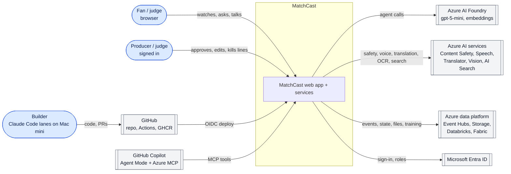
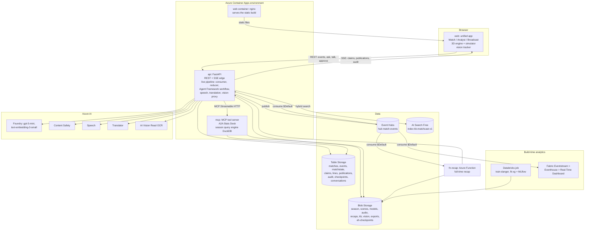

# 02 System context and containers (C4 levels 1 and 2)

Status: **Agreed design**. Last reviewed 22 Oct 2026.

This file follows the [C4 model](https://c4model.com): level 1 shows MatchCast with its people and outside systems, and level 2 shows every deployable part. Level 3 (components inside one container) is in each component spec (04 to 11).

## 1. System context (C4 level 1)

Exported image: [img/1-system-context.png](img/1-system-context.png) (regenerate with `scripts/export_diagrams.sh`).

## 2. Containers (C4 level 2)

Exported image: [img/5-data-flow.png](img/5-data-flow.png) (regenerate with `scripts/export_diagrams.sh`).

## 3. Container catalogue

Every deployable part, where its code lives, and who owns it. "Lane" is the Claude Code build lane.

| Container | What it does | Tech | Code | Runs on | Scale | Stage | Lane |
| --- | --- | --- | --- | --- | --- | --- | --- |
| `web` (browser app) | The three views, 3D render, simulator engine, vision tracker, postMessage bus | HTML, JS, three.js r160 | `apps/unified/` | Browser; files served by the `web` container | n/a | a, d, e | Experience |
| `web` (container) | Serves the static build with gzip/brotli and cache headers | nginx 1.27 alpine | `apps/unified/Dockerfile` | Container App, external ingress, Easy Auth (unauthenticated allowed) | 0 to 1 | d | Platform |
| `api` | REST + SSE edge; validates and publishes events; consumes them; runs the reducer and the agent workflow; speech, translation, vision proxy; approvals | Python 3.12, FastAPI, Microsoft Agent Framework | `services/api/`, `packages/agents/`, `packages/metrics/`, `services/worker/` (consumer and reducer library) | Container App, external ingress, Easy Auth | 0 to 1 (see ADR-0005) | a, b, c, e | Agents |
| `mcp` | MCP tools for agents and Copilot; A2A Stats Desk; read-only season SQL; `predict_danger` with ONNX | Python 3.12, `mcp` SDK, DuckDB, onnxruntime | `services/mcp/` | Container App, internal ingress plus one external route behind Easy Auth | 0 to 2 | b, c | Agents |
| `fn-recap` | Builds the full-time recap per persona | Python 3.12 Azure Functions, Event Hubs trigger | `services/recap/` | Functions Flex Consumption | 0 to 1 | c, e | Agents |
| Batch tools | Scene generation, season build, realism check, xG fit, KB ingestion, replay publisher | Node 22 (headless engine), Python 3.12 | `services/simulation/`, `scripts/` | Mac mini and CI only; outputs go to Blob | n/a | a, b | Data |
| Databricks job | Trains the danger model and fits xG; logs to MLflow; exports ONNX | PySpark notebooks, MLflow, Unity Catalog | `data/databricks/` | Databricks Premium jobs compute, single node | Run once, then stopped | b | Data |
| Fabric | Eventstream from Event Hubs into an Eventhouse; Real-Time Dashboard (4 tiles) | Fabric RTI, KQL | `data/fabric/` | F2 capacity, about 12 active hours, then paused | n/a | b, d | Data |

Folders that exist today and keep their name: `services/api`, `services/worker`, `services/simulation`, `packages/contracts`, `packages/agents`, `apps/unified`. The early Next.js scaffold `apps/broadcast-web` and the empty placeholders `services/commentary` and `services/match-state` were deleted on 22 Oct, because `apps/unified` is the demo app and the Narrator lives in `packages/agents` and the reducer lives in `services/worker`.

## 4. Azure resources

Names follow `<type>-matchcast-<env>` with `env = dev` (the only environment). The full Bicep list with SKUs, regions and roles is in [13-deployment-and-operations.md](13-deployment-and-operations.md).

| Resource | Name | SKU |
| --- | --- | --- |
| Resource group | `rg-matchcast` (exists, East US) | n/a |
| Foundry resource and project | `matchcast-foundry` / `proj-default` (exist, East US 2) | Global Standard deployments |
| Container Apps environment | `cae-matchcast-dev` | Consumption |
| Function app | `fn-matchcast-recap-dev` | Flex Consumption |
| Event Hubs namespace | `evhns-matchcast-dev`, hub `match-events` | Basic, 1 TU, 1 partition |
| Storage account | `stmatchcastdev` | Standard LRS, shared key off |
| AI Search | `srch-matchcast-dev` | Free |
| Content Safety | `cs-matchcast-dev` | S0 |
| Speech | `spch-matchcast-dev` | S0 |
| Translator | `tr-matchcast-dev` | S1 |
| AI Vision | `cv-matchcast-dev` | S1 |
| Key Vault | `kv-matchcast-dev` | Standard, RBAC |
| Log Analytics and App Insights | `log-matchcast-dev`, `appi-matchcast-dev` | Pay as you go, 0.5 GB daily cap |
| Managed identity | `id-matchcast` | User-assigned |
| Databricks | `dbw-matchcast` | Premium |
| Fabric | workspace `MatchCast` | F2 or the 60-day trial |

## 5. Stage map

| Stage (rules §4.1) | Where it happens |
| --- | --- |
| (a) Ingest | Browser simulator emits contract events; `api` validates and publishes to Event Hubs; vision tracker emits tracking frames |
| (b) Interpret | `services/worker` reducer builds state; `packages/metrics` computes xG, pass quality, pressure, control and chaos; Databricks danger model; Fabric KQL |
| (c) Explain | Producer, Analyst, Narrator, Verifier in `packages/agents`; RAG chatbot; recap function |
| (d) Render | Watch Match Pulse, Broadcast lower-thirds and teleprompter, Analyst ledger and dashboards, condensed broadcast camera |
| (e) Personalise | Personas (casual, analyst, broadcast, my-club, player-focus, one-metric), languages (the ten feed languages, ADR-0023), voice, talk to a player |
