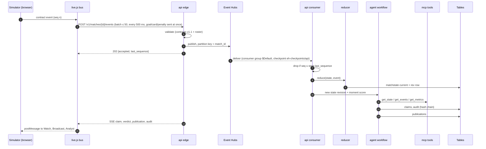
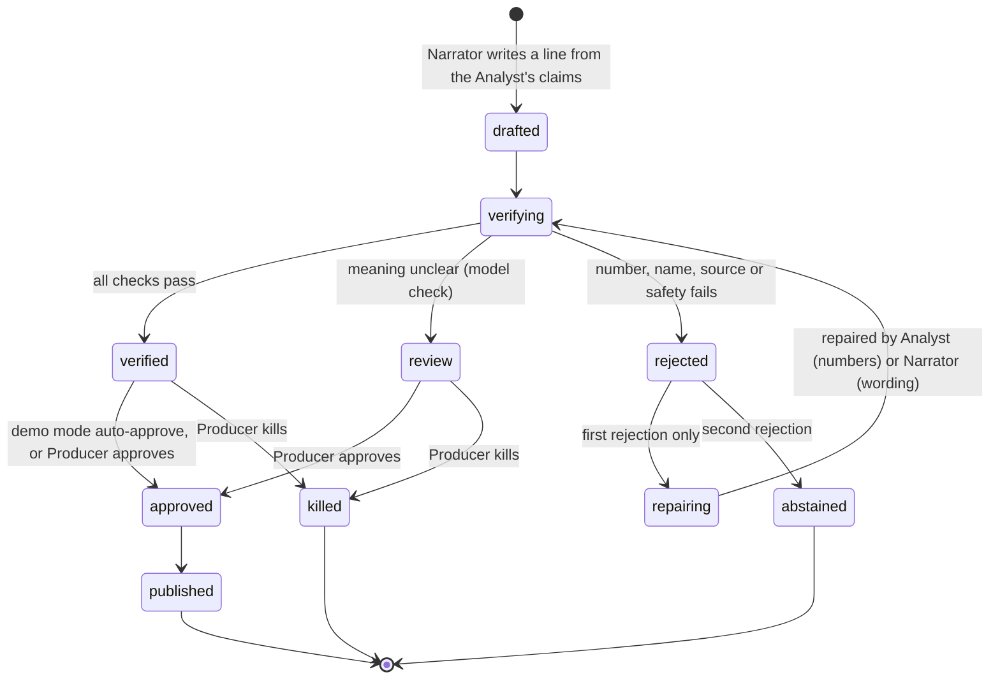
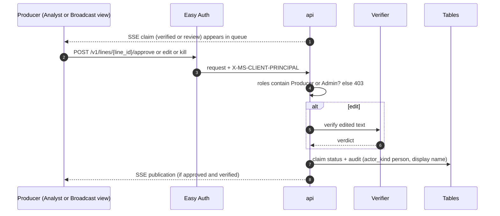
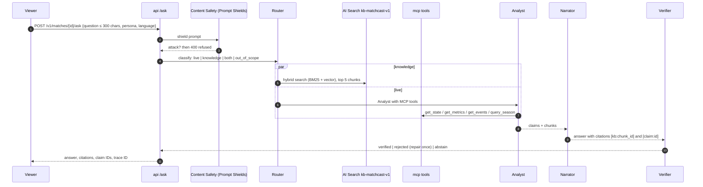
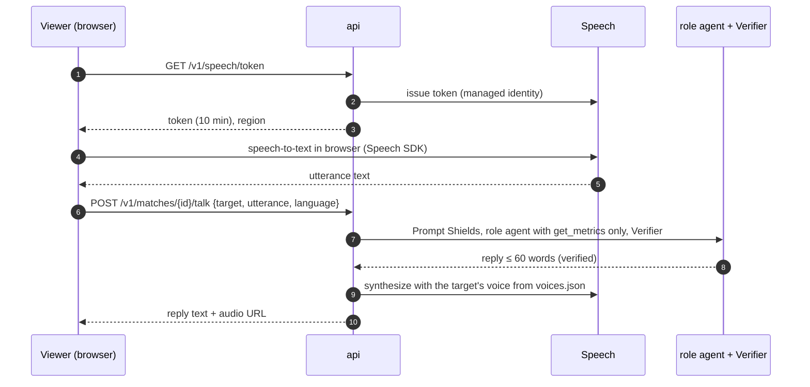
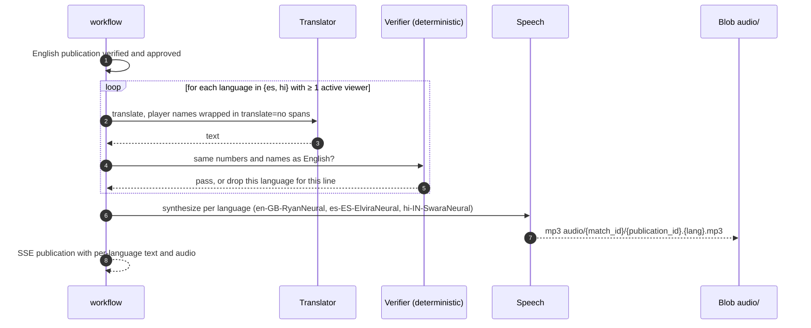
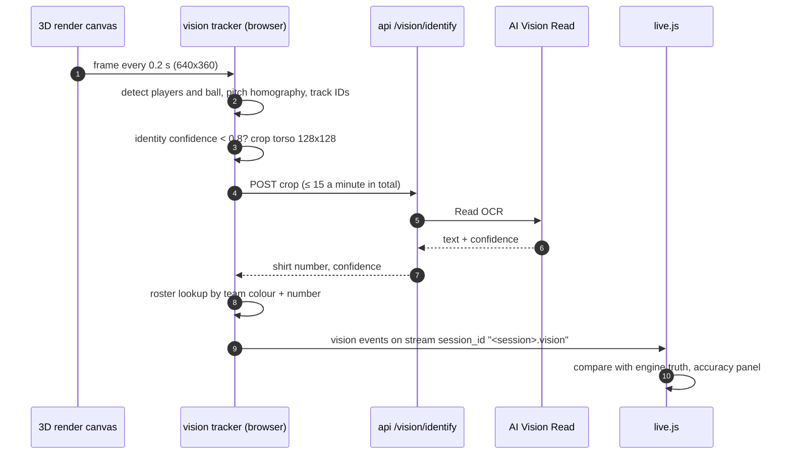
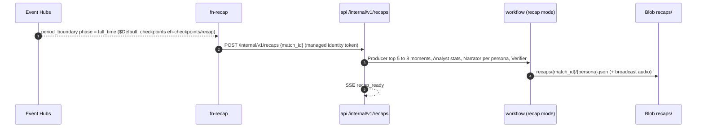
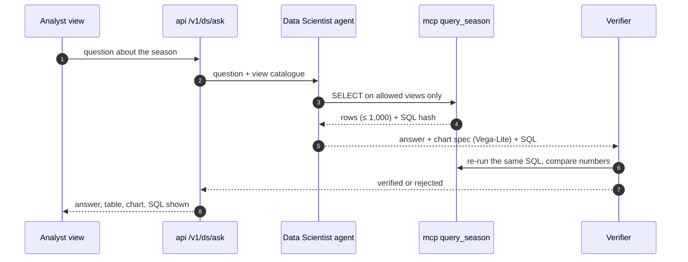
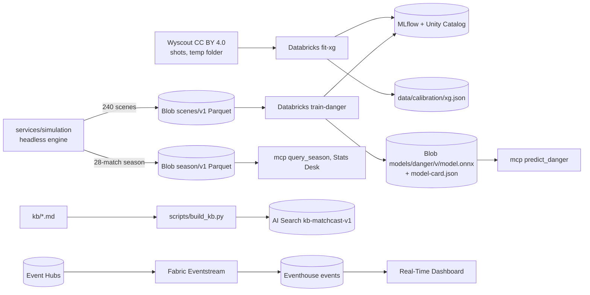

# 03 Runtime flows

Status: **Agreed design**. Last reviewed 22 Oct 2026.

Each flow is a sequence diagram plus numbered rules. Names in `code` are real endpoints, tables, tools or files. Timings are the budgets from [01-goals-and-constraints.md](01-goals-and-constraints.md) §5.

| Flow | Trigger | Budget |
| --- | --- | --- |
| [F1 Live match loop](#f1-live-match-loop) | Simulator emits an event | p95 ≤ 6 s to screen |
| [F2 Line lifecycle](#f2-line-lifecycle-verify-repair-abstain-fallback) | Any drafted line | 1 repair maximum |
| [F3 Producer approval](#f3-producer-approval) | Producer mode on | Human |
| [F4 Ask the chatbot](#f4-ask-the-chatbot-rag--live-tools) | Viewer question | p95 ≤ 8 s |
| [F5 Talk to a player by voice](#f5-talk-to-a-player-by-voice) | Push-to-talk | p95 ≤ 8 s |
| [F6 Translation and voice](#f6-translation-and-voice-for-a-publication) | Verified publication | translated line ≤ 3 s after English, first audio ≤ 2 s |
| [F7 Vision identification](#f7-vision-identification-ocr) | Vision mode on | ≤ 15 OCR calls a minute |
| [F8 Full-time recap](#f8-full-time-recap) | `period_boundary` full time | ≤ 60 s |
| [F9 Cold start and resume](#f9-cold-start-and-resume-after-a-crash) | Replica start | ≤ 60 s to resume |
| [F10 Data Scientist query](#f10-data-scientist-query) | Analyst asks | p95 ≤ 10 s |
| [F11 Build-time data pipeline](#f11-build-time-data-pipeline) | Data lane runs it | Once |

## F1 Live match loop

Exported image: [img/3-life-of-one-claim.png](img/3-life-of-one-claim.png) (regenerate with `scripts/export_diagrams.sh`).

Rules:
1. The browser engine is the only match source (EXP-2). Broadcast and Analyst render from the bus.
2. `api` publishes to Event Hubs **before** it acknowledges; a publish failure returns 503 and the browser retries the same batch with the same IDs (idempotent).
3. The consumer is the only writer of `matchstate`. It applies an event only if `stream_sequence > state.last_sequence`; corrections and retractions follow [docs/contracts.md](../contracts.md).
4. The workflow runs for a revision only when the Producer's rate rule allows it (one task per 8 s of match time, or immediately for priority 1). See [04-agents.md](04-agents.md).
5. Tracking frames from the engine stay in the browser. Only semantic events cross the network.
6. In rules mode (`MATCHCAST_AGENT_MODE=rules`) steps 10 to 12 run the deterministic implementations; everything else is identical.

## F2 Line lifecycle (verify, repair, abstain, fallback)

Rules:
1. The states are the `lines.status` values in [07-data-and-storage.md](07-data-and-storage.md) §4; verdicts and approvals belong to lines, not claims (ADR-0013). Every transition writes one audit record from the closed list in [04-agents.md](04-agents.md) §4 (`line_drafted`, `line_verified`, `line_review`, `line_rejected`, `line_repair_requested`, `line_abstained`, `line_approved`, `line_killed`, `publication_created`, `fallback_used`); the Analyst's claim writes `claim_created` first.
2. Only `published` lines reach any screen, voice or translation.
3. When a model call fails (timeout 20 s, 429 after one retry, 5xx, or the circuit is open), the same step runs its rules implementation, the claim's or line's `derivation_version` gets the suffix `+rules`, and the audit action `fallback_used` is written. The UI shows the "Rules fallback" chip.
4. Content Safety runs inside `verifying`; severity ≥ 2 in any category gives `rejected` with reason `unsafe_content`, and is never repaired.

## F3 Producer approval

Rules: producer mode is a per-match setting (`matches.approval_mode = auto | producer`). The demo default is `auto`. An edit that fails verification is not published and the original stays in the queue.

## F4 Ask the chatbot (RAG + live tools)

Rules: out-of-scope questions get "I can only answer questions about this match and MatchCast." Abstain text: "I can't confirm that from the match data yet." 5 questions a minute per browser session. Full design in [05-assistant-rag.md](05-assistant-rag.md).

## F5 Talk to a player by voice

Orders that change play ("press higher") are a game feature labelled "Game mode". They change the simulator's behaviour but never edit past events.

## F6 Translation and voice for a publication

A language with no viewers costs nothing. Lines older than 5 s are captioned but not voiced.

## F7 Vision identification (OCR)

Vision events use the existing contracts on a separate stream, so they can never overwrite engine truth. Full design in [09-vision-identification.md](09-vision-identification.md).

## F8 Full-time recap

The function holds no agent logic. It only triggers the `api`, so all agent code lives in one place.

## F9 Cold start and resume after a crash

1. `api` starts with zero replicas. The first HTTP request or an Event Hubs backlog of 50 or more starts one replica (KEDA). The browser shows "Warming up the match engine" until `/ready` returns 200.
2. On start, for every match with `matches.status = live`, the consumer loads `matchstate/current`, then the Agent Framework checkpoint from `checkpoints`, then resumes Event Hubs from the Blob checkpoint.
3. Events at or below `last_sequence` are skipped. Claims use the idempotent key `claim_id = sha256(match_id, moment_id, agent, derivation_version)[:24]`, so a replayed step overwrites with the same row and never duplicates.
4. Readiness returns 200 only after resume finishes. Target: claims resume within 60 s (AGT-13).

## F10 Data Scientist query

## F11 Build-time data pipeline

