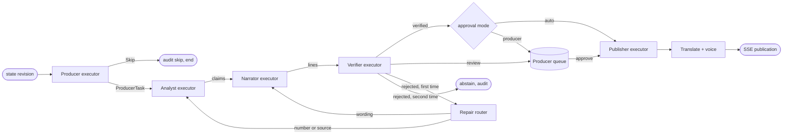

# 04 Multi-agent design

Status: **Agreed design**. Last reviewed 22 Oct 2026. Backlog: AGT-3 to AGT-15, EXP-5, EXP-16. Earlier design notes: `/mnt/project-files/matchcast-v2/orchestration/DESIGN.md` (superseded by this file where they differ).

## 1. Principles

1. **Four core agents, each with one job.** Producer decides, Analyst measures, Narrator writes, Verifier checks. No agent does another's job.
2. **Shared state, not chat.** Agents hand off typed packets (contracts v1.1) through the workflow and the `claims` table. No agent reads another agent's prompt or free text.
3. **Numbers come from tools.** A model may state a number only if a tool returned it in the same turn and the claim cites that tool call.
4. **Nothing reaches a screen unverified.** Only `published` publications are sent over SSE.
5. **Every step degrades.** Each agent has a deterministic rules implementation with the same interface.
6. **Everything is audited.** Each step appends a hash-chained `AuditRecord`.

## 2. Agents

| Agent | Job | Input | Output | Tools | Model settings | Fallback (rules) | Prompt |
| --- | --- | --- | --- | --- | --- | --- | --- |
| Producer | Picks the moment, sets priority, routes to personas, skips quiet play | Last 30 s of events, state, `moment_score`, active personas | `ProducerTask` or `Skip{reason}` | none today: the rules Producer reads the state in process (a live Producer is **Planned**; its prompt exists). The Stats Desk call is made by the workflow after verification, not by the Producer | default temperature, answer budget 400 + 1500 reasoning headroom | Threshold rule: score ≥ 60 or priority kind | `packages/agents/prompts/producer.md` |
| Analyst | Turns events into 1 to 3 claims with evidence | `ProducerTask` | `ClaimPacket[]` (status pending) | `get_metrics` today (all numbers and xG). The MCP server also serves `get_state`, `get_events`, `get_evidence`, `query_season` and `search_kb`, which the Analyst does not call yet; `predict_danger` is served by the MCP server but no agent calls it yet | default temperature, answer budget 400 + 1500 reasoning headroom | Metric templates per event kind | `prompts/analyst.md` |
| Narrator | Writes one line per persona and language-neutral English | Claims + personas | `DraftLine[]` | none | default temperature, answer budget 400 + 1500 reasoning headroom | Templated lines per persona. Goals, shots on target and cards add a consequence clause (opens the scoring, a player short, pressure on the defence); the clause carries no number the Verifier would have to tie to a claim | `prompts/narrator.md` |
| Verifier | Checks every number, name, source, freshness, meaning and safety | Claims + lines + state | `Verdict` per line | recounts every number from the stored events in process (`verify/checks.py`), never through a tool the Analyst could have influenced; each claim backs one number in the line, so a score with one side repeated is refused; in goal, card, shot, tackle and foul lines a player named in full must be one the event names (scorer, assist, ...); an event that names no player allows its team's players. A swapped-in player, from either club, is refused. Not caught: a surname alone. Refused although legitimate: a teammate or opponent the event does not name (a keeper, an assister the claims do not carry), which goes to one repair and then abstains. Summaries, period ends, recaps and Ask answers are exempt; Content Safety | default temperature, answer budget 400 + 1500 reasoning headroom (model step only) | Deterministic checks alone; `review` instead of model meaning check | `prompts/verifier.md` |

On-demand agents (never on the live loop):

| Agent | Where | Job | Tools | Verified by |
| --- | --- | --- | --- | --- |
| Data Scientist | Analyst view, `POST /v1/ds/ask` | Answers season questions with SQL, a table and a chart | `query_season`, `describe_views` (in process, and as MCP tools on the `mcp` container) | Verifier re-runs the SQL and compares every cell |
| Stats Desk (A2A partner) | `mcp` container, path `/a2a`, Agent Card at `/.well-known/agent-card.json` | `compare_to_season(metric, scope, value, team_id?)`: value, season average, rank among the season's team or player match performances (`of` counts those rows, 56 for teams, not matches). The api calls the skill over A2A when `STATS_DESK_URL` is set (`https://<mcp host>/a2a`) and audits `transport: a2a`; without it, or with a malformed value, it calls the same skill in process and audits `transport: in_process`. `/v1/status` shows `stats_desk` live only with the URL | DuckDB over `season/v1` | Deterministic, no model. Called for priority 1 moments only, after a line is verified, for a claim behind a verified line, within a 2 s budget; failures are audited as `a2a_failed` |
| Player persona (talk) | `POST /v1/matches/{id}/talk` | First-person reply ≤ 60 words using only that player's own counts (or the producer's score and key moment); template replies in rules mode, a Foundry persona is **Planned** | counts recounted from the event log | Reply checked before it is returned: each number must equal the log's count for the metric it names, names in the roster; otherwise "I can't confirm that from the match data yet." |
| Recap mode | `POST /internal/v1/recaps` | Full-time recap per persona | Same as the core four | Verifier per sentence; a failing sentence is dropped |
| Ask pipeline | `POST /v1/matches/{id}/ask` | Chatbot answers | Router + AI Search + core tools | Verifier, see [05-assistant-rag.md](05-assistant-rag.md) |

## 3. Workflow graph (Microsoft Agent Framework)

Exported image: [img/2-agent-workflow.png](img/2-agent-workflow.png) (regenerate with `scripts/export_diagrams.sh`).



- Built with Agent Framework `WorkflowBuilder` (`packages/agents/matchcast_agents/af_graph.py`, package `agent-framework-core`): executors Producer, Analyst, Narrator, Verifier and Stats Desk, edges carrying small dataclasses, the Stats Desk edge conditional on priority 1. The repair router and the approval step run inside the Verifier executor, where the one-repair rule lives. It is the default (`MATCHCAST_ORCHESTRATOR=af`); `native` runs the same steps as plain calls, and a test checks the two give identical claims, lines and audit records (actor, action, subject and details). A new workflow is built per event because Agent Framework refuses concurrent runs on one instance. Checkpointing is our own Table store (AGT-13), not the framework's. The publisher and translate steps are not executors yet.
- Checkpointing: once per event (after the graph run, not after every executor) the processed sequence, the match state and the Producer's memory are saved as one checkpoint row per stream (`put_checkpoint`; Table `checkpoints`, PartitionKey the stream key), and a restart resumes from it, see AGT-13.
- Concurrency: today events of one match are processed one at a time under a lock, so there is one run per moment and no pre-emption; overlapping runs (at most 2 per match, priority 1 first) are **Planned**.
- Rate rule: at most one Producer task per 8 s of match time, except priority 1 (goal, red card, penalty, own goal).

## 4. Packet shapes

The wire contracts are in `packages/contracts` ([docs/contracts.md](../contracts.md)). Internal workflow packets live in `packages/agents/matchcast_agents/messages.py`:

```text
ProducerTask   moment_id, match_id, event_ids[], up_to_sequence, priority 1|2|3,
               personas[], deadline_ms, reason
Skip           moment_id, reason (quiet_play | rate_limited | duplicate_moment | low_score)
DraftLine      line_id, claim_ids[], persona, text, max_chars
Verdict        line_id, verdict verified|review|rejected, reason_code, checks[] (name, passed, detail)
RepairRequest  line_id, target analyst|narrator, verdict, attempt 1
```

`reason_code` values: `number_mismatch`, `unknown_player`, `unknown_source`, `stale_state`, `unsupported_statement`, `unsafe_content`, `length_exceeded`, `citation_missing`.

`fallback_reason` values (written with audit action `fallback_used`, ADR-0014): `timeout` (20 s), `rate_limited` (429 after one retry), `model_error` (5xx or invalid structured output), `circuit_open`, `tool_error` (a tool call failed, in process or over MCP: the Analyst makes no claim for that moment, so no line is written and no number is guessed).

Audit `action` values (closed list; add new ones here first): `event_rejected`, `moment_skipped`, `claim_created`, `line_drafted`, `line_verified`, `line_review`, `line_rejected`, `line_repair_requested`, `line_abstained`, `line_approved`, `line_edited`, `line_killed`, `publication_created`, `translation_rejected`, `fallback_used`, `recap_created`, `ask_answered`, `talk_answered`, `export_created`, `safety_blocked`, `a2a_call`, `a2a_failed`, `ds_answered`, `ds_unverified`.

## 5. Verifier checks (in order)

| # | Check | Rule | Tolerance |
| --- | --- | --- | --- |
| 1 | Sources exist | Every `source_event_id` exists in `events` at the cited revision | exact |
| 2 | Freshness | Claim snapshot revision ≥ current revision − 5 and match time within 30 s | as stated |
| 3 | Numbers | Every number in the line appears in a claim, and each claim value is recomputed with `get_metrics` | counts 0; ratios 0.01; km/h 0.5; metres 0.5 |
| 4 | Names | Every player or club name is in the roster for this match | exact, case-insensitive |
| 5 | Persona rules | Length limit and number limit per persona: casual 140 chars, 1 number; analyst 280 chars, 6 numbers; broadcast 180 chars, 2 numbers; the watch modes `my-club:<team>`, `player-focus:<player>` and `one-metric:<metric>` use casual, casual and analyst character limits and 1, 1 and 2 numbers | exact |
| 6 | Citations (Ask only) | Every sentence carries `[kb:…]` or `[claim:…]` | exact |
| 7 | Safety | Content Safety text:analyze, all categories severity < 2. The api calls Azure when `CONTENT_SAFETY_ENDPOINT` is a `*.cognitiveservices.azure.com` host (Entra token, `safety_from_env`); a failed call falls back to the local screen (a short word list, **Simulated** strength), is counted, is audited as `fallback_used`, and the result source says `local`; three failures in a row skip Azure for 60 s. `/v1/status` goes unavailable while the circuit is open or when 5 of the last 10 line screens in the last 2 minutes used the local list, and reads live again by itself once those age out or Azure answers; Prompt Shields calls are not counted. Without the variable only the local screen runs (**Simulated**) | as stated |
| 8 | Meaning (model) | Does the line say only what the claims support? Returns supported, unclear or unsupported | unclear gives `review` |

Checks 1 to 7 are deterministic and run first. Check 8 runs only if 1 to 7 pass. In rules mode check 8 is skipped and the verdict is `verified` only if the line came from a template; otherwise `review`.

## 6. Tools (MCP server)

All tools are served by `services/mcp` over Streamable HTTP; until a shared store exists (DAT-2) the api mounts the same app at `/mcp` (ADR-0005). Every match tool takes `session_id` and `up_to_sequence` as well as `match_id` (`describe_views`, `query_season` and `search_kb` are not match-scoped), so an agent can never read the future. Each result is at most 20 KB.

| Tool | Parameters | Returns | Source |
| --- | --- | --- | --- |
| `get_state` | match_id, up_to_sequence | score, clock, possession, revision, last 10 event ids (players on pitch and cards are **Planned**) | the store's match state |
| `get_events` | match_id, from_seq, to_seq, kinds[] (max 200) | contract events | Table `events` |
| `get_metrics` | match_id, up_to_sequence, names[] as `<metric>:<team_id>` (`window_s`, `player_id` are **Planned**) | values with units and `derivation_version` | counts from the match state, xG from `xg.py` |
| `get_evidence` | claim_id (plus `session_id`, `up_to_sequence`) | source events, tool calls, formula inputs | Tables `claims`, `events` |
| `get_replay_clip` | event_id (plus `session_id`, `up_to_sequence`) | event window ±5 s for the explain replay | Table `events` |
| `predict_danger` | event_id (plus `session_id`, `up_to_sequence`) | `score` (a ranking score for a same-team shot within 10 s, not a probability), model version and AUC, `unset_inputs`, limits | ONNX `data/models/danger/v1` (override with `MATCHCAST_DANGER_MODEL`); contract events lack xg, phase and kind, so those inputs are unset and the card shows held-out AUC 0.884 with overconfident top scores. Needs onnxruntime; an image without it refuses the call. The mcp image has no Dockerfile yet (**Planned**) |
| `predict_danger` | match_id, event_id | probability of a shot within 10 s, model version | **Planned** (needs the danger model, ONNX from Blob `models/danger/`) |
| `query_season` | sql (SELECT only), limit ≤ 1,000 | rows, columns, sql_hash, elapsed_ms | DuckDB over Blob `season/v1/*.parquet` |
| `describe_views` | none | allowed views and columns | DuckDB catalogue |
| `search_kb` | query, corpus?, top ≤ 8 | chunks with ids and scores | AI Search `kb-matchcast-v1` ranks in the process that has `SEARCH_ENDPOINT` and `SEARCH_QUERY_KEY` (today the api, which mounts `/mcp`; the standalone mcp container is not given them, so it reports `local`) and the index is loaded (keyword only; embeddings **Planned**); BM25 over `kb/` otherwise or on a failed call. The result's `retrieval` says which (`local`, `search`, `search_fallback`) |

Copilot Agent Mode uses the same server through the external route (Easy Auth), configured in `.vscode/mcp.json` (AGT-10, PLT-11).

## 7. Model access

- Endpoint `FOUNDRY_PROJECT_ENDPOINT`, deployment `FOUNDRY_MODEL_DEPLOYMENT=gpt-6-luna`, embeddings `FOUNDRY_EMBEDDING_DEPLOYMENT=text-embedding-3-small`. Auth with `id-matchcast` (role Azure AI User). No API key.
- Output format: JSON Schema structured output generated from the packet models. If the deployment rejects structured output, use JSON mode and validate; invalid JSON counts as a failure.
- Budgets per call: 20 s timeout; 1 retry on 429 honouring `Retry-After`; circuit breaker opens after 3 failures in 60 s, half-opens after 30 s.
- Every call logs `gen_ai.usage.input_tokens` and `output_tokens` (see [15-observability.md](15-observability.md)).

## 8. Prompts

Each prompt file has these sections, in this order: `# Role`, `# Inputs`, `# Rules` (numbered, testable), `# Output schema`, `# Examples` (2 good, 1 bad with the reason). The first line is `version: <semver>`. Claims carry the metric formula's `derivation_version` (the contract pattern is `x.y.z`, so `<agent>@<version>` does not fit); recording the prompt version in the audit trail is **Planned**. A prompt change that alters output needs a minor version bump and a re-run of `eval/compare.py`. Prompt files today: `producer.md`, `analyst.md`, `narrator.md`, `verifier.md` (the live Analyst, Narrator and Verifier load theirs; the Producer is rules only); `router.md`, `ds.md` and `player.md` are **Planned**.

## 9. Package layout

```text
packages/agents/
  matchcast_agents/
    workflow.py        MatchWorkflow: ingest, steps, repair, approval, talk, recap, checkpoint
    af_graph.py        the Agent Framework WorkflowBuilder graph over those steps
    rules/             deterministic Producer, Analyst, Narrator and Verifier
    live/              Foundry model client and the model-backed Analyst, Narrator, Verifier
    resilience.py      timeouts, one retry on 429, circuit breaker, rules fallback
    (live pacing: model only for priority-1 moments by default, lines of a moment verified together, one shared redraft per target; docs/infra.md)
    verify/            deterministic checks 1-7 (check 8, meaning, is the live Verifier's model step)
    tools/             in-process tools and the MCP client path for the Analyst
    ask/               chunking, BM25 retrieval, router rules and answer assembly
    roles/             player and producer chat replies for /talk
    data_scientist.py  season questions, SQL re-run check
    statsdesk.py       A2A client for the Stats Desk
    personas.py        persona and watch-mode names
    safety.py          Content Safety and Prompt Shields clients, local screens
    store.py tables.py repositories: in-memory and Table Storage
    messages.py        workflow packets
    context.py state.py  per-event context and the match state the agents read
    xg.py metrics_spec.py  the xG model and the metric definitions with units
    recap.py hub.py    full-time recap and the stream hub for SSE
  prompts/             producer.md analyst.md narrator.md verifier.md
  tests/               unit tests, fixtures/match-short.json
```

## 10. How this proves multi-agent value (judging)

| Judges look for | Where we show it |
| --- | --- |
| Distinct roles | Trace panel shows four agents with their own tools and outputs (EXP-6) |
| Shared state and handoffs | Claims ledger: one claim, its Analyst evidence, Narrator lines, Verifier verdict (EXP-10) |
| Failure recovery | Seeded bad claim repaired on cue (`?seedBadClaim=1`); rules fallback chip; kill-and-resume clip (QUA-5) |
| Better than one agent | QUA-4: same 30 moments, one agent vs four, verified-claim rate and hallucinations per 100 lines, real numbers in the README |
| Interoperability | MCP for tools and Copilot; A2A Stats Desk with an Agent Card |
