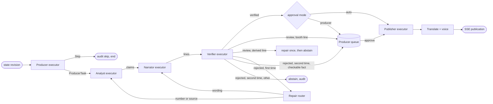

# 04 Multi-agent design

Status: **Agreed design**. Last reviewed 25 Oct 2026. Backlog: AGT-3 to AGT-15, EXP-5, EXP-16. Earlier design notes: `/mnt/project-files/matchcast-v2/orchestration/DESIGN.md` (superseded by this file where they differ).

## 1. Principles

1. **Four core agents, each with one job.** Producer decides, Analyst measures, Narrator writes, Verifier checks. No agent does another's job.
2. **Shared state, not chat.** Agents hand off typed packets (contracts v1.1) through the workflow and the `claims` table. No agent reads another agent's prompt or free text.
3. **Numbers come from tools.** A model may state a number only if a tool returned it in the same turn and the claim cites that tool call.
4. **Nothing reaches a screen unverified.** Only `published` publications are sent over SSE.
5. **Every step degrades.** Each agent has a deterministic rules implementation with the same interface.
6. **Everything is audited.** Each step appends a hash-chained `AuditRecord`.

## 2. Agents

| Agent | Job | Input | Output | Tools | Model settings | Fallback (rules) | Prompt |
| --- | --- | --- | --- | --- | --- | --- | --- |
| Producer | Picks the moment, sets priority, routes to personas, skips quiet play | Last 30 s of events, state, `moment_score`, active personas | `ProducerTask` or `Skip{reason}` | none. The model Producer (`live/producer.py`, prompt `producer.md` v0.3.0) chooses among the rules' candidates: it narrows the personas to those the candidate allows, asks the Stats Desk for a moment that is not priority 1, or skips a storyline it just aired. Goals and red cards never reach the model. Any model failure falls back to the rules decision and is audited. The Stats Desk call is made by the workflow after verification, not by the Producer | default temperature, answer budget 400 + 1500 reasoning headroom | Threshold rule: score ≥ 60 or priority kind | `packages/agents/prompts/producer.md` |
| Analyst | Turns events into 1 to 3 claims with evidence | `ProducerTask` | `ClaimPacket[]` (status pending) | `get_metrics` today (all numbers and xG). The MCP server also serves `get_state`, `get_events`, `get_evidence`, `query_season` and `search_kb`, which the Analyst does not call yet; `predict_danger` is served by the MCP server but no agent calls it yet | default temperature, answer budget 400 + 1500 reasoning headroom | Metric templates per event kind | `prompts/analyst.md` |
| Narrator | Writes one line per persona and language-neutral English | Claims + personas | `DraftLine[]` | none | default temperature, answer budget 400 + 1500 reasoning headroom | Templated lines per persona. Goals, shots on target and cards add a consequence clause (opens the scoring, a player short, pressure on the defence); the clause carries no number the Verifier would have to tie to a claim | `prompts/narrator.md` |
| Verifier | Checks every number, name, source, freshness, meaning and safety | Claims + lines + state | `Verdict` per line | recounts every number from the stored events in process (`verify/checks.py`), never through a tool the Analyst could have influenced; each claim backs one number in the line, so a score with one side repeated is refused; in goal, card, shot, tackle and foul lines a player named in full must be one the event names (scorer, assist, ...); an event that names no player allows its team's players. A swapped-in player, from either club, is refused, and so is a surname or first name of a roster player who is not in the moment (the adversarial pass, 8a). A score whose sides are swapped is refused by the same pass. Refused although legitimate: a teammate or opponent the event does not name (a keeper, an assister the claims do not carry), which goes to one repair and then escalates if it is the booth's call, or is dropped from air otherwise. Summaries, period ends, recaps and Ask answers are exempt from the name rules; Content Safety | default temperature, answer budget 400 + 1500 reasoning headroom (model step only) | Deterministic checks alone; `review` instead of model meaning check | `prompts/verifier.md` |

On-demand agents (never on the live loop):

| Agent | Where | Job | Tools | Verified by |
| --- | --- | --- | --- | --- |
| Data Scientist | Analyst view, `POST /v1/ds/ask` | Answers season questions with SQL, a table and a chart | `query_season`, `describe_views` (in process, and as MCP tools on the `mcp` container) | Verifier re-runs the SQL and compares every cell |
| Stats Desk (A2A partner) | `mcp` container, path `/a2a`, Agent Card at `/.well-known/agent-card.json` | `compare_to_season(metric, scope, value, team_id?)`: value, season average, rank among the season's team or player match performances (`of` counts those rows, 56 for teams, not matches). The api calls the skill over A2A when `STATS_DESK_URL` is set (`https://<mcp host>/a2a`) and audits `transport: a2a`; without it, or with a malformed value, it calls the same skill in process and audits `transport: in_process`. `/v1/status` shows `stats_desk` live only with the URL | DuckDB over `season/v1` | Deterministic, no model. Called for priority 1 moments only, after a line is verified, for a claim behind a verified line, within a 2 s budget; failures are audited as `a2a_failed`; a club with no season rows is compared with every season team and the `a2a_call` says so (`compared_with`, `requested_team_id`). The match's club *name* is resolved to the season's club code through the generated profiles in `kb/clubs` (`season_clubs.py`); a name the season does not know (a test fixture's `home`) is compared league-wide |
| Player persona (talk) | `POST /v1/matches/{id}/talk` | First-person reply ≤ 60 words using only that player's own counts (or the producer's score and key moment), his squad and team sheet and kb passages in words (ADR-0020), and the whole match log by relevance, with minutes only from the log (ADR-0021); the model writes the player's reply and names the instruction it heard in live mode (`packages/agents/prompts/player.md`), the rules template is the fallback (ADR-0018). An instruction becomes an order only if the role guard allows it for his position (ADR-0016). He may talk about the last 8 match events, every goal and card, and each club's totals. Every count must be his own or a club total from the log, with the club named in the reply; a name outside those events fails the check | counts recounted from the event log | Reply checked before it is returned: each number must equal the log's count for the metric it names, names in the roster; otherwise "I can't confirm that from the match data yet." |
| Recap mode | `POST /internal/v1/recaps` | Full-time recap per persona | Same as the core four | Verifier per sentence; a failing sentence is dropped |
| Ask pipeline | `POST /v1/matches/{id}/ask` | Chatbot answers | Model answer from a fact sheet in live mode (`packages/agents/prompts/ask.md`); router + AI Search + core tools otherwise | Verifier, see [05-assistant-rag.md](05-assistant-rag.md) |
| Broadcast Copilot | `POST /v1/matches/{id}/ask` with `surface: "broadcast"` | Highlights, camera focus and a production plan for the Broadcast view | Ranking in code over events and state (`matchcast_agents/broadcast.py`); no model call yet | Rules; every pick cites its event. See [ADR-0019](adr/0019-broadcast-copilot-reuses-ask.md) |

### 2.1 Specialists (per moment, `matchcast_agents/specialists/`)

The Showrunner (CREW-1.1) spawns specialists for one moment through `plan_spawns`, which returns up to five `SpawnRequest`s for a goal or red card and at most one for any other moment. Each specialist implements `Specialist.run(ctx, request) -> SpecialistReport`. A report carries findings, each with its figures and the event ids (or history row ids) they came from, so the Verifier can recount them. Specialists never write a line.

| Specialist | Story | Input | Output | Model call | Fallback |
| --- | --- | --- | --- | --- | --- |
| Replay | CREW-2.1 crew | The events before the moment, back through the attacking team's passes (fifteen seconds, twelve passes at most), stopped by a turnover or a tackle or foul by the other side | Build-up: passes, seconds and the chain of players, each pass cited by event id | none, deterministic | `no_data` when the moment has no pass before it |
| Tactics | CREW-2.1 crew | Pressures in the thirty seconds before the moment, the side of the pitch from the moment's y coordinate, and counter or build-up (the attack began within ten seconds with three passes or fewer) | Pressing team's pressure count and the move's side and style, cited by event id | none, deterministic | `no_data` when the moment has no position and no pressure |
| Stats | CREW-2.1 crew | The analyst's metrics up to the moment, through `InProcessTools.get_metrics` (shots and xG) | Shots and xG per team, each finding citing that team's shot events | none, the in-process tool | `failed` when the tool is unavailable |
| History | CREW-2.2 (AB#391) | Real past meetings of two nations (martj42 CC0 results file, ADR-0020), cut at the day the match was created (the same cut the Verifier recounts from) | Head-to-head counts, last meeting, each finding citing `results:<row>`, the data row of the file it counted (header excluded) | none, deterministic | `no_data` for a fictional squad or a pair with no past meeting; `failed` if the results file is missing; no why line in either case, so the Narrator writes no history claim |
| Rhythm | CREW-2.3 (AB#486) | Raw events in a trailing five-minute window ending at the moment | Whole-minute control index (-1 to 1, positive means home), the control team when the index passes 0.2 and at least 10 on-ball actions are in the window, and swings (a sign flip within three minutes, both readings at least 0.1, at most one per team per span) written to `ctx.extra["rhythm"]`; a `why` line naming a swing from the last five minutes, with the event ids of the window that ends at the swing | none, deterministic | `no_data` report when the window is empty; the rules twin still writes the line |

`run_all` (`specialists/runner.py`) runs a plan's requests concurrently against `default_registry()`, the built specialists, and returns their reports in plan order. A name missing from the registry is skipped. A specialist that raises is logged and reported as `failed`, so the other reports of the same moment still come back.

`plan_spawns` (CREW-2.1, AB#385) sizes the call: a priority-1 moment (a goal or a red card) gets up to five specialists in parallel, in the order `SPAWN_POOL` lists them (replay, tactics, stats, rhythm, history), and any other moment at most one. Two budgets stop the spawns from running on: the priority-1 pool (`SpawnBudget`, 60 spawns per match: five a goal or red card, so the first twelve priority-1 moments get the full fan-out and a later one is refused with `budget exhausted`, leaving it without Rhythm and History) and a quiet pool for every other moment (40 per match), so a run of quiet moments cannot use up a goal's specialists. Both pools are per match, not per stream: the engine stream and its Vision stream share them (`MatchSpawnBudgets`: the engine workflow owns them, and its Vision workflow takes them from it). Each workflow checkpoints its own share, so a restart adds back exactly what it spent and refills nothing. A workflow that already ran a match refuses a replay from the first event when its checkpoint is gone (`conflict`), because the replay would write the audit records again; a workflow that has not checkpointed yet (a restart, or a first event that failed) replays from the first event and starts its share, its ledger and the Producer's memory at zero. When a pool is spent, or no specialist is available, the planner spawns nothing and gives the reason, which the ledger records and the rules twin covers.

`MatchWorkflow._spawn` runs the plan after the rundown entry is written. Each report adds its name to the entry's `called` and a `spawns` list (`name`, `status`, number of `findings`). A moment that spawns has a `spawns` key; a refused moment gets `spawn_reason` and no `spawns` key, so the ledger does not gain an empty list on every entry. The reports stay on the moment's context (`ctx.extra["specialists"]`), so this moment's Analyst can read them; the Narrator writes from the claims, not the reports. History is on air: on a priority-1 moment whose History report is `ok`, the Analyst adds one `h2h_played` claim (the meetings the report found, `count`; the live Analyst delegates to the same code, so it adds it too), and the analyst line of a goal says how often the sides have met. The History report counts only meetings before the match's history cut (the day the match was created), the same cut the Verifier recounts `h2h_played` from, so a finding that disagrees with the record is refused. Rhythm is on air the same way: on a priority-1 moment whose Rhythm report cites a swing, the Analyst adds a `rhythm_share:<team>-<end_ms>` claim (the team's percent of the on-ball actions over the five minutes that end at the swing; `-` because a claim metric may not hold `@`), and the analyst line of a goal says so. The Verifier recounts it from the events (`recount_share`), so a share that disagrees with the log is refused. The other reports are not on air yet.

Pass quality (CREW-2.4, AB#491, `matchcast_agents/passes.py`) is a deterministic record per pass that has both positions: straight-line distance in metres and a difficulty from 1 to 5 (under 10 m 1, under 20 m 2, under 30 m 3, under 45 m 4, longer 5). The engine does not record pass completion, so no record claims it. Shot speed and player speed tags are not built: the event stream carries no ball velocity and no continuous player track, and carry speeds derived from carry durations reach 28 m/s in the fixture, which is not a usable threshold.

Rhythm weights on-ball actions (passes and carries) and pass tempo at 0.6 of the index, and territory, pressure, shots and turnovers won at 0.4. The engine emits no possession time, so possession is the share of on-ball actions. The sides swap at half time, the usual convention; the fixture has only one period, so the swap is not checked against engine data.

## 3. Workflow graph (Microsoft Agent Framework)

Exported image: [img/2-agent-workflow.png](img/2-agent-workflow.png) (regenerate with `scripts/export_diagrams.sh`).



- Built with Agent Framework `WorkflowBuilder` (`packages/agents/matchcast_agents/af_graph.py`, package `agent-framework-core`): executors Producer, Analyst, Narrator, Verifier and Stats Desk, edges carrying small dataclasses, the Stats Desk edge conditional on priority 1. The repair router and the approval step run inside the Verifier executor, where the one-repair rule lives. A line that fails its one repair on a checkable fact (number, unknown player, unknown source, stale state) is escalated when it is a booth line (play-by-play or colour): it waits in the producer queue with `escalated: true` for a person to kill it (the desks offer no approve or edit, since the Verifier could not check the line), and a `handoff verifier to repair` span traces the repair. Every other line that fails its repair, derived feeds included, is dropped from air with a `line_abstained` record and never reaches the queue (CREW-4.3). An escalated line can only be killed: approve and edit are refused in the workflow, so the api and the web app both enforce the hold, and a second Verifier pass cannot approve it. It is the default (`MATCHCAST_ORCHESTRATOR=af`); `native` runs the same steps as plain calls, and a test checks the two give identical claims, lines and audit records (actor, action, subject and details). A new workflow is built per event because Agent Framework refuses concurrent runs on one instance. Checkpointing is our own Table store (AGT-13), not the framework's. The publisher and translate steps are not executors yet.
- Checkpointing: once per event (after the graph run, not after every executor) the processed sequence, the match state and the Producer's memory are saved as one checkpoint row per stream (`put_checkpoint`; Table `checkpoints`, PartitionKey the stream key), and a restart resumes from it, see AGT-13.
- Rundown ledger (`MatchWorkflow._record_rundown`, AB#375): each moment the Producer routes gets one entry in `rundown`: the moment, `called` (the agents that actually ran for it: analyst, narrator, verifier, and stats_desk when asked; a moment with no claims lists only the analyst; the specialists it spawned, see `spawns` below), `spawns` (each specialist spawned: name, status, number of findings) or `spawn_reason` when the planner spawned none, `skipped` (stats_desk when the moment does not want the desk), why, and who routed it (`rules` or `model`). Skipped moments get no entry. The ledger keeps the latest 400 moments and is checkpointed as a copy, so a restart keeps it. The routing decision is still the Producer's: a separate Showrunner model call is not built yet, because the Producer already makes the Stats Desk decision. No new audit action or stream event is added, since both are closed contracts.
- Shared match memory (`packages/agents/matchcast_agents/memory.py`): before the Producer and Narrator run, the context carries the storylines of verified lines (`extra["storylines"]`), and the Narrator's facts carry `already_said_about_this_play`: the latest two lines that passed a check or a person (verified, approved or published) about the same player or club. Lines still drafted, verifying, repairing, abstained, rejected, in review or killed are never remembered. Only the wording goes to the models, with every number replaced by `#`, so no number can be copied from memory; the Narrator must not repeat the wording (prompt rule 14, `narrator.md` v0.3.1). The Producer sees the same memory (`producer.md` v0.3.0).
- Follow my player (CREW-7.7, `matchcast_agents/player_story.py`): a fan's standing storyline for one fictional player. A verified goal, shot, won tackle, foul or card that involves the player gets one line whose only number is that play's running total, recounted from the stored events up to the moment, so it keeps the casual persona's one-number limit. Own goals count for nobody. Passes are not beats in this version (one line per pass would break the rate rule). After ten match minutes without an involvement, one summary line airs per spell, measured on the stored events, and only when shared memory holds a verified beat for the player (no model call). Switching the player swaps the storyline and leaves the match running. `total_check` is the Verifier's recount of a stated total from the events. **Planned**: calling `total_check` from the live Verifier, the Showrunner feed that emits these lines, and the Watch picker (Experience lane, which already has a player mode). Until they land the module is not on screen.
- Half-time explainer (CREW-7.4, `matchcast_agents/half_time.py`): **Simulated** as a writer and as a feed (AB#499): the piece airs on the match service when the first half ends. The piece is cut at the earliest `period_boundary` that ends period 1 (a retracted one gives no piece), only period-1 events up to that cut are folded, and it is templated: a score headline, up to three first-half goals, the first-half shots (on target in parentheses) and one closing line. Each sentence lists the metrics it quotes for the Verifier. Own goals count in the score but are not named. A retraction leaves its target out wherever it sits in the stream, and a retracted half-time boundary gives no piece. A correction to a first-half event holds the piece (`None`): nothing folds corrections yet, so the hold lasts until a fold exists. A named goal is dropped from the end when the piece runs past 90 seconds at 2.5 words a second; the piece gives no piece only when the fixed lines alone do not fit. The workflow's `half_time()` turns the piece into one claim per metric it quotes (counted from the first-half events only) and one `DraftLine` per sentence with persona `half_time`, and the Verifier checks each line against those first-half events. A line that fails is dropped and stored with the Verifier's verdict (`rejected` or `review`), and a kept line is stored as `verified`, so the claims it cites show that verdict. If no line survives, the piece is held (`None`). Within one process, a repeat call with the same claims returns the same answer without writing again. A stored half-time line cannot be approved on its own. The piece airs once, from `_air_half_time`, when the first-half `period_boundary` is processed: one `publication` (persona `half_time`, the whole piece, the claims of its kept lines marked approved; a dropped line's claims are neither approved nor cited) and one `onair` record (feed `half_time`, citing the first-half events it counts). The kill and dedupe checks run before the piece is verified, so an aired or killed piece is not verified again. A piece the desk has killed at the boundary never airs: a later resume of the feed airs nothing, because the boundary is not processed again. A replayed boundary does not air it twice (the publication id is `pub-half-time-<cut>`), and it publishes any kept line a crash left `verified`. When the piece airs, its kept lines become `published` (only the lines whose text is in the piece, so a leftover verified line from an earlier write is not published). `kill()` refuses any half-time line whose text is on air, even before its status says published, as it refuses a ticker line: a desk cannot kill a half-time line viewers are reading (the desk takes the feed down instead). Before the piece airs, a desk kill on a stored half-time line holds the piece, also when the piece is written again after a restart, so a restart cannot mark that line verified again. After the piece airs, a repeat `half_time()` call (a fresh process) reads the aired piece back and writes nothing except publishing its kept lines a crash left `verified`. Known gap: a repeat `half_time()` call does not read a human feed kill back from the store; the air path checks the live kill set before it airs. The persona is written by the workflow only: it is in `PACKET_PATTERN` (what a `DraftLine` may carry) and `FEED_ONLY`, not in `PATTERN`, so a viewer cannot ask for it. `half_time()` itself airs nothing: the workflow's event loop airs the piece through `_air_half_time`, under the match lock. The Verifier sees the same first-half events as the claims, retractions already removed. **Known gap, a follow-up:** a correction to a first-half event holds the piece (`None`) because nothing folds corrections yet. Folding corrections into the state, so the piece can correct itself instead of waiting, is the follow-up.
- Storylines and stall replan (CREW-3.2 and CREW-1.2). The stall clock is `matchcast_agents/stall.py`: 60 s of wall time with no verified line makes the Showrunner replan, once. It starts when the workflow starts ingesting the match, and a timer checks it every 5 s, so a silent feed replans too. The timer pauses at full time (the last standing period boundary is an ended one from period 2 on) and starts again on the next event, so extra time and a retracted full time are covered. Limit: a silent feed in the break after regulation does not replan. The replan picks the player with the most remembered beats from shared memory (`storyline.pick_plan`) and assigns the replay specialist to it. A second stall with still no verified line picks the rules storyline instead of looping. The replan is one rundown entry (`routed_by: rules`, the same shape as every other entry) with the specialist in `skipped`: it is assigned, not run, so no `crew_spawn` frame claims a run. No contract change. The clock is wall time and is not checkpointed, so a replay or a restart can replan differently. The payoff (CREW-3.2): the replan opens the picked player's storyline (`storyline.StorylineBook`), and that player's next goal pays it off once. The payoff reaches the rules Narrator's analyst and casual goal lines as one clause each (no numbers, so the Verifier's recount is not needed). The model Narrator reads it too: the live facts carry one `storyline_payoff` line on the paying goal, with no figures, and the narrator prompt (rule 15, v0.3.3) asks for it in the goal's analyst line. The book is checkpointed with the match (with the plan and the replan's own checkpoint), so a restart keeps an open storyline; a replay from the first event starts the book over. A storyline already paid stays paid. **Planned**: the specialist actually running, and a payoff for the other storyline kinds.
- Concurrency: today events of one match are processed one at a time under a lock, so there is one run per moment and no pre-emption; overlapping runs (at most 2 per match, priority 1 first) are **Planned**.
- Rate rule: at most one Producer task per 8 s of match time, except priority 1 (goal, red card, penalty, own goal).
- Live-run fixes after the first deployed match (40 of 58 lines rejected): the names check ignores a possessive ("Harbour United's", "Ellis'") and a capitalised sentence opener before a roster name; the live Verifier is also given the stored `moment` (play, player, club) and may accept a stock "why it matters" clause (prompt 0.1.2); the Narrator no longer receives the character limits as numbers (it echoed them into lines); `line_drafted` audit records carry the moment reason.
- Pre-match history metrics (national-team fixtures): `h2h_played`, `h2h_home_wins`, `h2h_draws`, `h2h_away_wins` and `elo` (rounded rating) are `count` claims over the whole stream, read by the tools and recounted by the Verifier from `MatchContext.extra["history"]` (`history_metrics.py`), not from events. They are offered to the Analyst only when the match carries that history; form strings are not claims. The contract is unchanged.
- Ticker (CREW-7.5, `matchcast_agents/ticker.py`): **Simulated** as a writer; aired on the derived lane on every match the match service runs (`LIVE_FEED_LINES`), with the desk's Planned flag until viewers see it. One line per verified goal, own goal, yellow or red card, from four fixed templates (`TEMPLATES`): player name, club, and the running score on goals. The minute is left out of the text: the Verifier cannot yet recount a minute from a claim, so it stays on the item, not in the words. `feed_lines.py` backs each line with claims (the counters its event moves, and the score on a goal), so the Verifier's adversarial pass can decide it. Each line is checked at its own cut, since the Verifier judges freshness against the state it is given. While any goal is retracted, goal score lines are not written: the Verifier's recount still counts a retracted goal (quality lane), so such a line would be refused as a number mismatch. It reads the engine's events, not any written line, so a refused line cannot reach it. A card's engine reason is never printed. Each item cites its event id. A retraction or correction counts for lines written after it: a ticker line already aired is not withdrawn (Planned). Substitutions are not in it: the engine may not emit them. Wired into the workflow after each event (`MatchWorkflow._write_feed_lines`) and aired on the derived lane, so it never waits for the producer. The match service turns it on for every live match (`LIVE_FEED_LINES`); the library default is off, so evals and grading keep their lines. The desk's Planned flag stays on until the feed is visible to viewers; the latency test (goal to ticker item within 5 s) is not measured yet.
- Catch-me-up (CREW-7.3, `matchcast_agents/catch_me_up.py`): **Simulated** as a writer, **Planned** as a feed. On request at minute `m`, the recap uses only events up to `m`: a score headline, then up to three named events (goals, booked and sent-off players, shots on target) ranked by `moment_score`, with the more recent first on a tie, in match order, within the feed's 280 words. Each sentence lists the metrics it quotes. A retracted event is left out; a correction to an event before the cut holds the recap (`None`). Open storylines are not in it: the shared memory keeps wording with numbers replaced by `#`, so it cannot be quoted as a fact yet. A retraction counts only if its own event time is at or before `m`. `MatchWorkflow.catch_me_up(minute)` builds the recap, recounts each quoted figure from the stored events up to the cut with the same rule, and publishes a `catch_me_up` hub event only when every figure recounts; otherwise nothing airs. A desk kill on the feed holds it. The read route `GET /v1/matches/{match_id}/catch-me-up` serves the recap without publishing it (12-api.md). The desk block renderer is not built in this PR, so the feed stays **Planned** in the UI.
- Audio description (CREW-7.2, `matchcast_agents/audio_description.py`): **Simulated** as a writer; not aired yet (`LIVE_FEED_LINES` leaves it out), Planned until the speak-time check lands. A gap detector finds windows of at least 2 s with no commentary, from the booth lines' word counts at 2.5 words a second. The describer speaks only in a window its sentence fits, names only the engine's player and club, and places the action by thirds of the pitch length (from x = 0) and the side of the pitch, never from pixels. Each line is backed by the counters its event moves (`feed_lines.py`); an event that moves none is not written, because the Verifier would refuse a line it cannot decide. No description starts more than 10 s after its event, so a line stays close to the moment it describes. Goals are placed first, so an earlier shot or pass cannot take a goal's gap. A goal whose gap starts more than 3 s after it is not written (the deadline is part of the goal's line), and a goal that no gap fits is dropped the same way. An event a retraction or a correction holds is not described. A placed description uses its time, so a later one never talks over it. `ticker` and `audio_description` are feed-only personas: a viewer cannot ask for them on a stream, and their draft lines carry them. Written, not aired: the workflow does not air it on any match yet. A booth line for a later event can land inside a description placed before it, so air waits for the speak-time check (Planned). The description latency is not measured.
- Commentary booth: two more personas, `booth:pbp` (play-by-play, calls the action) and `booth:colour` (colour analyst, reacts to the call: shape, tactics, what it means). They are ordinary personas (no contract change, limits of `broadcast`, two numbers), written in the same Narrator call so the exchange hangs together, checked by the same Verifier, and the colour line is checked and aired after the call it answers. A viewer asks for both with `GET /v1/matches/{id}/stream?persona=booth`; a `colour` moment also carries the booth voices. `buildup` (kick-off) and `filler` (quiet spell) moment kinds have claims and rules lines ready (goals/shots of both sides); the Producer emitting them is the orchestration lane's and is **Planned** until it lands, so kick-off and quiet-spell booth talk do not fire yet. Only the booth line of a call that aired is checked and aired: if the play-by-play is turned away, the colour line is not shown. A booth registers both voices or neither (the 8 extra-mode cap). A colour line must name a player or a club, or carry a number from a claim: a reaction that fits any match ("the balance of the game is getting clearer") is refused by the Verifier's `specific` check (reason `unsupported_statement`), and the Narrator prompt (0.2.3) asks for the ball carrier's name, energy that follows the danger and varied openings. `eval/agents_eval.py` reports the share of generic colour drafts and how many are worded differently. Live-line rejections measured on the Oct 25 build (audit of a live smoke) were mostly length (casual 140 characters), casual lines with two numbers (a 2-1 score) and a model echoing its own limit as a number; the Narrator prompt (0.2.4) now gives word budgets instead of character counts and says a score is two numbers, and the live Narrator drops whole trailing sentences from a line that is over its limit (`live/narrator.py fit`) before the Verifier checks it, so the checks themselves are unchanged. The one Narrator redraft is told what failed, in words and without the figures of the failed check (`workflow.repair_feedback`, the `feedback` argument of `Narrator.write`; the rules Narrator ignores it). The live Narrator is also told which club the moment's player plays for (`player_club`, prompt 0.2.5): in a live audit the two meaning rejections were a goal by one side's player credited to the other. In producer approval mode the booth voices wait in the producer queue after the Verifier passes them, so the producer approves the main booth line (CREW-4.3). `hold_booth` defaults to on at match creation; `hold_booth: false` lets booth talk air as soon as it is verified, which is dead air risk the producer accepts. The six derived feeds never wait: they air once verified, or are dropped. A kill on a derived feed is enforced by the air gate: a killed feed airs nothing and resumes on `resume`. A person cannot edit a derived line: a line that fails its repair stays dropped (`feed_drop`), and edit refuses it. A stream with a persona gets only that persona's publications; line records (the producer approval queue) stay on every stream. In rules mode the call is the broadcast line and the reading is a stock sentence with no number.
- Colour line (live agents only): a quiet play (off-target shot, tackle, foul) becomes a `colour` moment, priority 3, analyst persona only, at most once per 45 s of wall time per match (`COLOUR_EVERY_S`, env `MATCHCAST_COLOUR_EVERY_S`, 0 = off; only with the analyst persona, a won tackle, and never mixed with watch-mode personas; a model pass costs a fraction of a cent so a match stays well under a dollar). It goes to the model even when the quiet gate would skip it, counts shots/xG, tackles won or fouls of the play's team, passes the same Verifier checks, and falls back to a rules line (`NarratorRules`) if the model fails. The rate rule above still applies, and a rate-limited play does not spend the budget. The rules-only workflow never emits it.
- Booth moments (only when a viewer has the two booth voices): `buildup` at the first event of the match, and `filler` after 20 s of wall time with nothing aired. Both are priority 3, personas `booth:pbp` and `booth:colour` only, never merged with watch modes, and not sent to the Producer model for a skip. The live Analyst and Narrator voice them (no rules-only quiet gate), so the booth is written, not templated.
- Model gate: moments at priority 1 or 2 (goal, red or yellow card, shot on target, half time, full time) go to the model; quieter moments use the rules twin. `MATCHCAST_LIVE_MAX_PRIORITY` overrides the gate (1 to 3); the default is 2.

## 4. Packet shapes

The wire contracts are in `packages/contracts` ([docs/contracts.md](../contracts.md)). Internal workflow packets live in `packages/agents/matchcast_agents/messages.py`:

```text
ProducerTask   moment_id, match_id, event_ids[], up_to_sequence, priority 1|2|3,
               personas[], deadline_ms, reason
Skip           moment_id, reason (quiet_play | rate_limited | duplicate_moment | low_score | model_skip), why (model_skip only)
DraftLine      line_id, claim_ids[], persona, text, max_chars
Verdict        line_id, verdict verified|review|rejected, reason_code, checks[] (name, passed, detail)
RepairRequest  line_id, target analyst|narrator, verdict, attempt 1
```

`reason_code` values: `number_mismatch`, `unknown_player`, `unknown_source`, `stale_state`, `unsupported_statement`, `unsafe_content`, `length_exceeded`, `citation_missing`.

`fallback_reason` values (written with audit action `fallback_used`, ADR-0014): `timeout` (20 s), `rate_limited` (429 after one retry), `model_error` (5xx or invalid structured output), `circuit_open`, `tool_error` (a tool call failed, in process or over MCP: the Analyst makes no claim for that moment, so no line is written and no number is guessed).

Audit `action` values (closed list; add new ones here first): `event_rejected`, `moment_skipped`, `claim_created`, `line_drafted`, `line_verified`, `line_review`, `line_rejected`, `line_repair_requested`, `line_abstained`, `line_approved`, `line_edited`, `line_killed`, `publication_created`, `translation_rejected`, `fallback_used`, `recap_created`, `ask_answered`, `talk_answered`, `export_created`, `safety_blocked`, `a2a_call`, `a2a_failed`, `ds_answered`, `ds_unverified`, `feed_killed`, `feed_resumed`.

## 5. Verifier checks (in order)

| # | Check | Rule | Tolerance |
| --- | --- | --- | --- |
| 1 | Sources exist | Every `source_event_id` exists in `events` at the cited revision | exact |
| 2 | Freshness | Claim snapshot revision ≥ current revision − 5 and match time within 30 s | as stated |
| 3 | Numbers | Every number in the line appears in a claim, and each claim value is recomputed with `get_metrics` | counts 0; ratios 0.01; km/h 0.5; metres 0.5 |
| 4 | Names | Every player or club name is in the roster for this match | exact, case-insensitive |
| 5 | Persona rules | Length limit and number limit per persona: casual 140 chars, 1 number; analyst 280 chars, 6 numbers; broadcast 180 chars, 2 numbers; the watch modes `my-club:<team>`, `player-focus:<player>` and `one-metric:<metric>` use casual, casual and analyst character limits and 1, 1 and 2 numbers | exact |
| 6 | Citations (Ask only) | Every sentence carries `[kb:…]` or `[claim:…]` | exact |
| 7 | Safety | Content Safety text:analyze, all categories severity < 2. The api calls Azure when `CONTENT_SAFETY_ENDPOINT` is a `*.cognitiveservices.azure.com` host (Entra token, `safety_from_env`); a failed call falls back to the local screen (a short word list, **Simulated** strength), is counted, is audited as `fallback_used`, and the result source says `local`; three failures in a row skip Azure for 60 s. `/v1/status` goes unavailable while the circuit is open or when 5 of the last 10 line screens in the last 2 minutes used the local list, and reads live again by itself once those age out or Azure answers; Prompt Shields calls are not counted. Without the variable only the local screen runs (**Simulated**) | as stated |
| 8a | Adversarial pass (CREW-4.1) | Five deterministic attempts to falsify the line against its claims, each recorded as its own check (`adversary:<attempt>`) so the audit shows what was tried. `score_attribution`: a number written straight after a club's name must be a claim about that club (a swapped score fails). `named_minute`: a minute the line names ("minute 12", "12th minute", "12'") must be within a minute of a claim's time. `surname_alone`: a capitalised first name or surname of a roster player who is not in the moment fails (check 4 reads whole names only). `unclaimed_number` and `repeated_value`: every number is a claim value and no value is stated more often than the claims carry it (also check 3; recorded as their own attempts). An attempt that cannot decide fails closed. Not run on Ask answers or recaps; summaries and period ends are not put to `surname_alone` | exact; a refusal gives `number_mismatch` (the four number attempts) or `unknown_player` (`surname_alone`), so a redraft can repair it |
| 8 | Meaning (model) | Does the line say only what the claims support? Returns supported, unclear or unsupported | unclear gives `review` (a booth line waits for the producer; a derived line is refused and repaired once) |

Checks 1 to 7 and the adversarial pass (8a) are deterministic and run first, with no model call. Check 8 runs only if they pass. In rules mode check 8 is skipped and the verdict is `verified` only if the line came from a template; otherwise `review`.

Repair and escalation (CREW-4.2, CREW-4.3). A rejected line gets one repair: a number, source or stale-state failure goes back to the Analyst, a wording failure to the Narrator, and the corrected line is audited with `repair_of` set to the line it replaces (`line_verified` or `line_review`), so the panel can show the rejected line, its reason and the fix together. A line that fails its repair on a checkable fact (`number_mismatch`, `unknown_player`, `unknown_source`, `stale_state`) is queued only when it is a booth line (`booth:pbp` or `booth:colour`): it waits in the producer queue flagged `escalated`, where only Kill is offered. Each of the six derived feeds that cannot be repaired is dropped from air with a `line_abstained` audit record; it never reaches the queue. A derived line the Verifier sends to `review` (a meaning check that cannot decide) is treated as rejected and gets the same one repair, so it is never queued either. Nothing that fails its checks airs, in any mode.

## 6. Tools (MCP server)

All tools are served by `services/mcp` over Streamable HTTP; until a shared store exists (DAT-2) the api mounts the same app at `/mcp` (ADR-0005). Every match tool takes `session_id` and `up_to_sequence` as well as `match_id` (`describe_views`, `query_season` and `search_kb` are not match-scoped), so an agent can never read the future. Each result is at most 20 KB.

| Tool | Parameters | Returns | Source |
| --- | --- | --- | --- |
| `get_state` | match_id, up_to_sequence | score, clock, possession, revision, last 10 event ids (players on pitch and cards are **Planned**) | the store's match state |
| `get_events` | match_id, from_seq, to_seq, kinds[] (max 200) | contract events | Table `events` |
| `get_metrics` | match_id, up_to_sequence, names[] as `<metric>:<team_id>` (`window_s`, `player_id` are **Planned**) | values with units and `derivation_version` | counts from the match state, xG from `xg.py` |
| `get_evidence` | claim_id (plus `session_id`, `up_to_sequence`) | source events, tool calls, formula inputs | Tables `claims`, `events` |
| `get_replay_clip` | event_id (plus `session_id`, `up_to_sequence`) | event window ±5 s for the explain replay | Table `events` |
| `predict_danger` | event_id (plus `session_id`, `up_to_sequence`) | `score` (a ranking score for a same-team shot within 10 s, not a probability), model version and AUC, `unset_inputs`, limits | ONNX `data/models/danger/v1` (override with `MATCHCAST_DANGER_MODEL`); contract events lack xg, phase and kind, so those inputs are unset and the card shows held-out AUC 0.884 with overconfident top scores. Needs onnxruntime; an image without it refuses the call. The mcp image has no Dockerfile yet (**Planned**) |
| `predict_danger` | match_id, event_id | probability of a shot within 10 s, model version | **Planned** (needs the danger model, ONNX from Blob `models/danger/`) |
| `query_season` | sql (SELECT only), limit ≤ 1,000 | rows, columns, sql_hash, elapsed_ms | DuckDB over Blob `season/v1/*.parquet` |
| `describe_views` | none | allowed views and columns | DuckDB catalogue |
| `search_kb` | query, corpus?, top ≤ 8 | chunks with ids and scores | AI Search `kb-matchcast-v1` ranks in the process that has `SEARCH_ENDPOINT` and `SEARCH_QUERY_KEY` (today the api, which mounts `/mcp`; the standalone mcp container is not given them, so it reports `local`) and the index is loaded (keyword only; embeddings **Planned**); BM25 over `kb/` otherwise or on a failed call. The result's `retrieval` says which (`local`, `search`, `search_fallback`) |

Copilot Agent Mode uses the same server through the external route (Easy Auth), configured in `.vscode/mcp.json` (AGT-10, PLT-11).

## 7. Model access

- Endpoint `FOUNDRY_PROJECT_ENDPOINT`, deployment `FOUNDRY_MODEL_DEPLOYMENT=gpt-6-luna`, embeddings `FOUNDRY_EMBEDDING_DEPLOYMENT=text-embedding-3-small`. Auth with `id-matchcast` (role Azure AI User). No API key.
- Output format: JSON Schema structured output generated from the packet models. If the deployment rejects structured output, use JSON mode and validate; invalid JSON counts as a failure.
- Budgets per call: 20 s timeout; 1 retry on 429 honouring `Retry-After`; circuit breaker opens after 3 failures in 60 s, half-opens after 30 s.
- Every call logs `gen_ai.usage.input_tokens` and `output_tokens` (see [15-observability.md](15-observability.md)).

## 8. Prompts

Each prompt file has these sections, in this order: `# Role`, `# Inputs`, `# Rules` (numbered, testable), `# Output schema`, `# Examples` (2 good, 1 bad with the reason). The first line is `version: <semver>`. Claims carry the metric formula's `derivation_version` (the contract pattern is `x.y.z`, so `<agent>@<version>` does not fit); recording the prompt version in the audit trail is **Planned**. A prompt change that alters output needs a minor version bump and a re-run of `eval/compare.py`. Prompt files today: `producer.md`, `analyst.md`, `narrator.md`, `verifier.md` (the live Producer, Analyst, Narrator and Verifier load theirs); `router.md`, `ds.md` and `player.md` are **Planned**.

## 9. Package layout

```text
packages/agents/
  matchcast_agents/
    workflow.py        MatchWorkflow: ingest, steps, repair, approval, talk, recap, checkpoint
    af_graph.py        the Agent Framework WorkflowBuilder graph over those steps
    rules/             deterministic Producer, Analyst, Narrator and Verifier
    live/              Foundry model client and the model-backed Analyst, Narrator, Verifier
    resilience.py      timeouts, one retry on 429, circuit breaker, rules fallback
    (live pacing: model only for priority-1 moments by default, lines of a moment verified together, one shared redraft per target; docs/infra.md)
    verify/            deterministic checks 1-7 (check 8, meaning, is the live Verifier's model step)
    tools/             in-process tools and the MCP client path for the Analyst
    ask/               chunking, BM25 retrieval, router rules and answer assembly
    roles/             player and producer chat replies for /talk
    data_scientist.py  season questions, SQL re-run check
    statsdesk.py       A2A client for the Stats Desk
    personas.py        persona and watch-mode names
    safety.py          Content Safety and Prompt Shields clients, local screens
    store.py tables.py repositories: in-memory and Table Storage
    messages.py        workflow packets
    context.py state.py  per-event context and the match state the agents read
    xg.py metrics_spec.py  the xG model and the metric definitions with units
    recap.py hub.py    full-time recap and the stream hub for SSE
  prompts/             producer.md analyst.md narrator.md verifier.md
  tests/               unit tests, fixtures/match-short.json
```

## 10. How this proves multi-agent value (judging)

| Judges look for | Where we show it |
| --- | --- |
| Distinct roles | Trace panel shows four agents with their own tools and outputs (EXP-6) |
| Shared state and handoffs | Claims ledger: one claim, its Analyst evidence, Narrator lines, Verifier verdict (EXP-10) |
| Failure recovery | Seeded bad claim repaired on cue (`?seedBadClaim=1`); failure drill: "Cut the model" on the Agents tab cuts the match's model calls mid-match and the rules twins take over with no gap (`POST …/drill`, 12-api.md); rules fallback chip; kill-and-resume clip (QUA-5) |
| Better than one agent | QUA-4: same 30 moments, one agent vs four, verified-claim rate and hallucinations per 100 lines, real numbers in the README |
| Interoperability | MCP for tools and Copilot; A2A Stats Desk with an Agent Card |
