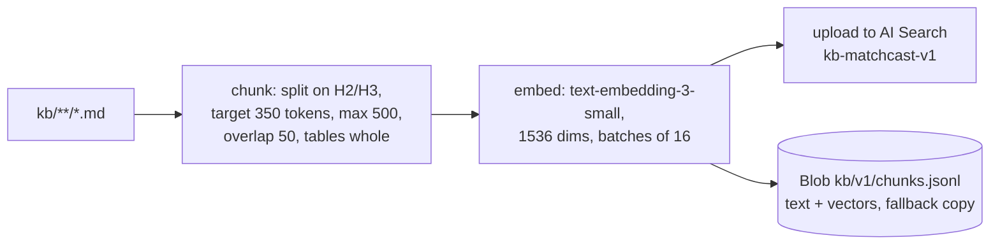
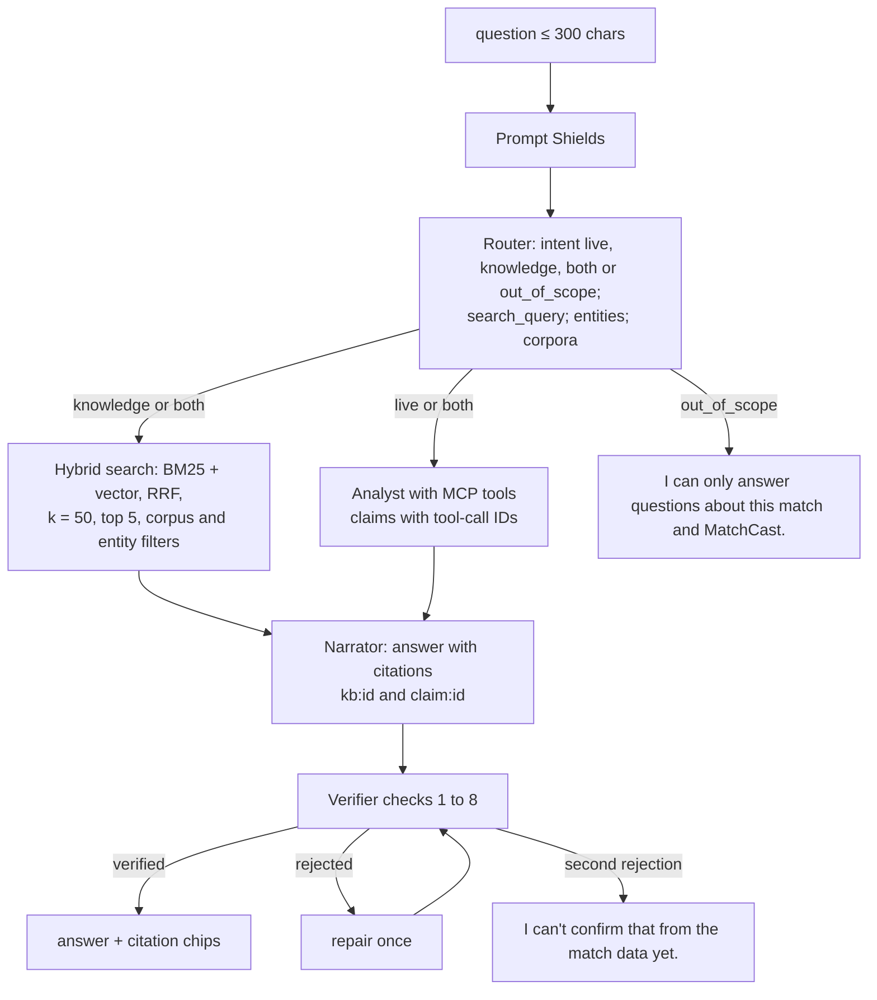

# 05 MatchCast Assistant (RAG chatbot)

Status: **Agreed design** (ADR-0009 accepted by Akshay, 22 Oct 2026). Last reviewed 22 Oct 2026. Backlog: EXP-5 (Ask), AGT-16 (knowledge base and retrieval, new).

## 0. What is built (22 Oct)

Built: the markdown knowledge base and chunker, in-memory BM25 retrieval (the "Search fallback" path), the rules router (which also declines tool or data actions, creative writing, personal details and any capitalised name that is not a club or player of the match or a KB club or player page, before it searches the KB; "story" is declined only as a writing request), Prompt Shields on the question (local screen, Azure client ready), answers with `[kb:…]`/`[claim:…]` citations checked by the Verifier, word limits per persona, the out-of-scope and abstain texts, and 5 questions a minute per match session. **Built, awaiting the live index:** the AI Search client (`ask/azure_search.py`: keyword index `kb-matchcast-v1`, upload, prune, query) used by Ask when `SEARCH_ENDPOINT` and `SEARCH_QUERY_KEY` are set; the answer carries `retrieval` (`local`, `search` or `search_fallback`). **Planned (needs Azure or later work):** the model router, embeddings and the vector half of hybrid search, Prompt Shields on retrieved documents, conversation memory (`conversations` table), the "Search fallback" and "Rules fallback" chips, and the CI quality gate described in §8.

## 1. What it is

One chatbot, three entry points:

| View | Entry point | Persona sent |
| --- | --- | --- |
| Watch | Copilot side panel, Ask tab | casual (or the viewer's mode) |
| Broadcast | "Ask the producer" box | broadcast |
| Analyst | Ask bar on every page | analyst |

It answers two kinds of question, often both at once:

- **Live questions** ("Who has the most touches?", "Why was that offside?"). These are answered from match state through the agents' tools. Live numbers are never taken from the search index.
- **Knowledge questions** ("What is a 4-3-3 low block?", "How is xG worked out?", "What kind of player is Harbor City's number 10?"). These are answered from our own knowledge base through retrieval-augmented generation (RAG).

## 2. Knowledge base

The source is markdown in the repo folder `kb/`, written by us and reviewed in pull requests like code. Nothing is scraped.

| Corpus | Folder | Content | Approx. size |
| --- | --- | --- | --- |
| `laws` | `kb/laws/` | Our own plain-English summary of each of the 17 Laws of the Game, with a link to the official IFAB text. No verbatim copying | 17 files |
| `metrics` | `kb/metrics/` | Every metric: definition, formula, units, `derivation_version`, a worked example | 15 files |
| `tactics` | `kb/tactics/` | 8 formations, 6 styles, phases of play, pressing, offside trap | 20 files |
| `clubs`, `players` | `kb/clubs/`, `kb/players/` | Fictional club and player profiles generated from the season league file (club, city, coach, squad with shirt, position, rating) and the season Parquet by `scripts/build_profiles.py` (built; run `uv run python scripts/build_profiles.py` after the season changes, a test fails if the committed pages drift): record and season totals | One file per club and per player. Retrieval returns these pages only when the question names the club, player or match, so general questions still find the metric and law pages |
| `season` | `kb/season/` | One page per season match (28), generated by the same script from the Parquet (the full-time recap function is separate) | 28 files |
| `venues` | `kb/venues/` | The 5 fictional stadiums, climate and pitch | 5 files |
| `app` | `kb/app/` | How to use MatchCast, what "Simulated" means, judge guide | 6 files |

## 3. Ingestion

- Script: `scripts/build_kb.py --version v1` writes the chunk file (`kb/build/v1/chunks.jsonl`); it works offline. `scripts/build_kb.py --version v1 --upload` creates the index and uploads the chunks (keyword fields only; it needs `SEARCH_ENDPOINT` and `SEARCH_ADMIN_KEY` from Key Vault and runs by hand on the Mac mini; **a CI step and embeddings are Planned**). AI Search ranks the candidates; the local BM25 score still gates which hits may answer, so the index can reorder what BM25 accepts but not add answers. The club, player and match pages are regenerated first with `scripts/build_profiles.py`.
- Chunk ID: `<corpus>:<doc_slug>:<chunk_no>`, for example `metrics:xg:2`. This is stable, so re-ingestion updates in place.
- Deleted files are removed from the index by comparing IDs.
- Size check: about 700 chunks × (6 KB vector + 2 KB text) ≈ 6 MB, inside the Free tier's 50 MB.

## 4. Index schema (`kb-matchcast-v1`)

| Field | Type | Attributes |
| --- | --- | --- |
| `key` | Edm.String | key (base64url of `id`: keys allow only letters, digits, `_`, `-`, `=`) |
| `id` | Edm.String | filterable (the chunk id, which contains colons) |
| `corpus` | Edm.String | filterable, facetable |
| `doc_id` | Edm.String | filterable |
| `title` | Edm.String | searchable |
| `section` | Edm.String | searchable |
| `text` | Edm.String | searchable, analyzer `en.microsoft` |
| `entity_ids` | Collection(Edm.String) | filterable (player_id, team_id, venue_id) |
| `source_path` | Edm.String | retrievable |
| `version` | Edm.String | filterable |
| `vector` | Collection(Edm.Single) | 1536 dims, HNSW, cosine, profile `vp-default` |

## 5. Answering a question

Rules:
1. Router: one `gpt-6-luna` call, temperature 0, at most 150 output tokens, JSON output (**Planned**). Today only the rules router runs: keyword lists per intent.
2. Retrieved chunk text is placed in a `<documents>` block. The prompt tells the model that this text is reference data and never instructions. Prompt Shields also checks the documents (**Planned**; the answer is currently assembled from the chunks without a model).
3. Answer length: casual ≤ 80 words, broadcast ≤ 60 words, analyst ≤ 200 words.
4. Every sentence ends with at least one citation. A number in the answer must come from a claim (live) or from a chunk (knowledge). Live numbers taken from chunks are rejected with reason `stale_state`.
5. Conversation memory: the last 3 turns (question and verified answer) from Table `conversations`; at most 10 turns per browser session (**Planned**; each question is answered on its own today).
6. Rate limit: 20 questions a minute per match `session_id` (a per-browser key is **Planned**). `/talk` has its own 20 a minute; 429 with `Retry-After: 60` for either. The shell says "Ask again in a minute" on a 429.
8. Rules goal answers: "who scored?" (and "what goals did X score") lists each goal from the stored events, each sentence citing its event as `[event:<id>]`; the citation's numbers are that goal's own line. "why was the first (or last) goal important?" states the score change at that goal. A club named in the question limits the list to that club. With no goal yet, both answer from the live score; a named club with no goal says "<club> haven't scored yet", cited to its goals claim. "who has the most shots?" (or shots on target) with no player named compares the two clubs' counts, both cited as claims; other counts and any player named in the question still abstain, because no tool ranks players. A worked example in the knowledge base that states a score is never shown as this match's score.
7. Live answers (ADR-0018): when the Foundry model is live, the Ask answer is written by the model from a fact sheet of this match (score, match state, team and player counts, every goal and card, the last 15 events), recounted with the Verifier's code. It cites fact ids; every number, scoreline, name and match-state word must be in a cited fact. A failed check, a 15 s timeout or a model error answers from the rules above instead. Ask never waits for the ingest lock.

## 6. Access and keys

AI Search Free does not support managed identity (Microsoft Learn, "Try Azure AI Search for free"). So:

- The **query key** (read-only) is stored in Key Vault as `srch-query-key`. `api` reads it through a Container Apps Key Vault reference. It never reaches the browser.
- The **admin key** is stored as `srch-admin-key`. Only `scripts/build_kb.py` uses it, in CI, through the OIDC identity's Key Vault access.
- Both are listed as exceptions in `docs/infra.md` (PLT-4).

## 7. Fallbacks

Ranking note: question filler (mean, explain, tell, define...) is a stop word, and a chunk whose section defines the term (Definition, "in plain words") is lifted x1.3, x1.3 more when its title is exactly the asked term, plus 1.0 for a title word. So "what is offside?" cites the rule before its exceptions. With AI Search on, the index ranks, except that the definition of the very term asked is moved first. The 2.2 gate is unchanged; generic words such as "won" still pass it (known, tracked in 17-risks-and-debt).

| Failure | Behaviour | UI label |
| --- | --- | --- |
| Search service unreachable or deleted (the Free tier can be removed after long inactivity) | `api` loads `kb/v1/chunks.jsonl` from Blob at start and runs in-memory BM25 + cosine | "Search fallback" chip |
| No embeddings quota | Index built without `vector`; keyword search only | none (documented) |
| Model failure | Router uses keyword rules; Narrator uses an extractive answer (the top chunk's first two sentences, cited) | "Rules fallback" chip |

## 8. Quality gate

`eval/ask_golden.jsonl` holds 40 questions (15 knowledge, 15 live on a fixed seed, 5 both, 5 unanswerable), each with expected chunk IDs or claim metrics.

| Metric | Target |
| --- | --- |
| hit@5 (an expected chunk in the top 5) | ≥ 0.90 |
| Verifier pass rate | ≥ 0.95 |
| Unanswerable questions abstained | 5 of 5 |
| p95 latency | ≤ 8 s |

Today `packages/agents/tests/test_ask.py` and `test_kb.py` run the golden questions and a retrieval hit@5 check on every `make test`; the dedicated `eval/ask_eval.py` gate with the latency and Verifier pass-rate targets is **Planned**.
