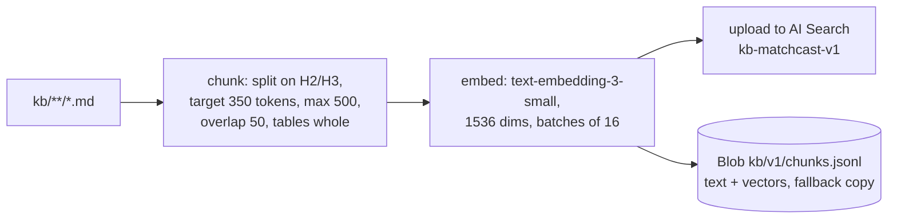
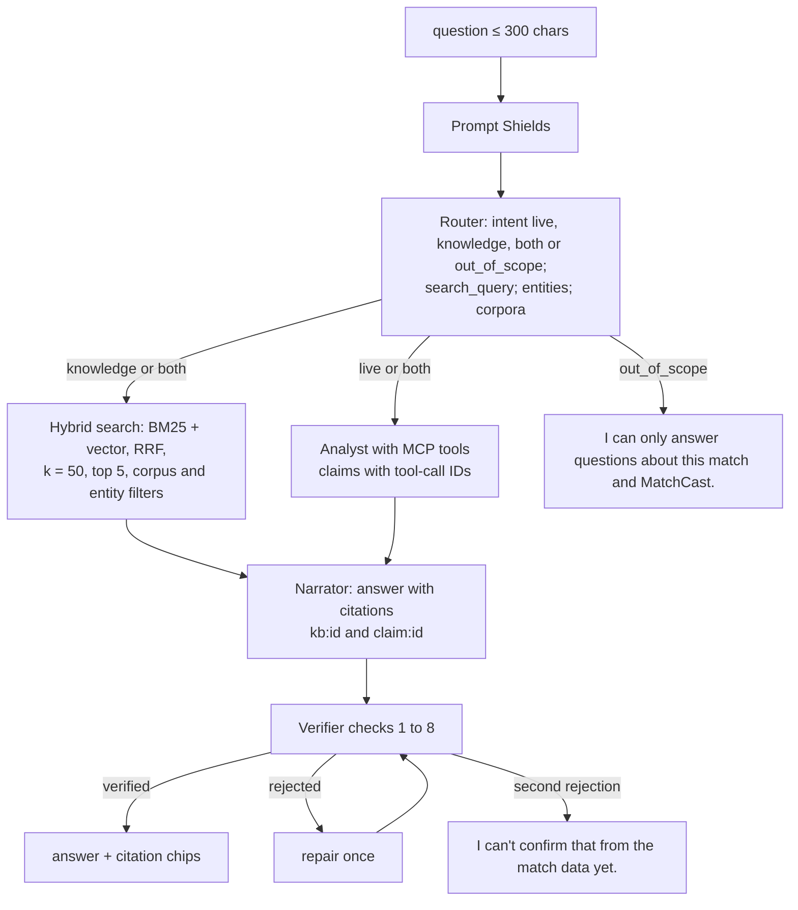

# 05 MatchCast Assistant (RAG chatbot)

Status: **Agreed design** (ADR-0009 accepted by Akshay, 22 Oct 2026). Last reviewed 22 Oct 2026. Backlog: EXP-5 (Ask), AGT-16 (knowledge base and retrieval, new).

## 1. What it is

One chatbot, three entry points:

| View | Entry point | Persona sent |
| --- | --- | --- |
| Watch | Copilot side panel, Ask tab | casual (or the viewer's mode) |
| Broadcast | "Ask the producer" box | broadcast |
| Analyst | Ask bar on every page | analyst |

It answers two kinds of question, often both at once:

- **Live questions** ("Who has the most touches?", "Why was that offside?"). These are answered from match state through the agents' tools. Live numbers are never taken from the search index.
- **Knowledge questions** ("What is a 4-3-3 low block?", "How is xG worked out?", "What kind of player is Harbor City's number 10?"). These are answered from our own knowledge base through retrieval-augmented generation (RAG).

## 2. Knowledge base

The source is markdown in the repo folder `kb/`, written by us and reviewed in pull requests like code. Nothing is scraped.

| Corpus | Folder | Content | Approx. size |
| --- | --- | --- | --- |
| `laws` | `kb/laws/` | Our own plain-English summary of each of the 17 Laws of the Game, with a link to the official IFAB text. No verbatim copying | 17 files |
| `metrics` | `kb/metrics/` | Every metric: definition, formula, units, `derivation_version`, a worked example | 15 files |
| `tactics` | `kb/tactics/` | 8 formations, 6 styles, phases of play, pressing, offside trap | 20 files |
| `clubs`, `players` | `kb/clubs/`, `kb/players/` | Fictional club and player profiles generated from the engine rosters (`TEAMS` in the simulator and the season roster) by `scripts/build_profiles.py`: position, ratings, style, short bio | One file per club and per player |
| `season` | `kb/season/` | One summary per season match (28), from the recap function | 28 files |
| `venues` | `kb/venues/` | The 5 fictional stadiums, climate and pitch | 5 files |
| `app` | `kb/app/` | How to use MatchCast, what "Simulated" means, judge guide | 6 files |

## 3. Ingestion

- Script: `scripts/build_kb.py --version v1`. It runs in CI on every merge that changes `kb/`, and by hand on the Mac mini.
- Chunk ID: `<corpus>:<doc_slug>:<chunk_no>`, for example `metrics:xg:2`. This is stable, so re-ingestion updates in place.
- Deleted files are removed from the index by comparing IDs.
- Size check: about 700 chunks × (6 KB vector + 2 KB text) ≈ 6 MB, inside the Free tier's 50 MB.

## 4. Index schema (`kb-matchcast-v1`)

| Field | Type | Attributes |
| --- | --- | --- |
| `id` | Edm.String | key |
| `corpus` | Edm.String | filterable, facetable |
| `doc_id` | Edm.String | filterable |
| `title` | Edm.String | searchable |
| `section` | Edm.String | searchable |
| `text` | Edm.String | searchable, analyzer `en.microsoft` |
| `entity_ids` | Collection(Edm.String) | filterable (player_id, team_id, venue_id) |
| `source_path` | Edm.String | retrievable |
| `version` | Edm.String | filterable |
| `vector` | Collection(Edm.Single) | 1536 dims, HNSW, cosine, profile `vp-default` |

## 5. Answering a question

Rules:
1. Router: one `gpt-6-luna` call, temperature 0, at most 150 output tokens, JSON output. Rules fallback: keyword lists per intent.
2. Retrieved chunk text is placed in a `<documents>` block. The prompt tells the model that this text is reference data and never instructions. Prompt Shields also checks the documents.
3. Answer length: casual ≤ 80 words, broadcast ≤ 60 words, analyst ≤ 200 words.
4. Every sentence ends with at least one citation. A number in the answer must come from a claim (live) or from a chunk (knowledge). Live numbers taken from chunks are rejected with reason `stale_state`.
5. Conversation memory: the last 3 turns (question and verified answer) from Table `conversations`; at most 10 turns per browser session.
6. Rate limit: 5 questions a minute per browser session; 429 with `Retry-After`.

## 6. Access and keys

AI Search Free does not support managed identity (Microsoft Learn, "Try Azure AI Search for free"). So:

- The **query key** (read-only) is stored in Key Vault as `srch-query-key`. `api` reads it through a Container Apps Key Vault reference. It never reaches the browser.
- The **admin key** is stored as `srch-admin-key`. Only `scripts/build_kb.py` uses it, in CI, through the OIDC identity's Key Vault access.
- Both are listed as exceptions in `docs/infra.md` (PLT-4).

## 7. Fallbacks

| Failure | Behaviour | UI label |
| --- | --- | --- |
| Search service unreachable or deleted (the Free tier can be removed after long inactivity) | `api` loads `kb/v1/chunks.jsonl` from Blob at start and runs in-memory BM25 + cosine | "Search fallback" chip |
| No embeddings quota | Index built without `vector`; keyword search only | none (documented) |
| Model failure | Router uses keyword rules; Narrator uses an extractive answer (the top chunk's first two sentences, cited) | "Rules fallback" chip |

## 8. Quality gate

`eval/ask_eval.py` runs `eval/ask_golden.jsonl`: 40 questions (15 knowledge, 15 live on a fixed seed, 5 both, 5 unanswerable), each with expected chunk IDs or claim metrics.

| Metric | Target |
| --- | --- |
| hit@5 (an expected chunk in the top 5) | ≥ 0.90 |
| Verifier pass rate | ≥ 0.95 |
| Unanswerable questions abstained | 5 of 5 |
| p95 latency | ≤ 8 s |

The gate runs in CI when `kb/`, `packages/agents/ask/` or a prompt changes. A miss fails the job.
