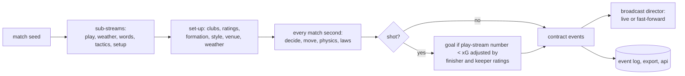

# 06 Synthetic match generator

Status: **Agreed design** (Akshay chose option A, condensed broadcast, on 22 Oct 2026). Backlog: DAT-9, DAT-10, DAT-5. The research behind it is in the Claude Doc "Synthetic match generator: how it works and how we make it realistic" (https://claude.ai/artifact/Rg4R9UgCFz3fgSHwkPkiZ2).

## 1. Shape

An agent-based simulation: 22 players and a ball move with physics, and each player decides every tick to pass, carry, shoot, press or tackle. Events come out of play; nothing is scripted. Rules follow Laws 8, 11 and 12. There are 8 formations and 6 styles.

## 2. Where it runs

| Mode | Code | Used for |
| --- | --- | --- |
| Browser (live) | Engine modules in `apps/unified/` (from `sources/3d-source/v2`) | Watch view; the only live match source |
| Headless (batch) | `services/simulation/run.cjs` drives the same engine in Chromium without rendering (`stepSim(0.02)` in a loop until full time) | 240 scenes (DAT-5), the 28-match season, the 200-seed realism check, replay publisher |

The engine source is `apps/unified/sources/3d-source/v2`; an identical copy lives in `broadcaster-console/engine` and the two must stay byte-identical (`cmp`). `services/simulation/tests/checks.cjs` runs in the e2e job (`tests/e2e/sim-engine.spec.ts`) and fails on a stray `Math.random`, on xG constants that differ from `data/calibration/xg.json`, or when one seed does not give byte-identical event JSON. Details and measured numbers: [docs/simulator.md](../simulator.md).

## 3. Randomness

- One seed per match. Sub-streams are derived as `mulberry32(hash32(seed + ":" + stream))` for `play`, `words`, `tactics` and `setup`; weather has its own `mulberry(seed)` in `initEnv` (`world.js`). There is no `visuals` stream: rain drops and animation phase stay unseeded because they change no event. Python batch code uses `numpy.random.default_rng([seed, stream_index])`.
- Unseeded `Math.random` is allowed in only three places: creating a brand-new seed (the two "roll" and "new match" handlers in `setup.js`), rain drop positions (`worldvis.js`) and animation phase (`main.js`). The other 7 call sites (4 in `setup.js`, 1 each in `world.js`, `talk.js`, `history.js`) now use sub-streams (DAT-9, done). The headless runner steps a fixed 0.02 s, so only it is byte-identical; a browser replay steps with the frame time and is statistically the same match.
- Same seed, same engine version: byte-identical event JSON (replay test in CI).

## 4. Match clock (option A, condensed broadcast)

- The engine simulates all 90 match minutes (plus added time) at real event density.
- The broadcast director scores each passage of play: shot or goal 1.0, box entry 0.4 (cut: the attack is skipped, the shot that ends it plays live), set piece 0.6, card 0.6, otherwise 0.1. A score of 0.5 or more plays live at the chosen speed; anything lower fast-forwards at 40x behind a wipe showing the minute range, for example 62' → 67'.
- A whole match at 1x lasts 8 to 12 real minutes.
- Every event, including fast-forwarded ones, goes into the event log, the stats and the agents.
- Fallback (option B), only if the headless timing test shows more than 60 s for 90 match minutes: 5-minute halves with shot and goal weights scaled to hit the goal and draw targets. The exported dataset still uses full density.

## 5. Realism targets

Both teams together, per match, over 200 seeds. Stored in `data/calibration/targets.json` with value, band, source and licence. Checked by `scripts/check_realism.py`; any miss exits non-zero.

| Measure | Target | Pass band | Source |
| --- | --- | --- | --- |
| Goals | 2.66 | 2.3 to 3.0 | martj42 (CC0) |
| Draws | 24% | 18% to 30% | martj42 |
| 0-0 | 7% | 3% to 12% | Poisson at 2.66 |
| Shots | 25 | 20 to 30 | Wyscout (CC BY 4.0) |
| Goals per shot | 0.11 | 0.08 to 0.13 | derived |
| Passes | 840 | 700 to 1,000 | Wyscout |
| Duels | 470 | 380 to 580 | Wyscout (the engine counts aerial duels, slide tackles, take-ons and turnovers, a wider set) |
| Goals in 76'–90' | 21.5% of goals | 17% to 26% | martj42 |
| Penalty goals | 6.8% of goals | 3% to 13% | martj42 (**known gap**: the 200-seed run gives 11.2%, about 4 standard errors high; the band was widened so the check gates regressions) |
| Watch length at 1x | 10 min | 8 to 12 | director accounting (live seconds plus fast-forwarded seconds / 40), not timed on a screen |

## 6. xG model

`xG = 1 / (1 + e^-(b0 + b1·angle + b2·distance))`, fitted offline on Wyscout public shot events by `scripts/fit_xg.py` (or the Databricks `fit-xg` notebook, which logs the run to MLflow). Only `b0`, `b1`, `b2` and the log-loss are stored, in `data/calibration/xg.json`. Raw Wyscout rows never enter the repo. Finisher and keeper ratings shift the logit by at most ±0.5.

## 7. Data sources and licences

| Source | Licence | Use |
| --- | --- | --- |
| Wyscout soccer match event dataset (Pappalardo et al., 2019) | CC BY 4.0 | Event-rate targets, xG fit. Credit in README and dataset card |
| martj42 international results | CC0 | Goals, draws, timing, Elo |
| StatsBomb open data | Free for research with credit and logo, under their user agreement | Optional only |
| Kaggle European Soccer Database, FIFA rating sets | Attributes come from EA games | Not used |

Real data is used only as aggregate statistics. No real event, player, club or name enters a generated match.

## 8. Outputs

| Output | Location | Format |
| --- | --- | --- |
| Live events | `api` → Event Hubs → Table `events` | contract events v1.1 |
| Scenes (240) | Blob `scenes/v1/` | Parquet, one row per event with features + `danger` label |
| Season (28 matches) | Blob `season/v1/` | Parquet: `matches`, `events`, `players`, `team_match_stats`, `player_match_stats` |
| Dataset card | `docs/dataset-card.md` | Seeds, engine version, targets met, licences |
| Export from the app | Download from Watch | JSON and CSV (existing feature) |
