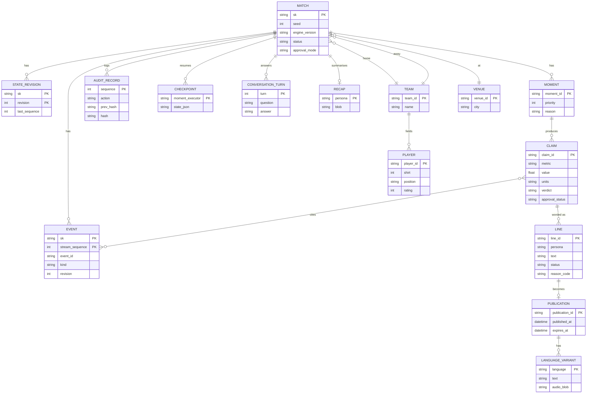

# 07 Data model and storage design

Status: **Agreed design**. Last reviewed 22 Oct 2026. Wire formats are defined in `packages/contracts` ([docs/contracts.md](../contracts.md)); this file defines how they are stored.

## 1. Store choices

| Store | Holds | Why this store |
| --- | --- | --- |
| Azure Table Storage | Matches, events, match state, claims, lines, publications, audit, checkpoints, conversations | Key-value by match; pennies a month; managed identity. Cosmos DB was dropped for cost (cost plan, 18 Oct) |
| Azure Blob Storage | Season and scene Parquet, models, audio, recaps, KB fallback, vision crops, exports, Event Hubs checkpoints | Files and large objects |
| Event Hubs `match-events` | The live event log, 1-day retention | Fan-out to `api`, `fn-recap`, Fabric |
| AI Search `kb-matchcast-v1` | Knowledge base chunks and vectors | Hybrid retrieval, see [05-assistant-rag.md](05-assistant-rag.md) |
| DuckDB (in `mcp`, read-only) | SQL over the season Parquet | Data Scientist and Stats Desk queries without a database server |
| Fabric Eventhouse `matchcast` | Copy of events for the Real-Time Dashboard | Build-time only; paused after filming |
| Databricks Unity Catalog + MLflow | Training data views, experiments, registered models | Build-time only |

## 2. Keys

The contracts identify a stream by the tuple `(tenant_id, session_id, match_id)`. Identifiers use `[A-Za-z0-9._:-]`, so `|` can never appear inside one.

- **Stream key** `sk = tenant_id + "|" + session_id + "|" + match_id`. Every Table partition and every Blob path for match data uses it.
- **Blob path prefix** `{tenant_id}/{session_id}/{match_id}/`.
- Where a backlog story writes `{match_id}` in a key or path, it means the stream key or this prefix.
- The demo tenant is `demo`. Vision output uses `session_id = <session>.vision` (see [09-vision-identification.md](09-vision-identification.md)).
- Sequence row keys are zero-padded to 10 digits, so they sort as text.

## 3. Logical model

A **claim** is one measured fact (Analyst). A **line** is the Narrator's text for one persona, built from one or more claims; the Verifier gives each line a verdict, and the Producer approves lines. A claim's contract field `approval_status` becomes `approved` when any line built on it is approved. A **publication** is an approved, verified line with its language variants and audio.

## 4. Tables

All tables live in `stmatchcastdev`. Columns hold JSON as strings where noted. A string property holds at most 64 KB of UTF-16 (32,768 units; the code uses 32,000); anything larger goes to Blob `overflow/{prefix}/{table}/{RowKey}.<sha256 prefix>.json` and the column holds `blob:<path>`.

| Table | PartitionKey | RowKey | Columns | Written by | Read by |
| --- | --- | --- | --- | --- | --- |
| `matches` | `tenant_id` | `session_id|match_id` | seed, engine_version, home_team_id, away_team_id, venue_id, kickoff_local, approval_mode (`auto`, `producer`), status (`scheduled`, `live`, `full_time`, `abandoned`), languages_active (JSON), score_home, score_away, created_at, ended_at | `api` | all |
| `events` | `sk` | `stream_sequence` (10 digits) | event_id, kind, revision, event_time_ms, period, team_id, player_id, payload (JSON), emitted_at, ingested_at | `api` consumer | `mcp`, `api` |
| `matchstate` | `sk` | `current` or `rev:<revision 10 digits>` | revision, last_sequence, state (JSON), updated_at | `api` consumer (only writer) | `mcp`, `api` |
| `claims` | `sk` | `claim_id` | moment_id, agent, metric, value, units, source_event_ids (JSON), tool_call_ids (JSON), formula_inputs (JSON), derivation_version, snapshot_revision, verdict, reason_code, approval_status, created_at | workflow | `api`, `mcp` (`get_evidence`) |
| `lines` | `sk` | `line_id` | claim_ids (JSON), persona, text, status (`drafted`, `verifying`, `verified`, `review`, `rejected`, `repairing`, `abstained`, `approved`, `killed`, `published`), reason_code, checks (JSON), repair_of, created_at, decided_by | workflow, Producer actions | `api` |
| `publications` | `sk` | `publication_id` | line_id, persona, variants (JSON: language → text, audio_blob, verifier_pass), match_time_ms, published_at, expires_at | workflow | `api` (SSE replay) |
| `audit` | `sk` | `sequence` (10 digits) | audit_id, time, actor_kind, actor_id, action, subject_id, details (JSON ≤ 2 KB), prev_hash, hash | everything, through `append_audit()` | `api` (`/audit`) |
| `checkpoints` | `sk` | `<moment_id>:<executor>` | checkpoint (JSON), created_at | workflow | workflow on resume |
| `conversations` | `sk|browser_session_id` | `turn` (4 digits) | question, persona, answer, citations (JSON), verdict, created_at | `api /ask` | `api /ask` |

Built today (`packages/agents/matchcast_agents/tables.py`, AGT-3 and AGT-13): `TableStore` implements the repositories for `matches`, `events`, `matchstate`, `claims`, `lines`, `publications`, `recaps`, `checkpoints` and `audit` with the keys above. Each row stores the whole record as JSON in a `doc` column beside its key columns (`event_id` and `revision` on events, `revision` and `last_sequence` on matchstate, `processed_sequence` on checkpoints), and a value over 32,000 UTF-16 units goes to the `overflow` container as described (`build_store` creates the container if it is missing). Claims, lines and publications also carry `ord` (a zero-padded nanosecond clock) so lists keep insertion order. The checkpoint is one row per match (`current`) holding the processed sequence, the state and the Producer memory, which is what the workflow resumes from. Events are keyed by `stream_sequence`, unique per stream, so a retry is the same row. `conversations` has no repository yet.

Write rules:
1. Idempotent keys: `claim_id = sha256(sk, moment_id, agent, derivation_version)[:24]`; `line_id = sha256(claim_ids, persona, attempt)[:24]`; `publication_id = sha256(line_id)[:24]`. Upserts with the same key are safe on replay.
2. `audit.sequence` is assigned by a single writer per match (the `api` replica) with an optimistic insert; a 409 Conflict means another writer won, so re-read the tail and retry once.
3. `matchstate/current` is updated with an ETag check (`If-Match`), so a stale writer fails instead of overwriting. `TableStore.put_state` is a plain upsert today (one writer, ADR-0005); the check comes with a second writer.

## 5. Blob containers

| Container | Path | Content | Lifecycle |
| --- | --- | --- | --- |
| `season` | `v1/{matches,events,players,team_match_stats,player_match_stats}.parquet` | 28-match season | Kept |
| `scenes` | `v1/part-*.parquet` | 240 labelled scenes | Kept |
| `models` | `danger/{version}/model.onnx`, `danger/{version}/model-card.json` | Danger model | Kept |
| `audio` | `{prefix}/{publication_id}.{lang}.mp3`, `{prefix}/recap.{lang}.mp3` | Voice | Delete after 30 days |
| `recaps` | `{prefix}/{persona}.json` | Full-time recaps | Kept |
| `kb-chunks` | `v1/chunks.jsonl` | Search fallback copy | Kept |
| `vision` | `{prefix}/{yyyyMMddHHmm}/crop-{n}.png` | OCR crops | Delete after 1 day |
| `exports` | `{prefix}/{export_id}.{csv,json}` | Analyst exports with SHA-256 | Delete after 7 days |
| `overflow` | see §4 | Large JSON values | With the row |
| `eh-checkpoints` | SDK-managed, one folder per reader (`api`, `recap`) | Event Hubs offsets | SDK-managed |

## 6. Season database (DuckDB in `mcp`)

The `mcp` container opens an in-memory DuckDB at start, reads the season Parquet from Blob with the managed identity, and creates these read-only views. `query_season` accepts only one `SELECT` statement over these views; it rejects any other statement, function or table, applies `LIMIT 1000`, and stops after 5 s.

| View | Grain | Key columns |
| --- | --- | --- |
| `matches` | one row per match | match_id, date, home_team_id, away_team_id, score_home, score_away, venue (stadium name) |
| `events` | one row per event | match_id, stream_sequence, kind, team_id, player_id, x, y, event_time_ms, outcome, xg |
| `players` | one row per player | player_id, team_id, name, shirt, position, rating |
| `team_match_stats` | team × match | match_id, team_id, side, goals, shots, xg, passes, passes_completed, possession_pct, fouls, yellow_cards, red_cards, offsides |
| `player_match_stats` | player × match | match_id, player (name), team_id, passes, passes_completed, tackles, shots, xg, distance_km |
| `player_vectors` | one row per player | per-90 vector of 12 metrics, used for similarity |

Built today (`scripts/export_season.py`, 28 matches, `data/season/v1/*.parquet`): `matches`, `team_match_stats` and `player_match_stats`, with exactly the columns shown for them above. `events`, `players` and `player_vectors` are planned. The tests in `services/mcp/tests/test_export_season.py` keep the exported columns and the queryable metrics in step.

## 7. Event Hubs

- Namespace `evhns-matchcast-dev`, Basic tier, hub `match-events`, 1 partition, 1-day retention, partition key `sk`, local auth disabled.
- Basic allows **one consumer group** (Microsoft Learn, "Compare Event Hubs tiers"). All readers use `$Default`: `api` and `fn-recap` each keep their own checkpoint folder in `eh-checkpoints`, and the Fabric Eventstream tracks its own position. A consumer group allows up to 5 readers per partition, and we use 3. See ADR-0006.

## 8. Fabric Eventhouse

Table `events` (KQL): `tenant_id: string, session_id: string, match_id: string, stream_sequence: long, event_id: string, revision: int, kind: string, team_id: string, player_id: string, x: real, y: real, event_time_ms: long, period: int, payload: dynamic, ingested_at: datetime`. Queries for the four dashboard tiles are in `data/fabric/queries.kql`.

## 9. Databricks Unity Catalog

Catalog `matchcast`: schema `raw` (external volumes over Blob `scenes` and `season`), schema `calib` (table `xg_fit`), schema `ml` (registered model `matchcast.ml.danger`). Everything is built by the `train-danger` and `fit-xg` jobs; nothing is edited by hand.

## 10. Retention and privacy

- No personal data is generated: all players and clubs are fictional.
- Personal data we do hold: the Producer's Entra display name and object ID in `audit`, and text that viewers type into Ask or Talk. `conversations` rows older than 24 hours are deleted by an hourly sweep in `api`. Vision crops are deleted after 1 day.
- Everything is deleted at shutdown with `azd down --purge` on 11 Nov 2026 (runbook, PLT-10).

## 11. Repository layer (how code reaches storage)

No code outside the store modules imports an Azure storage SDK. This keeps tests fast and makes a later change of database a contained job.

- One repository per table in §4 (`MatchRepo`, `EventRepo`, `StateRepo`, `ClaimRepo`, `LineRepo`, `PublicationRepo`, `AuditRepo`, `CheckpointRepo`, `ConversationRepo`), defined as Python `Protocol` classes in `packages/agents/matchcast_agents/store.py`.
- Two implementations: `TableStore` (azure-data-tables with the managed identity, plus the Blob overflow rule) and `MemoryStore` (dictionaries, for unit tests and the local rules mode). The setting `MATCHCAST_STORE=table|memory` picks one; the default in Azure is `table`, locally and in CI it is `memory`. The api's `Registry` reads the setting (`build_store()`), so the MCP tools, the workflow and the routes share that one store.

Known limits of `table` mode today (Oct 22 review): the Azure SDK clients are synchronous and the api calls them from async routes, so a busy match blocks the event loop (move the store calls to a thread before enabling it under load); after an api restart the same `session_id`/`match_id` resumes its stored checkpoint, lines and audit chain instead of starting fresh; and an event correction that keeps its `stream_sequence` overwrites revision 0, where `MemoryStore` keeps both revisions.
- The same contract test suite runs against both (see [16-testing-and-quality.md](16-testing-and-quality.md) §7): `TableStore` against Azurite, `MemoryStore` in process. A new store is allowed only when it passes that suite unchanged.

## 12. If a feature needs a real database

Table Storage, Blob and DuckDB cover every story in the backlog today (ADR-0007). When a new story looks like it needs a database, work through these questions in order and stop at the first yes:

| # | Question | If yes |
| --- | --- | --- |
| 1 | Is every read by stream key, or by key and a sequence range? | New Table in §4 with `sk` as PartitionKey, plus a repository |
| 2 | Is it analysis over finished matches? | Parquet in Blob and a DuckDB view in §6 |
| 3 | Is it text or meaning search? | An index in AI Search ([05-assistant-rag.md](05-assistant-rag.md)) |
| 4 | Is it a file, an image or audio? | A Blob container in §5 |

Only if all four are no does it need a database. Signs of that: filters on non-key fields across live matches, a write that must change several rows at once or not at all, secondary indexes, or more than about 1,000 writes a second. Then:

1. **Default choice: Azure Cosmos DB for NoSQL, serverless.** One container per table with partition key `/sk`, so the keys in §2 and the repositories keep their shape. Data-plane access by managed identity (built-in role Cosmos DB Built-in Data Contributor), local auth disabled, no keys. Serverless bills per request unit and per GB stored, so a demo-sized load is a few dollars at most over the whole period (check the Azure pricing page before accepting).
2. **If joins or relational constraints are the need: Azure Database for PostgreSQL Flexible Server, Burstable B1ms**, Entra authentication only. It costs roughly $13 a month plus storage even when idle, so it is a second choice.
3. **Process:** write an ADR (it changes cost, so Akshay decides), add `infra/modules/<db>.bicep` with the role assignment, implement the repository, pass the store contract suite, add a one-off copy script from Tables if data must move, and switch with `MATCHCAST_STORE`. The spend must still fit the $100 cap with the $40 and $50 alerts.

The rule for this is ADR-0015 (accepted by Akshay, 22 Oct 2026).
