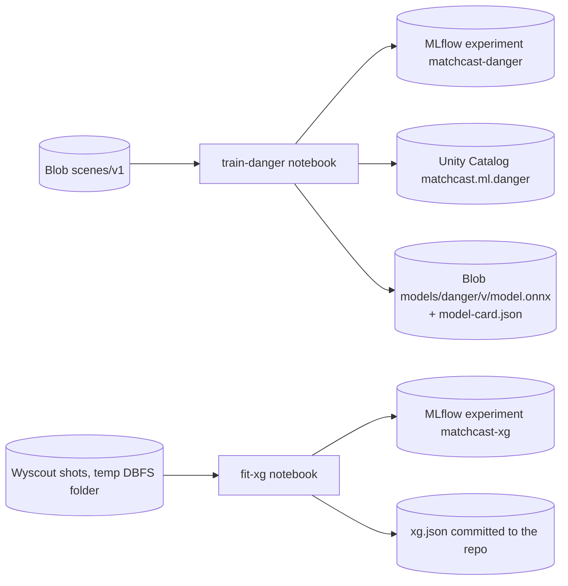

# 08 Data science, analytics and ML

Status: **Agreed design**. Last reviewed 22 Oct 2026. Backlog: DAT-3, DAT-4, DAT-5, DAT-6, DAT-7, DAT-8, AGT-14, EXP-13.

## 1. Four layers

| Layer | What | Runs | When |
| --- | --- | --- | --- |
| Metrics engine | xG, pass quality, ball speed, pressure, moment score, control, chaos, tempo | `packages/metrics` inside `api` and `mcp` | Live, every event |
| Season analytics | SQL, charts, similarity over the 28-match season | DuckDB in `mcp`, Data Scientist agent | On demand |
| ML training | Danger-moment classifier, xG fit | Databricks jobs + MLflow + Unity Catalog | Once during the build |
| Streaming analytics | Real-Time Dashboard on the event stream | Fabric Eventstream → Eventhouse → dashboard | About 12 active hours, then paused |

## 2. Metrics engine (`packages/metrics`)

Every function is pure, takes contract events and state, and returns a value with units and a `derivation_version` (semver). The same functions run live and in the Verifier's recompute step, so a claim and its check can never disagree on the formula.

| Function | Output | Units | Definition |
| --- | --- | --- | --- |
| `xg(shot, state)` | 0–1 | ratio | Logistic on angle and distance with `data/calibration/xg.json`, ± rating shift (see [06-simulation.md](06-simulation.md)) |
| `pass_difficulty(pass, state)` | 0–100 | score | Six capped terms: distance, pressure, lane (distance of the nearest opponent to the pass line), marking, flight, weak foot |
| `pass_quality(pass, state)` | 0–1 | ratio | outcome × (0.2 + 0.4 × difficulty + 0.4 × progression); outcome 1 completed, 0.25 missed |
| `ball_speed_kmh(samples, event_time_ms)` | number | km/h | 3D distance over time between the first and last ball sample within ±500 ms of the event |
| `pressure_index(x, y, state, radius_m=5)` | 0–1 | ratio | 0.7 × nearest-opponent term + 0.3 × crowding (up to 3 opponents inside the radius); `radius_m` must exceed 1 |
| `moment_score(events, minute, goal_margin)` | 0–100 | score | Highest event score, +10 per further event (max +30), x1.1 late, x1.1 when close. Formulas: [../metrics.md](../metrics.md); decision: ADR-0016 |
| `control_index`, `chaos_index`, `tempo` | number | ratio, ratio, passes/min | Rolling 5-minute window (DAT-4) |

Golden tests: 54 cases with expected values from JavaScript reference formulas (`packages/metrics/golden/export_golden.cjs`); Python must match within 0.001 (DAT-3). The reference restates the documented formulas and the engine's xG curve and pass-difficulty terms, not the engine's own functions; ADR-0016 records why.

## 3. Data Scientist workspace (Analyst view)

What is real and what is labelled, so nothing is ambiguous in the demo:

| Prototype page | v1 behaviour | Backed by | Label |
| --- | --- | --- | --- |
| Query workbench (SQL) | Real | `query_season` over DuckDB | none |
| Ask the Data Scientist | Real | Data Scientist agent, Verifier re-runs SQL | none |
| Chart builder | Real | Vega-Lite 5 in the browser, on returned rows | none |
| Dashboards | Real, built from saved queries | Browser storage per viewer | none |
| xG model lab | Real | `xg.json` + MLflow run metrics in `models/danger/*/model-card.json` | none |
| Player similarity | Real | Cosine similarity over `player_vectors` | none |
| Danger model card | Real (Planned in the UI until DAT-6 ships it) | `model-card.json` from Blob | none |
| Tracking lab | Real | Vision accuracy panel ([09-vision-identification.md](09-vision-identification.md)) | none |
| Notebooks | Not connected | Static example | "Simulated" |
| Connectors | Not connected | Static list | "Simulated" |
| Fabric dashboard | Screenshot, 20 s clip, link | Fabric (paused after filming) | "Paused after filming to save cost" |

Data Scientist rules: it may run only `query_season` and `describe_views`; it shows the SQL with every answer; the Verifier re-runs the same SQL (matched by `sql_hash`) and compares every number in the answer with the rows.

## 4. Databricks jobs

| Item | Value |
| --- | --- |
| Workspace | `dbw-matchcast-dev`, Premium, East US 2 |
| Compute | Single-node jobs cluster `Standard_D4ds_v5` (fallback `Standard_DS3_v2` if quota blocks it), auto-terminate when the run ends |
| `train-danger` | Gradient-boosted classifier trained on the scene dataset (`scripts/generate_scenes.py`: 30 s windows of headless matches in six families, the same number per family, one row per event). Label `danger` = the event's own team takes a shot in the next 10 s; the features (passes, turnovers and shots in the previous 10 s, position, xG) look back only, so the label never leaks into them (`tests/test_scenes.py`); 80/20 split by match, not by row; logs params, AUC, Brier score, calibration plot; exports ONNX |
| `fit-xg` | Logistic regression on angle and distance; logs log-loss and a reliability plot; writes `b0..b2` |
| Code | `data/databricks/train_danger.py`, `data/databricks/fit_xg.py` in the repo, deployed as a Databricks Asset Bundle `data/databricks/databricks.yml` |
| After the runs | Stop all compute; record run URLs and metrics in `docs/data.md` |

Serving: no Databricks Model Serving (it would be an always-on cost). The `mcp` tool `predict_danger` loads the ONNX file with onnxruntime at start.

## 5. Fabric Real-Time Intelligence

- Workspace `MatchCast` on F2 (or the 60-day trial). Eventstream source: Event Hubs `match-events`, consumer group `$Default`, Entra auth. Destination: Eventhouse `matchcast`, table `events`.
- Real-Time Dashboard with exactly four tiles: control vs chaos timeline, pass quality leaders, shots and xG by team, events per minute. Refresh 10 s.
- Film a 20 s clip during a 4x replay, export screenshots, save the KQL in `data/fabric/queries.kql`, then pause the capacity (runbook).
