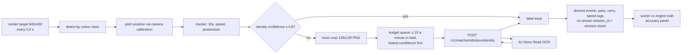

# 09 Vision: auto-eventing and player identification (OCR)

Status: **Agreed design** (ADR-0010 accepted by Akshay, 22 Oct 2026). Last reviewed 22 Oct 2026. Backlog: DAT-11 (new). Prototype: `autoevent.js` (v9 report `/mnt/project-files/matchcast-v2/v9/reports/auto.md`).

## 1. Why

The challenge lists auto-eventing as an example: "running a model over an incoming video feed to generate the pass and speed metrics above automatically" (rules §4.1(ii)). We show that MatchCast can build events from **pixels alone**, then grade them against the engine's ground truth. That is a strong, honest demo, because the score is measured, not claimed.

## 2. What exists (prototype v9)

- Every 0.2 s the broadcast camera view is rendered at 640×360 and read back as pixels.
- Players, officials and the ball are found by kit colour classes and placed on the pitch through the camera calibration.
- Tracks are kept frame to frame; shirt numbers are read with glyph templates; speeds, possession and passes are derived.
- The engine's true positions are read only by the scorer, never by the tracker.
- Measured identity accuracy: 60–74% on the Broadcast camera, 88–89% on the Tactical camera (v9 README).
- Known gap: the camera matrix is taken from the renderer instead of being solved from the pitch lines.

## 3. Design (v1)

Rules:
1. **Cloud OCR is a second opinion, not the main reader.** The in-browser glyph reader runs on every frame. A crop goes to Azure only when a track's identity confidence is below 0.8.
2. **Budget:** at most 15 OCR calls a minute in total, enforced in the browser queue and again in `api` (429 above it). The S1 resource has no per-minute cap that low; the cap is ours, for cost. `api` also stops after 3,000 calls in total (`VISION_MAX_CALLS`, about $5 at the S1 price; check the pricing page), after which the glyph reader works alone and the Tracking lab says "OCR budget used".
3. **Combining answers:** OCR text is accepted only if it is 1 or 2 digits, its confidence is ≥ 0.7, and that shirt number exists on the team whose kit colour the track has. Otherwise the glyph reading stands.
4. **Separate stream:** vision events use the same contracts with `session_id = <session>.vision`, so they can never mix with or overwrite engine truth (see [07-data-and-storage.md](07-data-and-storage.md) §2).
5. **No people:** the video is our own synthetic render with fictional players, so no face or personal data is processed. Crops are kept 1 day for debugging, then deleted.

## 4. API

`POST /v1/matches/{match_id}/vision/identify`

| Field | Type | Rule |
| --- | --- | --- |
| `crop` | PNG, base64 | 128×128, ≤ 40 KB |
| `track_id` | string | tracker's ID |
| `team_hint` | `home` or `away` | from kit colour |

Response `200`: `{ "shirt": "10" | null, "confidence": 0.0-1.0, "source": "azure_read", "elapsed_ms": n }`. `429` above the budget. `api` calls Image Analysis 4.0 with feature `read` using `id-matchcast` (role Cognitive Services User).

Status (22 Oct): the route and its budget are built (`services/api/app/vision.py`, tests in `tests/test_api_vision.py`). The reader calls Image Analysis 4.0 over REST with a managed-identity token when `VISION_ENDPOINT` is set (the `cv-matchcast-dev` resource is Azure-blocked until PLT-3); otherwise it answers `source: unavailable` and never invents a number. Crops are not stored yet (the Blob `vision/` debug copy is Planned).

## 5. Accuracy panel (Analyst view, Tracking lab)

Shown live and saved per match: detection recall, identity accuracy (glyph only vs glyph + OCR), position error (median metres), pass detection precision and recall, ball speed error (km/h). The before/after identity number is the headline for the video.

## 6. Targets

| Measure | Today | Target with OCR |
| --- | --- | --- |
| Identity accuracy, Broadcast camera | 60–74% | ≥ 85% |
| Identity accuracy, Tactical camera | 88–89% | ≥ 92% |
| OCR calls a minute | 0 | ≤ 15 |

If the target is missed, we report the measured number. We never round it up.

## OCR route behaviour (task 275)

- `VISION_ENDPOINT` unset means no resource: the route answers `source: unavailable` and the glyph reader works alone. A value that is not an `https://<resource>.cognitiveservices.azure.com` host (or `.cognitive.microsoft.com`) stops the api at startup. The managed-identity token is never sent across a redirect.
- Budget is per api process and shared by every caller; one viewer can use all 15 a minute. This is a cost cap (ADR-0010), not fairness. With more than one replica the ceiling is the sum.
- A call that reaches Azure is charged even if Azure fails. A failure to get a token is refunded. Failures are logged by type only, never with the token or the image.
- Crops are validated before any budget is taken: complete PNG (IHDR CRC, IEND), 128x128, at most 40 KB.

## Browser crop queue (task 275, browser side)

`apps/unified/embed/vision-crops.js` builds the crop and `index.html` relays it (`vision-crop` to `LV.identify`, `vision-ocr` back). Rules in code: confidence proxy `min(1, stable/6)` below 0.8, at most one call in flight and one per 4.1 s, lowest confidence first, PNG at most 40 KB, nothing kept. Tracks under 24 px tall are counted as "too small to read" and not sent, since a number cannot fit in the pixels. Counters (`sent`, `answered`, `read`, `no_digits`, `skipped_small`, `unavailable`, `errors`) travel in the vision report to the Tracking lab. Measured on the Broadcast camera in the sandbox: players are 8 to 13 px tall, so OCR is expected to help only on the Tactical camera; task 279 reports the real numbers.

## Combining OCR with the glyph reading (task 277)

`combine` in `embed/vision-crops.js` applies rule 3 above: 1 or 2 digits, confidence at least 0.7, a shirt number the track's team has and that is not sent off (home for kit classes 1 and 3, away for 2 and 4; "07" is not a shirt number). An accepted reading is kept in `mcOcr.accepted` (track to player); the tracker's own tracks are not written to, because its identity score compares `track.pid` with truth and OCR would contaminate the glyph-only figure. Each accepted answer is scored from a snapshot taken when the crop was sent (the glyph pid then, and the player of that team nearest the track within 1.5 m from engine truth), since the answer arrives seconds later. The Tracking lab shows glyph alone against glyph + OCR **on the low-confidence tracks OCR answered** (those are the glyph reader's weakest, so the figure is not comparable with the whole-run identity row), with the scored and accepted counts side by side. A whole-run glyph + OCR identity would need the scorer in the prototype source to read `accepted`; not done. Posting vision events is described next.

## Measurement (task 279)

`MEASURE=1 make e2e E2E_ARGS="tests/e2e/vision-measure.spec.ts"` loads Watch on 3 seeds (`MEASURE_SEEDS`, default 11, 22, 33) on the Broadcast and the Tactical camera, waits for `MEASURE_CAPTURES` tracker captures (default 150, at most `MEASURE_TIMEOUT_S` seconds per run, default 1800; a run that falls short fails but still records its numbers with `reached: false`, appended to the file as each run ends) and writes the tracker's own report (detection, identity, speed, ball, passes, cost per capture) to `$MEASURE_OUT` (default `/tmp/vision-measure.json`). Targets from §3: identity at least 85% on the Broadcast camera and at least 92% on the Tactical camera; the measured value is reported whatever it is.

**Status: measured on short runs, not a full match (23 Oct).** A capture costs 7 to 21 s in the sandbox (software WebGL), so a full match needs a GPU machine such as the Mac mini; runs here were capped at 900 s wall time (a 1800 s run on Tactical seed 22 reached 102 captures). The tracker needs the kick-off calibration window first, so these numbers cover only the opening stretch of play (a few minutes at most). Tracker report, engine truth as the reference:

| Camera | Seed | Captures | Detection recall | Precision | Position error | Identity | Unknown | Switches | Ball found |
|---|---|---|---|---|---|---|---|---|---|
| Broadcast | 11 | 37 | 97.5% | 78.6% | 0.46 m | 94.4% | 5.6% | 0 | 45.9% |
| Broadcast | 22 | 46 | 99.0% | 77.5% | 0.47 m | 92.1% | 7.9% | 0 | 63.0% |
| Broadcast | 33 | 40 | 96.6% | 77.2% | 0.45 m | 97.3% | 2.7% | 0 | 60.0% |
| Tactical | 11 | 40 | 97.9% | 69.4% | 0.37 m | 94.9% | 5.1% | 0 | 57.5% |
| Tactical | 22 | 102 | 99.0% | 69.3% | 0.36 m | 92.3% | 7.7% | 0 | 75.5% |
| Tactical | 33 | 40 | 95.4% | 68.8% | 0.37 m | 93.3% | 6.7% | 0 | 57.5% |

Reading it honestly: recall (95 to 99%) and position error (under 0.5 m) meet the in-app check in `autoevent.js` (detection 85%+, position error under 1 m). Identity meets the 85% target on the Broadcast camera in all three seeds but the Tactical camera is at 92.3 to 96.9% across its four runs (the table shows the 102-capture run for seed 22; a separate 40-capture run on that seed gave 96.9%), so the 92% target holds with little margin and only on these short windows. Precision is 69 to 79%: about a quarter to a third of reported boxes do not match an engine player (the cause was not analysed). Ball is found in 46 to 76% of captures where it is in view. Pass detection has 0 to 5 engine passes per window, too few to score: the best run (Tactical 22, 102 captures) found 4 of 5, while two other runs reported 2 passes against 1 real one and one reported a pass where there was none, so pass precision is mixed. Not measured: a full match, long-run identity drift, and the Azure OCR path (the glyph reader worked alone; the sandbox has no Azure access). The earlier 40-capture smoke figures (identity about 30%, 78 to 84 switches) came from an earlier run with a shorter window (about 8 s of match time) and possibly an earlier build and are superseded; why identity differs so much was not investigated.

## Vision events on the `.vision` stream (task 277)

`embed/vision-events.js` watches the tracker's pass list (`VIS.passes`, possession moving to a team-mate) while Vision is on and sends each completed pass to the shell. `LV.visionEvents` in `live.js` creates a second match on the session id `<session>.vision` (same match id and roster, the roster's `stream` rewritten) and posts contract `pass` events (schema 1.0.0) to `POST /v1/matches/{id}/events?session_id=<session>.vision`. The engine stream never receives them. Start and end positions are the tracker's own track positions from a short history near the pass times, so they are pixel-derived, not engine truth, and are clamped to the pitch. Not built: passes to the other team (counted as `skipped_other_team`, since an interception needs its own rule), carries and speed tags, and any consumer of the vision stream (the Analyst does not read it yet). A queue is capped at 2,000 events if the api never accepts the stream. In live agent mode the api's agents also see this second stream; it is cheap in rules mode and counts against the model budget otherwise, so check that before filming. `mcVisEvents()` reports `sent`, `skipped_*`, `derived` and `tracked`; `mcVisDerive(passes)` feeds the same path in tests, because the software-GL tracker needs minutes to see a real pass.

## Vision -> Agents (ADR-0022)

The passes on `<session>.vision` are not only stored. The agents of that match read them and work on them:

- Its Producer writes a Vision summary every minute of match time (`VISION_SUMMARY_MS`, at priority 3, so the rules twin writes it and no model call is spent on it). Its Analyst counts `passes:<team>` (not shots), and its Narrator writes "Vision has tracked ...", with rule 13 of the Narrator prompt forbidding it to present the count as engine truth.
- Its Verifier recounts each count from Vision's own passes (check `numbers`), then compares it with the engine's passes for the same team and match time (check `vision`). The check reports the agreement, as "Vision counted 41 passes for Northgate FC, the engine 44 (93% agree)". It does not block the line: the disagreement is shown, not hidden.
- The api reads the agreement at `GET /v1/matches/{id}/vision/summary` (`vision_summary()`). It gives passes in, the lines the Verifier passed, the latest such line, and the precision (the share of Vision's passes that an engine pass backs within 8 s of match time, same team, passer and receiver) and recall. Only the span both streams have covered is compared: from 8 s before Vision's first pass to the engine's latest event. Vision passes after that are `pending`, not misses.
- Watch shows the latest line and the agreement as a "Camera mode · simulated pitch" chip, and its Vision button is labelled "Camera mode (experimental)": the tracker reads the rendered simulated pitch, not a real camera. The shell's Agents strip shows "Vision -> Agents" with the same counts.
- The engine feed carries one Vision moment per match, once the engine clock reaches 15 min: Vision's pass count beside the engine's, and the share of Vision's passes an engine pass backs (ADR-0022 addendum). It is labelled Vision and does not time-match each pass, because the tracker's detection lag is not yet measured.

Engine events remain the only source of the match record and of every engine line. Vision never writes to the engine stream, and the engine's agents do not read Vision's passes; a Vision pass can add a count to the Vision stream and nothing else. The line counter (`lines_verified`) lives in the api process and starts again at zero after a restart; the passes and the agreement come from the stored `.vision` and engine events, so they are recomputed on each read.

