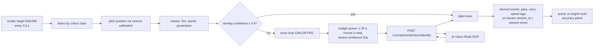

# 09 Vision: auto-eventing and player identification (OCR)

Status: **Agreed design** (ADR-0010 accepted by Akshay, 22 Oct 2026). Last reviewed 22 Oct 2026. Backlog: DAT-11 (new). Prototype: `autoevent.js` (v9 report `/mnt/project-files/matchcast-v2/v9/reports/auto.md`).

## 1. Why

The challenge lists auto-eventing as an example: "running a model over an incoming video feed to generate the pass and speed metrics above automatically" (rules §4.1(ii)). We show that MatchCast can build events from **pixels alone**, then grade them against the engine's ground truth. That is a strong, honest demo, because the score is measured, not claimed.

## 2. What exists (prototype v9)

- Every 0.2 s the broadcast camera view is rendered at 640×360 and read back as pixels.
- Players, officials and the ball are found by kit colour classes and placed on the pitch through the camera calibration.
- Tracks are kept frame to frame; shirt numbers are read with glyph templates; speeds, possession and passes are derived.
- The engine's true positions are read only by the scorer, never by the tracker.
- Measured identity accuracy: 60–74% on the Broadcast camera, 88–89% on the Tactical camera (v9 README).
- Known gap: the camera matrix is taken from the renderer instead of being solved from the pitch lines.

## 3. Design (v1)

Rules:
1. **Cloud OCR is a second opinion, not the main reader.** The in-browser glyph reader runs on every frame. A crop goes to Azure only when a track's identity confidence is below 0.8.
2. **Budget:** at most 15 OCR calls a minute in total, enforced in the browser queue and again in `api` (429 above it). The S1 resource has no per-minute cap that low; the cap is ours, for cost. `api` also stops after 3,000 calls in total (`VISION_MAX_CALLS`, about $5 at the S1 price; check the pricing page), after which the glyph reader works alone and the Tracking lab says "OCR budget used".
3. **Combining answers:** OCR text is accepted only if it is 1 or 2 digits, its confidence is ≥ 0.7, and that shirt number exists on the team whose kit colour the track has. Otherwise the glyph reading stands.
4. **Separate stream:** vision events use the same contracts with `session_id = <session>.vision`, so they can never mix with or overwrite engine truth (see [07-data-and-storage.md](07-data-and-storage.md) §2).
5. **No people:** the video is our own synthetic render with fictional players, so no face or personal data is processed. Crops are kept 1 day for debugging, then deleted.

## 4. API

`POST /v1/matches/{match_id}/vision/identify`

| Field | Type | Rule |
| --- | --- | --- |
| `crop` | PNG, base64 | 128×128, ≤ 40 KB |
| `track_id` | string | tracker's ID |
| `team_hint` | `home` or `away` | from kit colour |

Response `200`: `{ "shirt": "10" | null, "confidence": 0.0-1.0, "source": "azure_read", "elapsed_ms": n }`. `429` above the budget. `api` calls Image Analysis 4.0 with feature `read` using `id-matchcast` (role Cognitive Services User).

Status (22 Oct): the route and its budget are built (`services/api/app/vision.py`, tests in `tests/test_api_vision.py`). The reader calls Image Analysis 4.0 over REST with a managed-identity token when `VISION_ENDPOINT` is set (the `cv-matchcast-dev` resource is Azure-blocked until PLT-3); otherwise it answers `source: unavailable` and never invents a number. Crops are not stored yet (the Blob `vision/` debug copy is Planned).

## 5. Accuracy panel (Analyst view, Tracking lab)

Shown live and saved per match: detection recall, identity accuracy (glyph only vs glyph + OCR), position error (median metres), pass detection precision and recall, ball speed error (km/h). The before/after identity number is the headline for the video.

## 6. Targets

| Measure | Today | Target with OCR |
| --- | --- | --- |
| Identity accuracy, Broadcast camera | 60–74% | ≥ 85% |
| Identity accuracy, Tactical camera | 88–89% | ≥ 92% |
| OCR calls a minute | 0 | ≤ 15 |

If the target is missed, we report the measured number. We never round it up.
