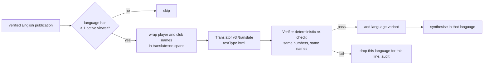

# 10 Voice and live translation

Status: **Agreed design**. Last reviewed 22 Oct 2026. Backlog: EXP-8, EXP-16, EXP-17.

## 1. Languages and voices

| Language | Code | Voice (commentary) | Voice (analyst) | Status |
| --- | --- | --- | --- | --- |
| English | `en` | `en-GB-RyanNeural` | `en-GB-SoniaNeural` | v1 |
| Spanish | `es` | `es-ES-ElviraNeural` | `es-ES-ElviraNeural` | v1 |
| Hindi | `hi` | `hi-IN-SwaraNeural` | `hi-IN-SwaraNeural` | v1 |
| Tamil | `ta` | none | none | Off until a native speaker reviews it |

Voices are configured only in `services/api/config/voices.json`. Player voices for Talk are assigned there by `player_id`. The contracts' `language` enum becomes `en | es | hi | ta` in v1.1.

## 2. Text to speech (commentary)

- Synthesis runs in `api`, never in the browser, with `id-matchcast` (role Cognitive Services User) on `spch-matchcast-dev` (S0, East US 2).
- Output: MP3 24 kHz mono to Blob `audio/{prefix}/{publication_id}.{lang}.mp3`; the publication's `audio_generation_id` holds the blob name; the browser fetches it through `GET /v1/audio/{publication_id}.{lang}.mp3` (api streams it, so Blob stays private).
- Lines older than 5 s (publication expiry) are captioned but not voiced. At most one line is voiced at a time per view; a priority 1 line interrupts.
- Every line is synthesised live (Akshay, 21 Oct: no pre-rendered audio counted against the plan).

## 3. Speech to text (Talk and voice questions)

- The browser uses the Speech SDK with a short-lived token from `GET /v1/speech/token` (10 minutes, issued by `api` with the managed identity). No key reaches the browser.
- Push-to-talk only; typed input is always available. Recognition language follows the viewer's language picker.
- The recognised text goes to `/talk` or `/ask` like typed text, so Prompt Shields and the Verifier apply.

## 4. Live translation

Rules:
1. Only verified English text is ever translated. Agents always work in English.
2. "Active viewer" means a browser that sent a heartbeat with that language in the last 30 s (SSE query parameter `lang`).
3. Translator resource `tr-matchcast-dev`, S1, with a custom subdomain so managed identity works (role Cognitive Services User).
4. The re-check compares the sets of numbers (digits normalised from Devanagari to ASCII for Hindi) and names between English and the translation. Any difference drops that language for that line.
5. Captions show in the chosen language. If a line has no variant in that language, the English line shows with a small "EN" tag.
6. Ask and Talk answers are translated the same way before they are shown.
