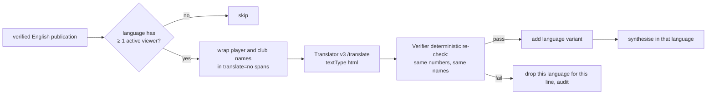

# 10 Voice and live translation

Status: **Agreed design**. Last reviewed 22 Oct 2026. Backlog: EXP-8, EXP-16, EXP-17.

## 1. Languages and voices

| Language | Code | Voice (commentary) | Voice (analyst) | Status |
| --- | --- | --- | --- | --- |
| English | `en` | `en-GB-RyanNeural` | `en-GB-SoniaNeural` | v1 |
| Spanish | `es` | `es-ES-ElviraNeural` | `es-ES-ElviraNeural` | v1 |
| Hindi | `hi` | `hi-IN-SwaraNeural` | `hi-IN-SwaraNeural` | v1 |
| Portuguese | `pt` | `pt-BR-FranciscaNeural` | `pt-BR-FranciscaNeural` | v1.1 (CREW-7.10): browser voice on checked lines, `apps/unified/voices.json` |
| Tamil | `ta` | none | none | Off until a native speaker reviews it |

Voices are configured only in `services/api/config/voices.json`. Player voices for Talk are assigned there by `player_id`. The contracts' `language` enum becomes `en | es | hi | ta` in v1.1.

## 2. Text to speech (commentary)

- Synthesis runs in `api` (`services/api/app/voice.py`), never in the browser. It calls the Speech neural TTS REST endpoint on the custom domain (`SPEECH_ENDPOINT`/tts/cognitiveservices/v1) with the api's managed identity (role Cognitive Services User on `spch-matchcast-dev`, S0, East US 2). No key.
- Built (23 Oct, EXP-16): English only, output MP3 24 kHz mono. Voices live in `services/api/config/voices.json` (commentary, producer, player default). Each player has his own voice: an explicit override by player id wins; every other player keeps one voice from the `players.pool` list, chosen by a stable hash of his id (so he sounds the same every time). The route `GET /v1/matches/{match_id}/lines/{line_id}/audio.mp3` voices a line on air (any age: the route does not apply the 5 s rule), and `GET /v1/voice/audition.mp3` serves the 30-second audition clip. The browser does not call them yet (see 6a). Clips are cached in process (300 at most), keyed by a hash of voice and text; a clip is made only for approved text, so an audio id names only what the api voiced. Limits: 1,000 characters a clip, 30 new clips a minute per IP (a talk reply that is over the allowance is shown unspoken), and a process-wide character budget (`SPEECH_MAX_CHARS`, default 200,000) as a cost cap.
- Built (24 Oct, EXP-8 task 201): every new clip is also written to the `audio` container of the storage account as `clips/<key>.mp3` (managed identity, Storage Blob Data Contributor; `STORAGE_BLOB_URL`). A clip is looked up in memory, then in Blob, then synthesised; a clip found in Blob is not charged to the character budget, and an `audio_url` from before a restart still plays. A Blob error only means the clip is made fresh and not kept; it never fails a request. Without `STORAGE_BLOB_URL` (local runs, tests) clips stay in process memory. Lifecycle: the clips are small and keyed by a hash, so there is no expiry yet. **Planned:** es and hi voices (waiting for checked translations). The browser plays the api clip when Voice is on; `audio_url` on a stream publication is an api-only extra field, not part of the contract packet.
- Lines older than 5 s (publication expiry) are captioned but not voiced. At most one line is voiced at a time per view; a priority 1 line interrupts.
- Every line is synthesised live (Akshay, 21 Oct: no pre-rendered audio counted against the plan).

## 3. Speech to text (Talk and voice questions)

- The browser uses the Speech SDK with a short-lived token from `GET /v1/speech/token` (10 minutes, issued by `api` with the managed identity). No key reaches the browser.
- Push-to-talk only; typed input is always available. Recognition language follows the viewer's language picker.
- The recognised text goes to `/talk` or `/ask` like typed text, so Prompt Shields and the Verifier apply.

## 4. Live translation

Rules:
1. Only verified English text is ever translated. Agents always work in English.
2. "Active viewer" means a browser that sent a heartbeat with that language in the last 30 s (SSE query parameter `lang`). Translation also stops after 500,000 characters in total (`TRANSLATOR_MAX_CHARS`, about $5 at the S1 price); after that, lines stay English with the note "Translation paused".
3. Translator resource `tr-matchcast-dev`, S1, with a custom subdomain so managed identity works (role Cognitive Services User).
4. The re-check compares the sets of numbers (digits normalised to ASCII from Devanagari, Arabic-Indic and full-width, Arabic decimal separators read as points) and names between English and the translation, and rejects any competition or federation name (neutral wording, ADR-0023). Any difference drops that language for that line.
5. Captions show in the chosen language. If a line has no variant in that language, the English line shows with a small "EN" tag.
6. Ask and Talk answers are translated the same way before they are shown.

Built (22 Oct, `matchcast_agents/translate.py`; ten languages from 25 Oct, ADR-0023): `GET /stream?lang=` takes any of `en, es, pt, hi, ar, fr, de, id, ja, zh-Hans` and adds `variants: {<lang>: text}` to each publication that passed the re-check, and `POST /ask` with `lang` adds the same `variants` to its reply. The base packet stays English, so the contract's `language` enum does not change; variants are not stored. One Translator call per line and language, shared by every viewer. The re-check compares numbers (Devanagari digits and decimal commas normalised), names and `[claim:]`/`[kb:]` markers; a failure keeps the English and writes a `translation_rejected` audit record with the reason. Past the `TRANSLATOR_MAX_CHARS` cap (default 500,000) or with no `TRANSLATOR_ENDPOINT`, lines stay English and nothing is audited. The Translator is called with the api's managed identity (`TRANSLATOR_ENDPOINT` custom domain, optional `TRANSLATOR_REGION`). `lang=ta` is refused with 422 until Tamil is reviewed. Limits: the character cap counts the HTML sent and lives in one api process, so it resets on restart; the number check compares the set of numbers, so swapped numbers pass (decimal points are kept, so 2.5 and 25 differ); results are shared per session and match, and a failed or paused attempt is retried by the next viewer. Clients must render `variants` as text, not HTML. **Planned:** deployment is in Bicep (22 Oct, #121: the Translator account, `TRANSLATOR_ENDPOINT` from its custom subdomain, `TRANSLATOR_REGION`, and Cognitive Services User for the api identity) but has not been provisioned or called against Azure, a client that reads `variants` (none does yet), the heartbeat-based active-viewer count (a stream with `lang` is the signal today), the `Translation paused` note, translating `/talk` replies, and per-language voices.

The Broadcast Copilot's picks (highlights, focus, plan; ADR-0019) are not translated: the api skips the `ask` translation when the reply carries `broadcast`, and the desk reads only that block. Its wording stays English until the model-written step.

## 5. Broadcast desk script today (Simulated)
- The Broadcast desk (`apps/unified/embed/bclang.js`) writes Spanish and Hindi lines from fixed rules templates, not from Azure AI Translator (**Planned**, section 4). Each line passes the same numbers/names/order re-check as the shell; a failing line stays English and the script list shows the reason. The desk does not yet write `translation_rejected` to the audit chain, which only the shell does. The check does not judge meaning, so the Translator path must add a semantic check before it replaces the templates.
- The desk's Speak button uses the browser's `speechSynthesis` (es-ES, hi-IN) and is labelled as a simulated voice. This is the one exception to "synthesis runs in api"; it goes away when the Speech SDK path is wired.
- Tamil is out of the desk until a native speaker reviews it.
- The Broadcast Spanish and Hindi rules templates (`embed/bclang.js`) were reviewed by Claude on 23 Oct for idiom (weather, lightning, own goal), not by a native speaker. Numbers and names are checked by the Verifier after translation either way; a native review stays Planned.

## 6. Built in the browser (22 Oct)
`apps/unified/speech.js` implements the token fetch (section 3) and both directions: synthesis and push-to-talk recognition in Broadcast. It has only been tested against a fake api and a fake SDK until the Speech resource is deployed. The browser voice remains the labelled fallback.
- The SSML energy follows the feed line's tone (`speech.js`): calm (a pass, a summary) at -4% rate, `hot` (a shot or a build-up of three passes) at 0% and a higher pitch, `big` (a goal, a red card, a score claim) at +3% with emphasis. The tone is set in `feed.js`. Whether the result sounds right on the live build has not been checked by ear.

## 6a. Talk replies (EXP-16, 23 Oct)
The api's `/talk` runs the role agent, then the Verifier's number and name check, then Content Safety on the reply. Only a reply that passes all three is voiced: the response carries `audio_url` (`/v1/audio/{id}.mp3`) and `lang: en`. A refused reply is shown as the fixed refusal text with `audio_url: null`, and nothing is spoken. The browser does not yet play `audio_url`; it still uses the SDK voice. Wiring that is Experience-lane work. Content Safety is Azure when `CONTENT_SAFETY_ENDPOINT` is set, otherwise the local word list (**Simulated**).

## 7. The console's language selector (22 Oct)
The top-bar selector (the ten feed languages, ADR-0023) is the single viewer language. It re-opens the api stream with `lang` (section 4), switches Watch and Broadcast, and chooses the voice: the checked translation with its voice where there is one (en, es, pt, hi), else the English line. The desk's rules translations log `translation_rejected` through the shell. Ask answers are translated the same way. Not covered: the Analyst view is English only.

## 8. Ten feed languages (25 Oct, CREW-7.9 and 7.10, ADR-0023)

- **Languages.** `en, es, pt, hi, ar, fr, de, id, ja, zh-Hans` (Azure `zh-Hans`). The api list is `LANGUAGES` in `translate.py`, the shell and embedded views read `apps/unified/langs.js` (`MC_LANGS`). Tamil stays off.
- **Checks.** Same as section 4, plus a neutral-wording check: a translation that names a competition or federation is dropped with reason `neutral_wording`. Arabic-Indic and full-width digits compare as numbers.
- **Picker.** One select in the shell header (the `#lang-pick` control). The choice is kept in `localStorage` (`mc-lang`) and sent to Watch and the Broadcast desk.
- **Voice.** Browser voice speaks checked lines in `en, es, pt, hi` only (`voices.json`). A language without a voice shows its caption and is not read in the English voice.
- **Limits.** Watch's own picker lists only some feed languages; a line in another language is shown with its checked translation when there is one, and otherwise the English line with a 'no checked translation' label. The Broadcast desk has rules templates for `es` and `hi` only, so a desk on `pt` shows English with the note. The feed-specific spoken routes (casual, audio description, catch-me-up) wait on the feeds thread. The Speech voice for a line on air (`/lines/{id}/audio.mp3`) is still English.
- **Cost.** `TRANSLATOR_MAX_CHARS` (default 500,000 per api process) is the cap; the Translator resource is S1 in Bicep. The free tier (F0, 2M characters a month) is a Platform-lane change to make in Azure, not in code.
