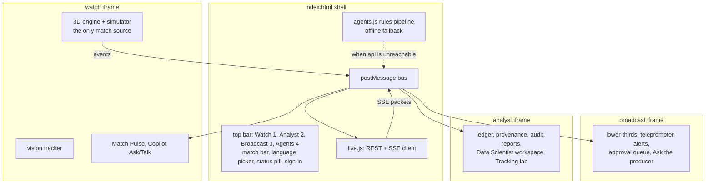

# 11 Front end (unified app)

Status: **Agreed design**. Last reviewed 22 Oct 2026. Backlog: EXP-1 to EXP-17. Current build notes: `apps/unified/README.md` (on branch `feature/unified-app`, PR #4).

## 1. Structure

- Three views, each an iframe built from its source folder by `apps/unified/build.py`, plus the shell.
- **Watch is the only engine** (EXP-2). Broadcast and Analyst run in consumer mode and render from bus messages.
- `live.js` is the only code that talks to the network. Views never call the API directly. The one exception is the vision crop upload, which goes through a `live.js` helper too.

## 2. Bus messages

All messages are `{ type, v: 1, sk, payload }`. The shell accepts engine messages only from the Watch frame's origin and only for the shared match.

| Type | From → to | Payload |
| --- | --- | --- |
| `event` | Watch → shell | contract event |
| `events_ack` | shell → Watch | last_sequence |
| `claim`, `line`, `verdict`, `publication`, `audit`, `recap_ready` | shell → all views | the SSE packet |
| `state` | shell → all views | score, clock, possession |
| `status` | shell → all views | `live`, `rules_fallback`, `offline`, `warming_up` |
| `persona`, `language` | any view → shell | viewer's choice, sent upstream as SSE query parameters |
| `persona-set` | shell → Watch | `casual` or `analyst`, from the story strip's Fan / Analyst switch |
| `ask`, `talk` | any view → shell | request; reply arrives as `ask_reply`, `talk_reply` |
| `approve`, `edit`, `kill` | Broadcast or Analyst → shell | line ID (ADR-0013) |

**Stream start.** `live.js` opens the SSE stream only after the match exists (`POST /v1/matches` answered 201 or 409), so the first connection cannot 404; if an events call answers 404 (the api lost the match), the next batch creates it again and reopens the stream.

**Full-time recap card.** When Watch reports full time against a live api, the shell polls `GET /v1/matches/{id}/recap/{persona}` (404 means not written yet; up to about two minutes) for `casual` and `broadcast` and shows a card in the matching view with the verified sentences only, their count and a "Rules fallback" (or "partly Rules fallback") label when the agents ran on rules. Listen plays `GET …/recap/{persona}/audio.mp3` through the voice path only when Voice is on; the card is absent without the live api (`tests/e2e/recap-card.spec.ts`, not run in the agent container).

## 3. Connection behaviour

| Situation | What the viewer sees | What happens |
| --- | --- | --- |
| `MATCHCAST_API` empty at build | Status pill "Offline (simulated)" | `agents.js` rules in the page |
| API cold (first request pending) | "Warming up the match engine" | Retry `/ready` every 2 s up to 45 s (Q13); after that, "Rules fallback" |
| API live | "Live agents" | REST + SSE |
| SSE drops | "Reconnecting" for up to 10 s | `EventSource` reconnects with `Last-Event-ID`; the server replays from `publications` and `audit` |
| API down for over 30 s during a match | "Rules fallback" | Switch to in-page rules; switch back when `/ready` returns 200 |

## 4. Personalisation (stage e)

| Control | Values | Effect |
| --- | --- | --- |
| Watch mode | Casual, Analyst, My club, Player focus, One metric | Persona sent to the agents; layout and density |
| My club | one of the two clubs | Lines framed from that club's angle |
| Player focus | any player on the pitch | Lines lead with that player; their name tag is highlighted |
| One metric | xG, pass quality, pressure, speed, control | Only that metric's lines |
| Language | English, Spanish, Hindi | Captions, voice, Ask and Talk replies |
| Voice | on or off | TTS playback |
| Playback | 0.25x to 2x | Live passages; quiet spells always fast-forward |

Other views can move Watch's camera with `window.MCWatch.focus({ player_id })` (the contract slug of a player's name) or `window.MCWatch.focus({ zone: 'box' | 'midfield' | 'wide' })` (the player in that zone nearest the ball). It uses Player focus mode and returns `true` only when the camera moved (`false` for an unknown player or zone, or before kick-off). Broadcast's "Go to it" button is meant to call it.

## 5. Rules for every view

1. Anything not connected is labelled "Simulated" (or the specific label in [08-analytics-and-ml.md](08-analytics-and-ml.md) §3).
2. Every published line shows its verdict mark (green tick verified, amber dot awaiting review) and a "How was this made?" link to the trace panel (EXP-6).
3. Rules-made lines show the "Rules fallback" chip.
4. Accessibility: keys 1, 2, 3 switch views; Tab order through cards; Enter opens a trace; Esc closes; an `aria-live="polite"` region reads each published line; WCAG AA contrast.
5. Performance: Watch interactive in ≤ 4 s cold on 50 Mbps; other views load on first switch; `players.json` and match files served compressed with long cache headers.
6. No secret, key or token is ever placed in the page, except the 10-minute Speech token, held in memory only.

## 6. Build and hosting

- `python3 apps/unified/build.py --api https://<api-fqdn>` writes `dist/`. The API base URL is injected as `window.MATCHCAST_API`.
- The `web` container (`nginx:1.27-alpine`) serves `dist/` with brotli/gzip, `Cache-Control: public, max-age=31536000, immutable` for hashed assets and `no-cache` for `index.html`.
- Content Security Policy: `default-src 'self'; script-src 'self' https://cdn.jsdelivr.net; connect-src 'self' https://<api-fqdn> https://*.tts.speech.microsoft.com https://*.stt.speech.microsoft.com wss://*.stt.speech.microsoft.com; img-src 'self' data: blob:; media-src 'self' https://<api-fqdn> blob:`.
- The shell head preconnects to the CDN and `modulepreload`s `three.module.js` so Watch and Broadcast find it in the HTTP cache (EXP-15). The version must equal `CDN` in `build.py`.

### Focused Analyst mode (refocus, 24 Oct)
`apps/unified/analyst-pages/70_focus.js` reshapes the Analyst console for the judge path. The nav shows five entries under **This match**: Live match (the new landing page, `#live.<fixture>`), Match centre, Ask the match, How was this made?, and Match library. **More** holds Scouting, Opposition report, Set pieces, Tactical board, Query explorer, Reports, Audit log, Agent operations and Users and access.
The Data science and Platform pages are not in the nav any more. They stay registered and open by route, and their code is not deleted.
- Match centre has five tabs: Overview, Shots, Patterns (pass network and average shape), Players, Verifier. The headline comparison stays in Overview's at-a-glance card; the full team table and the event log are no longer tabs (the event log is still one CSV export).
- Live match reads the shell's feed (`pushFeed` in `index.html`): Watch's score, minute, stats (xG, shots, possession, completed passes) and last five events. It is labelled 'Live from Watch · the simulated match engine'. With no live feed it shows the season run for the fixture and says so. PPDA is shown at full time only.
- Ask the match sends the question to the shell (`window.mcAskShell` in `embed/analyst.js`), which answers through the api or the rules, as it does for Watch. Answers say whether the Verifier checked them.
- How was this made? lists each agent insight of the match with its Verifier verdict, from the recorded run. It does not open the live trace panel yet.
- Tests: `tests/e2e/analyst-focus.spec.ts`.

### Analyst Data platform page (EXP-13)
`apps/unified/analyst-pages/10_data_platform.js` adds the Data platform page (not in the focused nav since 24 Oct; open it with `go('data-platform')`). It shows the Fabric clip/screenshot and the Databricks model card from `shared/` (copied from `apps/unified/platform-assets/` by `build.py`). Until DAT-8 / DAT-6 supply the files each block is labelled Planned. The card moves to a Blob read through the api when DAT-6 lands.

### Broadcast instant replay (AB#360)
`apps/unified/embed/replay.js`, appended to the Broadcast view after `broadcast.js`. A capture listener on the `frame` bus message keeps the last 60 s of Watch's frames in the page (not persisted). The producer can replay the last 10, 20 or 30 s at normal or half speed; the view then shows the buffered player and ball positions while clock, score and stats stay live, with a REPLAY tag, and returns to live by itself or on Back to live. Events and agent lines are never replayed. Overlays for this view must sit inside `#bc-view` (the desk's CSS hides other children of `body`). At 560 px and below the bar is one row (the three clip buttons and the Slow-mo switch, the first button marked with a ↺; the heading is hidden but the group keeps its "Instant replay" name, because a heading or a second row left no room above the lower-third in the 260 px phone stage). While a replay plays (class `rp-on`) "Back to live" takes the clips' place, so the bar stays one row, each button and the Slow-mo label a 44 px target, no label breaking across lines, and Back to live still hidden until a replay plays (UX review pass 5). Test: `replay-phone.spec.ts`.

### Broadcast action poses (AB#361)
Watch's 4 Hz `frame` message carries a sixth element per player, `actOf(p.act)` in `embed/watch.js`: the current action (type, kind, power, timing, foot, side and so on) or 0. Broadcast's `consumerStep` takes the action when a new frame arrives, replaces its own only when the type changes or the clocks differ by more than 0.35 s, and runs the action clock itself between frames because the desk never calls `stepSim`. The pose code is the engine's own `animate`. The frame also carries the referee and assistants (position, yaw, current signal or flag); Broadcast places them, takes the signal once per frame and runs its clock.

### Broadcast on-air log (AB#362)
`apps/unified/embed/onair.js` keeps the lines the shell sent as `air` (approved lines only, from the shell window) and exports them as `matchcast.onair/1` JSON for external graphics tools, with the file's SHA-256 shown. The content is marked `simulated: true` while the agents are the in-page rules.

## Status dialog and Analyst service status (22 Oct)

The top bar has a Status button beside the api pill. It opens a dialog built by `apps/unified/status.js` from `GET {MATCHCAST_API}/v1/status` (doc 12): every dependency as Live, Simulated, Planned or Unavailable, with the api's own detail text. With no api configured, or no answer in 8 s, it says the console runs on in-page stand-ins (simulated); the page never invents a state. The Analyst's Platform > Service status page shows the same table in a card above its checks (`analyst-pages/50_service_status.js`; the card is redrawn with the page from a cached answer). Text is set with `textContent`. Tested in `tests/e2e/connection.spec.ts` and `analyst.spec.ts`.

## Live stream cards and Talk (Experience)

- `agents.js` `ingest` maps the api stream as follows. A `claim` event is evidence (a ledger row). A `publication` event is the card a viewer sees (`pub-<line_id>`, labelled "API-Verified"); it is not a ledger row, and it marks the claims in its `claim_ids` verified. A `line` event only updates an existing card: `abstained`, `rejected` and `killed` mark it abstained, and `checks[]` is kept.
- Typing to a player in Watch also calls `POST /v1/matches/{id}/talk` through `live.js`. Only a `verified` reply with non-empty `facts` joins the chat, shown as "Checked against the match record". Offline or without a match, nothing is added. `/talk` shares the `/ask` rate limit, and a player with no events yet returns 404; both leave the chat unchanged.
- Ask answers from the api carry a source chip (Watch shows it in brackets, Broadcast in the tag) built by `live.js` from `intent` and `retrieval`: `from the match record` (live question), `from the knowledge base` (BM25 over `kb/`), `from AI Search`, or `Search fallback` (AI Search was tried and the knowledge base answered). Refusals and out-of-scope answers show no chip. The chip text stays English in Spanish and Hindi.
- Voice (EXP-8, EXP-16): a published line's `audio_url` and a verified talk reply's `audio_url` are the api's Azure Speech clips. The shell plays them through `voice.js` only when the **Voice** button is on (that button is the mute control; captions always show); a rejected reply is neither shown nor spoken. When an api is configured, a **Voice sample** button plays `/v1/voice/audition.mp3` on click, even with Voice off, and says "Voice sample unavailable" if it cannot. Without the api, speech falls back to the browser voice, labelled as simulated.
- The Analyst Data platform page reads the danger model card from `GET /v1/models/danger/card` when an api is configured, and from `shared/model-card.json` if a build ships one (none does today); with neither, the block says Planned (DAT-6). The page says which source it used. The card describes the danger model whether it was trained locally or in Databricks; the Databricks job itself is Planned. The Fabric clip stays Planned until DAT-8 produces it.
- Watch labels (from the screenshot review): the commentary card says `COMMENTARY · CHECKED IN PAGE · SIMULATED` because Watch writes and checks those lines in the page (API-Verified lines are the Match Pulse cards); Watch's xG rows say `xG (engine)` because the Verifier uses the shared model and the two differ on low-value shots; the Analyst sparkline panel sits beside the Match Pulse panel on screens 1100 px and wider, and inside it on narrower ones.

## Continuous commentary feed (live commentary)
- `apps/unified/feed.js` (`CM`) keeps one ordered feed for Watch and Broadcast: every Watch moment and key event, plus a recounted summary for any two-minute quiet stretch, so the feed never goes silent during a match.
- Booth voices (`index.html` `voiceFeed`): each new feed line is voiced once, when it arrives (`VC` drops a line older than 5 s). Play-by-play lines use the play-by-play voice; summaries and the agents' lines use the analyst voice. A big line swells the crowd bed.
- Crowd bed (`voice.js`, simulated): a brown-noise murmur under the commentary while Voice is on. It is synthesised, not a recording, and the Voice line labels it `crowd bed (simulated)`.
- Play-by-play (`CM`'s `callPlay`): the booth calls the newest pass, tackle, interception or foul every 0.2 match minutes (about 12 s of match time). The line names the player and club from the event. A run of three or more passes by one side, with no action by the other side in between and within one match minute, is counted from the events (`Rules · recounted`). A tackle line says the player challenged, not who won the ball, because the batch carries no outcome.
- Each feed line carries `numbers`, the same shape as an air line's: `[{name, value}]`, the values it was counted from (an xG on a shot line, the passes in a run). A line with no counted numbers has an empty list.
- Each feed line keeps the persona in effect when it was written (`casual`, `analyst`, `broadcast`, or a lens such as `club:<key>`), set from the shell's `persona` messages through `CM.setPersona`. The Broadcast desk uses it to show which lens wrote a line. Play lines keep the feed moving between key events, so the two-minute summary rarely fires.
- The api's checked line (`publication`) replaces the rules line for the same match minute or joins the feed, labelled `Live agents · verified`; rules lines are labelled `Rules · recounted`. Each line lists the agents that made it.
- The shell posts `feed-lines` to Watch and Broadcast (at most every 200 ms); `embed/feed.js` draws the newest line and the list. Voice reads big moments with SSML (`speech.js`).
- Limit: the api narrates only the moments its Producer scores at 60 or more (goals, red cards, shots on target, half time, periodic summaries), so most lines in the feed come from the in-page rules until the live model keeps pace.

## UX review pass 1 (24 Oct): shell and phone Watch
- Header: the utilities (Tour, Voice, EN/ES/हिन्दी, the agents pill, Status, the Azure label) are one row. On a phone (≤ 560 px) that row scrolls sideways and the agents pill comes first, so the header is three short rows and the view gets about 60 percent of an 844 px screen. Chips and pills are at least 32 px tall, with 12 px type in the pills, chips, match-bar labels and tour (the Agents tab tables are unchanged). `#voice-src` is a live region and is not drawn while it is empty. The agents pill reads "Agents · Offline (simulated)" so it is not mistaken for the engine chips ("Same fixture as Analyst", "Match engine running here").
- The fixture list reads "A v B (recorded 3–3)" and the score label says "Recorded", because a finished season result is not the live score at 0:00. On a phone the meta line (unless it shows a season load error) and the engine chip are hidden, and the toast moves to the top.
- Watch at ≤ 640 px: the Vision tracker still starts with the match, but its panel starts closed. The Vision button and the panel's close button show and hide the panel only; pass 7 made this true at every width, so no viewer turns the tracker off from the HUD. The live stats strip is hidden (Match data holds the numbers) so it does not sit under the Match Pulse bar. Tests: `shell-layout.spec.ts`, `watch-phone-overlays.spec.ts`.

## UX review pass 1 (24 Oct): Analyst presentation
`analyst-pages/80_polish.js` and `embed/analyst.js`: the recap sentence under the scoreboard carries a "Template recap · simulated" chip (the simulator's template writes it, no model). The "Live from Watch" pill sits bottom right and hides on the Live match page, while the Copilot drawer is open, and at ≤ 820 px, where the page or the shell's match bar already shows the score. On a phone the control, chaos and tempo table stacks label, value and sparkline (the sparkline keeps its own width), and the Copilot button shows a short "Ask" label (its accessible name is set to "Ask Copilot"). The pill also hides while the Copilot drawer is open. Test: `analyst-polish.spec.ts`.

## UX review pass 1 (24 Oct): the story strip, loading skeleton and demo pace
- Under the match bar (hidden below 820 px) the story strip names the five stages of one moment with live counters from `AG.run.stat`: 1 Ingest (events), 2 Interpret (claims with evidence), 3 Explain (verified lines), 4 Render (the view on screen), 5 Personalise. The first four open the Agents tab or Watch; the counters read "waiting for kick-off" until Watch has started the shared match.
- 5 Personalise holds a labelled Fan / Analyst switch. It posts `persona-set` (`casual` or `analyst`) to Watch, which calls `fanSet`; Watch's own picker still offers club, player and metric modes, and the strip then says "Showing: club · …" instead of lighting either button. The mode is also written to Watch's `mcx-mode` so a reload keeps it.
- "⏩ Demo at 4× speed" links to `?seed=2026&speed=4#watch` (the filming URL) and hides when the page is already at 4×.
- While the 3D engine loads, Watch and Broadcast show a dashed skeleton of the layout to come (score bar, pitch, moments, commentary) behind the loader text. The skeleton is `aria-hidden`, so the loader's `role=status` text is unchanged. The engine chip is blue (running), so it is not read as the amber Simulated label. On a desktop the match bar is one row and its meta line ends in an ellipsis with the full text as its tooltip. Tests: `story-strip.spec.ts`, `loading-skeleton.spec.ts`.

## UX review pass 3 (24 Oct)
- Watch: the Match Pulse, Vision, data and stats panels (`#pulse`, `#visp`, `#datap`, `#fan-strip`) use a fully opaque `--panel` (96 percent in the first cut, pass 4 made it solid after a faint label still showed), so player name labels no longer show through them, and the Match Pulse control line wraps under its label instead of running into it (`embed/watch.js`). Test: `watch-desktop-panels.spec.ts`.
- Phone shell: the story strip shrinks to one "Viewing as" row with the 44 px Fan | Analyst switch (the stage links and the demo link stay desktop only); the utility row ends in a visible › cue that goes at the end of the scroll; the phone stage floor in `shell-layout.spec.ts` is 480 px (was 500) because the Viewing-as row and the 44 px switch take their share; the toast sits under the story row (`--toast-top`, set when it shows), clear of the brand and the bottom controls; the engine chip is hidden and the sync chip stays. Tests: `story-strip.spec.ts`, `shell-layout.spec.ts`, `watch-phone-overlays.spec.ts`.

## UX review pass 6 (24 Oct): 12 px type floor, one icon cue
- No readable text in the default Watch, Analyst and Broadcast views is below 12 px (panels that only open on demand, such as the Analyst-mode sparkline panel and the push-to-talk status, are in the same rule blocks but are not measured by the spec). Each view gets one rule block with `!important` for the selectors that were 9 to 11 px (Watch `embed/watch.js`, Broadcast `embed/broadcast.js`, Analyst `analyst-pages/80_polish.js`), and the shell's Agents tab tag and table heads moved to 12 px. The source views stay untouched. Left small on purpose: the 3D player name labels on the pitch (`.lbl`) and SVG axis text, which would crowd the pitch. Test: `type-floor.spec.ts` (Watch, Analyst and Broadcast at 1440 px and 390 px, with a no-sideways-scroll check).
- Icons: the shell's Demo link uses an inline SVG instead of the ⏩ emoji, so it looks the same on every OS. The emoji inside the views (📊 👁 on Watch buttons, the weather chips, 🎤 on push-to-talk) come from the prototype sources or other lanes' hooks and are not replaced here; that is a candidate for a later pass, because replacing them means editing the prototype sources or other lanes' hooks.

## UX review pass 7 (25 Oct): the first screen tells the story
- Phone toast: it takes the place of the Viewing-as row for its 2.6 s (`--toast-top` and `--toast-h` are set when it shows, the text is 12 px and clipped to the row), so it no longer covers the scoreboard in the view. Test: `watch-phone-overlays.spec.ts`.
- Watch Vision: the tracker still starts at kick-off and feeds the agents, but the Vision panel (accuracy figures) and the detection boxes (which doubled the 3D name tags) start closed at every width. The Vision button and the panel's close button only show or hide the panel, so the tracker can no longer be turned off from the HUD; the Boxes button inside the panel turns the boxes on. Test: `watch-first-screen.spec.ts`.
- Watch bottom cards: the On-the-ball card sits to the right of the Live commentary card on a desktop wider than 1100 px (it used to be hidden underneath it) and is hidden at 1100 px and below, where there is no room beside the commentary card and the commentary says the same thing (`embed/watch.js`). Test: `watch-first-screen.spec.ts`.
- Analyst Live match at 0': Watch's own "vision on" line is not listed as a match event, and the page says "Waiting for kick-off in Watch" with an empty-state line until the first event. Test: `analyst-polish.spec.ts`.
- Shell theme (not changed): the shell header stays dark above a light Analyst page on purpose, as the dark frame the views sit in (see the `--bg` comment in `apps/unified/index.html`). A light shell would mean re-checking every chip, pill and gradient for contrast the day before submission, so it is a candidate for after the deadline.

## UX review pass 8 (25 Oct): a visible way in to talking to a player
- Watch has a "Talk to a player" button beside the Copilot button (`embed/watch.js`, `#mcx-talk`): a 44 px target, positioned from the Copilot button's own rectangle so it follows the layout on desktop and phone, hidden while the Copilot drawer is open. It sits next to the Copilot button in the tab order, has a focus ring, and is hidden whenever the Copilot button is (before kick-off, in Setup, in director mode) or the sim's `openTalk()` is missing; between 561 and 1200 px it stacks under the Copilot button (the camera chips crowd its left there), and on a very narrow screen it stacks above it instead of overlapping it. It calls `openTalk()`, which opens the Copilot Talk tab (roster, Follow, message box). Clicking a name tag on the pitch still does the same. The button promises nothing about replies: the Talk tab labels each reply, and typed questions are checked against the match record only when the agent api is connected (otherwise a labelled rules fallback answers; quick orders are only role-checked). The tour's Watch step names the control. Tests: `watch-talk-entry.spec.ts` (1440, 1024, 390 and 320 px, plus close and reopen), `tour.spec.ts`.

### Pass 8, second batch (25 Oct): cards that covered each other, the Vision boxes, the recorded match
- Bottom-left cards in Watch are docked by one function (`dock()` in `embed/watch.js`, on a one second timer, on resize and after clicks). The Live commentary card, opened or closed, never covers Match Pulse's Key moments text: above 1100 px it moves to the right of the Pulse column when it would overlap, below that its list is shortened (never under 72 px). The followed-player card (`#fan-pcard`, Player cam) used to sit under the commentary card; above 1100 px it docks to the right of it and the On-the-ball card moves further right, below that it stacks above the commentary card. Spec: `watch-docked-cards.spec.ts` (1440, 1280, 1024, 390).
- Vision detection boxes were one-pixel lines. `embed/vision-events.js` wraps the overlay canvas's `stroke` and `strokeRect` so boxes get a 2.5 px line and a soft glow in their own colour. On screens wider than 1100 px the boxes are drawn from kick-off (the panel stays closed); on phones and small laptops they stay off until asked for, because there they sit on top of the 3D name tags.
- Analyst's Live match page, when Watch is not feeding it, shows a "Recorded match · not live" chip and a line saying the numbers are the season run's full-time figures (`#live-recorded`, `analyst-pages/70_focus.js`). The existing Simulated source line stays. With the feed on, the chip is not shown. Spec: `analyst-focus.spec.ts`.
