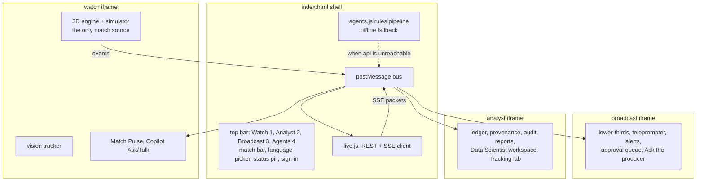

# 11 Front end (unified app)

Status: **Agreed design**. Last reviewed 22 Oct 2026. Backlog: EXP-1 to EXP-17. Current build notes: `apps/unified/README.md` (on branch `feature/unified-app`, PR #4).

## 1. Structure

- Three views, each an iframe built from its source folder by `apps/unified/build.py`, plus the shell.
- **Watch is the only engine** (EXP-2). Broadcast and Analyst run in consumer mode and render from bus messages.
- `live.js` is the only code that talks to the network. Views never call the API directly. The one exception is the vision crop upload, which goes through a `live.js` helper too.

## 2. Bus messages

All messages are `{ type, v: 1, sk, payload }`. The shell accepts engine messages only from the Watch frame's origin and only for the shared match.

| Type | From → to | Payload |
| --- | --- | --- |
| `event` | Watch → shell | contract event |
| `events_ack` | shell → Watch | last_sequence |
| `claim`, `line`, `verdict`, `publication`, `audit`, `recap_ready` | shell → all views | the SSE packet |
| `state` | shell → all views | score, clock, possession |
| `status` | shell → all views | `live`, `rules_fallback`, `offline`, `warming_up` |
| `persona`, `language` | any view → shell | viewer's choice, sent upstream as SSE query parameters |
| `ask`, `talk` | any view → shell | request; reply arrives as `ask_reply`, `talk_reply` |
| `approve`, `edit`, `kill` | Broadcast or Analyst → shell | line ID (ADR-0013) |

**Stream start.** `live.js` opens the SSE stream only after the match exists (`POST /v1/matches` answered 201 or 409), so the first connection cannot 404; if an events call answers 404 (the api lost the match), the next batch creates it again and reopens the stream.

**Full-time recap card.** When Watch reports full time against a live api, the shell polls `GET /v1/matches/{id}/recap/{persona}` (404 means not written yet; up to about two minutes) for `casual` and `broadcast` and shows a card in the matching view with the verified sentences only, their count and a "Rules fallback" (or "partly Rules fallback") label when the agents ran on rules. Listen plays `GET …/recap/{persona}/audio.mp3` through the voice path only when Voice is on; the card is absent without the live api (`tests/e2e/recap-card.spec.ts`, not run in the agent container).

## 3. Connection behaviour

| Situation | What the viewer sees | What happens |
| --- | --- | --- |
| `MATCHCAST_API` empty at build | Status pill "Offline (simulated)" | `agents.js` rules in the page |
| API cold (first request pending) | "Warming up the match engine" | Retry `/ready` every 2 s up to 45 s (Q13); after that, "Rules fallback" |
| API live | "Live agents" | REST + SSE |
| SSE drops | "Reconnecting" for up to 10 s | `EventSource` reconnects with `Last-Event-ID`; the server replays from `publications` and `audit` |
| API down for over 30 s during a match | "Rules fallback" | Switch to in-page rules; switch back when `/ready` returns 200 |

## 4. Personalisation (stage e)

| Control | Values | Effect |
| --- | --- | --- |
| Watch mode | Casual, Analyst, My club, Player focus, One metric | Persona sent to the agents; layout and density |
| My club | one of the two clubs | Lines framed from that club's angle |
| Player focus | any player on the pitch | Lines lead with that player; their name tag is highlighted |
| One metric | xG, pass quality, pressure, speed, control | Only that metric's lines |
| Language | English, Spanish, Hindi | Captions, voice, Ask and Talk replies |
| Voice | on or off | TTS playback |
| Playback | 0.25x to 2x | Live passages; quiet spells always fast-forward |

## 5. Rules for every view

1. Anything not connected is labelled "Simulated" (or the specific label in [08-analytics-and-ml.md](08-analytics-and-ml.md) §3).
2. Every published line shows its verdict mark (green tick verified, amber dot awaiting review) and a "How was this made?" link to the trace panel (EXP-6).
3. Rules-made lines show the "Rules fallback" chip.
4. Accessibility: keys 1, 2, 3 switch views; Tab order through cards; Enter opens a trace; Esc closes; an `aria-live="polite"` region reads each published line; WCAG AA contrast.
5. Performance: Watch interactive in ≤ 4 s cold on 50 Mbps; other views load on first switch; `players.json` and match files served compressed with long cache headers.
6. No secret, key or token is ever placed in the page, except the 10-minute Speech token, held in memory only.

## 6. Build and hosting

- `python3 apps/unified/build.py --api https://<api-fqdn>` writes `dist/`. The API base URL is injected as `window.MATCHCAST_API`.
- The `web` container (`nginx:1.27-alpine`) serves `dist/` with brotli/gzip, `Cache-Control: public, max-age=31536000, immutable` for hashed assets and `no-cache` for `index.html`.
- Content Security Policy: `default-src 'self'; script-src 'self' https://cdn.jsdelivr.net; connect-src 'self' https://<api-fqdn> https://*.tts.speech.microsoft.com https://*.stt.speech.microsoft.com wss://*.stt.speech.microsoft.com; img-src 'self' data: blob:; media-src 'self' https://<api-fqdn> blob:`.
- The shell head preconnects to the CDN and `modulepreload`s `three.module.js` so Watch and Broadcast find it in the HTTP cache (EXP-15). The version must equal `CDN` in `build.py`.

### Analyst Data platform page (EXP-13)
`apps/unified/analyst-pages/10_data_platform.js` adds Platform > Data platform. It shows the Fabric clip/screenshot and the Databricks model card from `shared/` (copied from `apps/unified/platform-assets/` by `build.py`). Until DAT-8 / DAT-6 supply the files each block is labelled Planned. The card moves to a Blob read through the api when DAT-6 lands.

### Broadcast instant replay (AB#360)
`apps/unified/embed/replay.js`, appended to the Broadcast view after `broadcast.js`. A capture listener on the `frame` bus message keeps the last 60 s of Watch's frames in the page (not persisted). The producer can replay the last 10, 20 or 30 s at normal or half speed; the view then shows the buffered player and ball positions while clock, score and stats stay live, with a REPLAY tag, and returns to live by itself or on Back to live. Events and agent lines are never replayed. Overlays for this view must sit inside `#bc-view` (the desk's CSS hides other children of `body`).

### Broadcast action poses (AB#361)
Watch's 4 Hz `frame` message carries a sixth element per player, `actOf(p.act)` in `embed/watch.js`: the current action (type, kind, power, timing, foot, side and so on) or 0. Broadcast's `consumerStep` takes the action when a new frame arrives, replaces its own only when the type changes or the clocks differ by more than 0.35 s, and runs the action clock itself between frames because the desk never calls `stepSim`. The pose code is the engine's own `animate`. The frame also carries the referee and assistants (position, yaw, current signal or flag); Broadcast places them, takes the signal once per frame and runs its clock.

### Broadcast on-air log (AB#362)
`apps/unified/embed/onair.js` keeps the lines the shell sent as `air` (approved lines only, from the shell window) and exports them as `matchcast.onair/1` JSON for external graphics tools, with the file's SHA-256 shown. The content is marked `simulated: true` while the agents are the in-page rules.

## Status dialog and Analyst service status (22 Oct)

The top bar has a Status button beside the api pill. It opens a dialog built by `apps/unified/status.js` from `GET {MATCHCAST_API}/v1/status` (doc 12): every dependency as Live, Simulated, Planned or Unavailable, with the api's own detail text. With no api configured, or no answer in 8 s, it says the console runs on in-page stand-ins (simulated); the page never invents a state. The Analyst's Platform > Service status page shows the same table in a card above its checks (`analyst-pages/50_service_status.js`; the card is redrawn with the page from a cached answer). Text is set with `textContent`. Tested in `tests/e2e/connection.spec.ts` and `analyst.spec.ts`.

## Live stream cards and Talk (Experience)

- `agents.js` `ingest` maps the api stream as follows. A `claim` event is evidence (a ledger row). A `publication` event is the card a viewer sees (`pub-<line_id>`, labelled "API-Verified"); it is not a ledger row, and it marks the claims in its `claim_ids` verified. A `line` event only updates an existing card: `abstained`, `rejected` and `killed` mark it abstained, and `checks[]` is kept.
- Typing to a player in Watch also calls `POST /v1/matches/{id}/talk` through `live.js`. Only a `verified` reply with non-empty `facts` joins the chat, shown as "Checked against the match record". Offline or without a match, nothing is added. `/talk` shares the `/ask` rate limit, and a player with no events yet returns 404; both leave the chat unchanged.
- Ask answers from the api carry a source chip (Watch shows it in brackets, Broadcast in the tag) built by `live.js` from `intent` and `retrieval`: `from the match record` (live question), `from the knowledge base` (BM25 over `kb/`), `from AI Search`, or `Search fallback` (AI Search was tried and the knowledge base answered). Refusals and out-of-scope answers show no chip. The chip text stays English in Spanish and Hindi.
- Voice (EXP-8, EXP-16): a published line's `audio_url` and a verified talk reply's `audio_url` are the api's Azure Speech clips. The shell plays them through `voice.js` only when the **Voice** button is on (that button is the mute control; captions always show); a rejected reply is neither shown nor spoken. When an api is configured, a **Voice sample** button plays `/v1/voice/audition.mp3` on click, even with Voice off, and says "Voice sample unavailable" if it cannot. Without the api, speech falls back to the browser voice, labelled as simulated.
- The Analyst Data platform page reads the danger model card from `GET /v1/models/danger/card` when an api is configured, and from `shared/model-card.json` if a build ships one (none does today); with neither, the block says Planned (DAT-6). The page says which source it used. The card describes the danger model whether it was trained locally or in Databricks; the Databricks job itself is Planned. The Fabric clip stays Planned until DAT-8 produces it.
- Watch labels (from the screenshot review): the commentary card says `COMMENTARY · CHECKED IN PAGE · SIMULATED` because Watch writes and checks those lines in the page (API-Verified lines are the Match Pulse cards); Watch's xG rows say `xG (engine)` because the Verifier uses the shared model and the two differ on low-value shots; the Analyst sparkline panel sits beside the Match Pulse panel on screens 1100 px and wider, and inside it on narrower ones.

## Continuous commentary feed (live commentary)
- `apps/unified/feed.js` (`CM`) keeps one ordered feed for Watch and Broadcast: every Watch moment and key event, plus a recounted summary for any two-minute quiet stretch, so the feed never goes silent during a match.
- Play-by-play (`CM`'s `callPlay`): the booth calls the newest pass, tackle, interception or foul every 0.2 match minutes (about 12 s of match time). The line names the player and club from the event. A run of three or more passes by one side, with no action by the other side in between and within one match minute, is counted from the events (`Rules · recounted`). A tackle line says the player challenged, not who won the ball, because the batch carries no outcome. Play lines keep the feed moving between key events, so the two-minute summary rarely fires.
- The api's checked line (`publication`) replaces the rules line for the same match minute or joins the feed, labelled `Live agents · verified`; rules lines are labelled `Rules · recounted`. Each line lists the agents that made it.
- The shell posts `feed-lines` to Watch and Broadcast (at most every 200 ms); `embed/feed.js` draws the newest line and the list. Voice reads big moments with SSML (`speech.js`).
- Limit: the api narrates only the moments its Producer scores at 60 or more (goals, red cards, shots on target, half time, periodic summaries), so most lines in the feed come from the in-page rules until the live model keeps pace.
