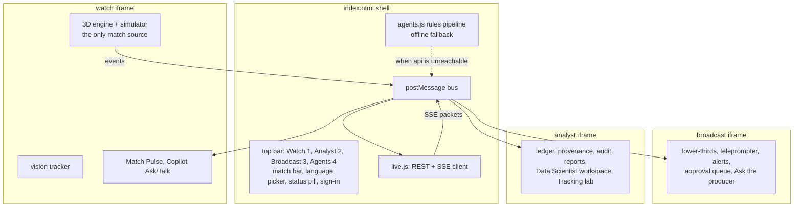

# 11 Front end (unified app)

Status: **Agreed design**. Last reviewed 26 Oct 2026. Backlog: EXP-1 to EXP-17. Current build notes: `apps/unified/README.md` (on branch `feature/unified-app`, PR #4).

## 1. Structure

- Three views, each an iframe built from its source folder by `apps/unified/build.py`, plus the shell.
- **Broadcast pane (ADR-0019):** on a window at least 900 px wide, Watch and Broadcast share the stage with a draggable divider (arrow keys too), kept per viewer. The app opens there on the live match. On a phone (under 480 px wide) one view shows at a time, and the Broadcast desk shows only its instant-replay row (the stage is about 180 px tall there). The Copilot and the production strip need a wider pane. The Broadcast desk's production strip shows the agents' trace for the last five lines on air, newest first, and its Copilot asks the api for highlights, a camera focus and a production plan.
- **Watch is the only engine** (EXP-2). Broadcast and Analyst run in consumer mode and render from bus messages.
- `live.js` is the only code that talks to the network. Views never call the API directly. The one exception is the vision crop upload, which goes through a `live.js` helper too.

## 2. Bus messages

All messages are `{ type, v: 1, sk, payload }`. The shell accepts engine messages only from the Watch frame's origin and only for the shared match.

| Type | From → to | Payload |
| --- | --- | --- |
| `event` | Watch → shell | contract event |
| `events_ack` | shell → Watch | last_sequence |
| `claim`, `line`, `verdict`, `publication`, `audit`, `recap_ready` | shell → all views | the SSE packet |
| `state` | shell → all views | score, clock, possession |
| `status` | shell → all views | `live`, `rules_fallback`, `offline`, `warming_up` |
| `persona`, `language` | any view → shell | viewer's choice, sent upstream as SSE query parameters |
| `persona-set` | shell → Watch | `casual` or `analyst`, from the story strip's Fan / Analyst switch |
| `ask`, `talk` | any view → shell | request; reply arrives as `ask_reply`, `talk_reply`. An `ask` from Broadcast with `surface: "broadcast"` asks for the Copilot's picks (ADR-0019); the answer carries them as `broadcast` |
| `queue` | shell → Broadcast | the lines waiting for a person (`items`: the line, its Verifier verdict, the repaired wording `was` when the Verifier changed it, `waiting_ms`) and the approval `mode`. A line the Verifier could not repair (`escalated`, with `escalation` in words) is marked and waits for a person, but only Kill is offered: approve, edit and Auto-air never air it. The Broadcast Producer section and the Agents queue show them |
| `panels` | Broadcast → shell | the desk's panels are up (`desk-panels.js`, before the 3D module loads): the shell lifts its loading card, while the pitch still loads underneath |
| `producer` | Broadcast → shell | `action`: `approve` or `kill` with the line `id`, or `mode` (`producer` or `demo`). The shell maps them to the approval gate in agents.js |
| `focus` | Broadcast → shell → Watch | a camera focus suggestion (`player_id`, `reason`). Watch shows it as a pill; "Go to it" moves the camera to that player (`MCWatch.focus`) and says whether it moved |
| `approve`, `edit`, `kill` | Broadcast or Analyst → shell | line ID (ADR-0013) |

**Stream start.** `live.js` opens the SSE stream only after the match exists (`POST /v1/matches` answered 201 or 409), so the first connection cannot 404; if an events call answers 404 (the api lost the match), the next batch creates it again and reopens the stream.

**Period boundaries.** Watch's engine reports `half_time` and `full_time` as data events; `live.js` sends each to `POST /v1/matches/{id}/events` as a contract `period_boundary` with `boundary: "ended"`, `clock.period` 1 at half time and 2 at full time (the same shape as `packages/agents/tests/fixtures/match-short.json`), in stream order after the events before it. They are what the half-time explainer and the full-time recap fire on. Each is sent once per match (a latch reset by `begin()`, so a stream reopen, pause or resume cannot repeat it). A match abandoned before half time sends no boundary. No `started` boundary is sent: nothing in the api consumes it. First-half stoppage time past minute 45 stays period 1, so the explainer sees the whole half (`tests/e2e/period-boundary.spec.ts`).

**Full-time recap card.** When Watch reports full time against a live api, the shell polls `GET /v1/matches/{id}/recap/{persona}` (404 means not written yet; up to about two minutes) for `casual` and `broadcast` and shows a card in the matching view with the verified sentences only, their count and a "Rules fallback" (or "partly Rules fallback") label when the agents ran on rules. Listen plays `GET …/recap/{persona}/audio.mp3` through the voice path only when Voice is on; the card is absent without the live api (`tests/e2e/recap-card.spec.ts`, not run in the agent container).

## 3. Connection behaviour

| Situation | What the viewer sees | What happens |
| --- | --- | --- |
| `MATCHCAST_API` empty at build | Status pill "Offline (simulated)" | `agents.js` rules in the page |
| API cold (first request pending) | "Warming up the match engine" | Warm-up counts up to 90 s for the api to take the first batch, then 60 s from that batch for a first claim (Q13 target stays 45 s); while batches are accepted and the stream is open the pill never drops to "Rules fallback" by itself, only a failed create or no claim in time does. The Agents tab Foundry chip and claim provenance are painted from `/v1/status` |
| API live | "Live agents" | REST + SSE |
| SSE drops | "Reconnecting" for up to 10 s | `EventSource` reconnects with `Last-Event-ID`; the server replays from `publications` and `audit` |
| API down for over 30 s during a match | "Rules fallback" | Switch to in-page rules; switch back when `/ready` returns 200 |

## 4. Personalisation (stage e)

| Control | Values | Effect |
| --- | --- | --- |
| Watch mode | Casual, Analyst, My club, Player focus, One metric | Persona sent to the agents; layout and density |
| My club | one of the two clubs | Lines framed from that club's angle |
| Player focus | any player on the pitch | Lines lead with that player; their name tag is highlighted |
| One metric | xG, pass quality, pressure, speed, control | Only that metric's lines |
| Language | English, Spanish, Hindi | Captions, voice, Ask and Talk replies |
| Voice | on or off | TTS playback |
| Playback | 0.25x to 2x | Live passages; quiet spells always fast-forward |

Other views can move Watch's camera with `window.MCWatch.focus({ player_id })` (the contract slug of a player's name) or `window.MCWatch.focus({ zone: 'box' | 'midfield' | 'wide' })` (the player in that zone nearest the ball). It uses Player focus mode and returns `true` only when the camera moved (`false` for an unknown player or zone, or before kick-off). Broadcast's "Go to it" button is meant to call it.

## 5. Rules for every view

1. Anything not connected is labelled "Simulated" (or the specific label in [08-analytics-and-ml.md](08-analytics-and-ml.md) §3).
2. Every published line shows its verdict mark (green tick verified, amber dot awaiting review) and a "How was this made?" link to the trace panel (EXP-6).
   The Agents tab also shows how the agents work, live: one lane per claim with its handoffs (Analyst, Narrator, Verifier, Producer), each marked model or rules, the agent chip taken from the api's stream status, and what Vision has sent to the api. A line the stream repeats is listed once in the Live flow.
3. Rules-made lines show the "Rules fallback" chip.
4. Accessibility: keys 1, 2, 3 switch views; Tab order through cards; Enter opens a trace; Esc closes; an `aria-live="polite"` region reads each published line; WCAG AA contrast.
5. Performance: Watch interactive in ≤ 4 s cold on 50 Mbps; other views load on first switch; `players.json` and match files served compressed with long cache headers.
6. No secret, key or token is ever placed in the page, except the 10-minute Speech token, held in memory only.

## 6. Build and hosting

- `python3 apps/unified/build.py --api https://<api-fqdn>` writes `dist/`. The API base URL is injected as `window.MATCHCAST_API`.
- The `web` container (`nginx:1.27-alpine`) serves `dist/` with brotli/gzip, `Cache-Control: public, max-age=31536000, immutable` for hashed assets and `no-cache` for `index.html`.
- Content Security Policy (documented, not yet enforced: the `web` container sends no CSP header today; `wss://` is for the talk call socket, 12-api.md): `default-src 'self'; script-src 'self' https://cdn.jsdelivr.net; connect-src 'self' https://<api-fqdn> wss://<api-fqdn> https://*.tts.speech.microsoft.com https://*.stt.speech.microsoft.com wss://*.stt.speech.microsoft.com; img-src 'self' data: blob:; media-src 'self' https://<api-fqdn> blob:`.
- The shell head preconnects to the CDN and `modulepreload`s `three.module.js` so Watch and Broadcast find it in the HTTP cache (EXP-15). The version must equal `CDN` in `build.py`.

### Focused Analyst mode (refocus, 24 Oct)
`apps/unified/analyst-pages/70_focus.js` reshapes the Analyst console for the judge path. The nav shows five entries under **This match**: Live match (the new landing page, `#live.<fixture>`), Match centre, Ask the match, How was this made?, and Match library. **More** holds Scouting, Opposition report, Set pieces, Tactical board, Query explorer, Reports, Audit log, Agent operations and Users and access.
The Data science and Platform pages are not in the nav any more. They stay registered and open by route, and their code is not deleted.
- Match centre has five tabs: Overview, Shots, Patterns (pass network and average shape), Players, Trust · Verifier. The headline comparison stays in Overview's at-a-glance card; the full team table and the event log are no longer tabs (the event log is still one CSV export).
- Live match reads the shell's feed (`pushFeed` in `index.html`): Watch's score, minute, stats (xG, shots, possession, completed passes) and last five events. It is labelled 'Live from Watch · the simulated match engine'. With no live feed it shows the season run for the fixture and says so. PPDA is shown at full time only.
- Ask the match sends the question to the shell (`window.mcAskShell` in `embed/analyst.js`), which answers through the api or the rules, as it does for Watch. Answers say whether the Verifier checked them.
- How was this made? lists each agent insight of the match with its Verifier verdict, from the recorded run. It does not open the live trace panel yet.
- Tests: `tests/e2e/analyst-focus.spec.ts`.

### Analyst Data platform page (EXP-13)
`apps/unified/analyst-pages/10_data_platform.js` adds the Data platform page (not in the focused nav since 24 Oct; open it with `go('data-platform')`). It shows the Fabric clip/screenshot and the Databricks model card from `shared/` (copied from `apps/unified/platform-assets/` by `build.py`). Until DAT-8 / DAT-6 supply the files each block is labelled Planned. The card moves to a Blob read through the api when DAT-6 lands.

### Sprint first screen: one 3D view, no camera presets (AB#497, AB#500)
The second 3D view (the Broadcast desk beside Watch, `#bc-toggle`) is off the first screen; `?split=1` still opens it for the specs. The seven Watch camera presets (`#cams`) stay in the page and are hidden by `embed/democtl.js`. The desk shows a simulated overlay feed preview (`#mc-overlay`, `embed/desk-panels.js`): the last two records of the on-air export (`window.MCOnAir.json()` in `embed/onair.js`, `matchcast.onair/1`), refreshed when a line airs. The timed stream endpoint and the overlay schema are not changed here.
**Six-up producer view (AB#475, CREW-7.6).** Each feed card in `#mc-feeds` shows, in order: the label with Kill / Resume, `Verified N · Dropped M · X lines/min (last 5 match min)`, and the last line, or `waiting for a moment` while the feed has aired nothing (never blank). Verified is the feed's aired count; Dropped counts its `feed_drop` records once each by audit id (the dropped text is never shown, only the reason in the Dropped list). Lines per minute is the lines the feed aired whose `match_time_ms` falls in the last 5 match minutes (`RATE_MIN`), divided by 5; the window ends at the newest `match_time_ms` any feed has aired, so a quiet feed's rate falls to 0.0 as the match moves on. A feed without a writer shows `Planned · no writer yet` instead of counts, driven by one list (`WRITERS` in `desk-panels.js`, casual and analyst, as in `packages/agents/matchcast_agents/feeds.py`; audio description, catch-me-up, half-time and ticker are Planned) and turns live if a record for it arrives. A Booth row above the cards shows `Booth · N waiting for approval`, the length of the approval queue the shell sends (`queue`). All text is escaped (set as `textContent`); the cards keep two columns, a 12 px floor and no sideways scroll in a 320 px desk (a 640 px pane; at 480 px and below the phone layout hides the desk body by design) (`tests/e2e/feeds-sixup.spec.ts`). Simulated: the lines are the stream's, and the rate is an aired-line count, not a quality score.

The desk also monitors the six English derived feeds (`#mc-feeds`, `embed/desk-panels.js`, simulated): each feed's Verified and Dropped counts, lines per minute and last line (see the six-up paragraph below), the Verifier drops with their reason (`reason_code`, no text), and a Kill / Resume per feed. Derived lines never wait for the producer: they air once verified, and the lines listing shows them with their status. The record fields are the `matchcast.onair/1` 1.2.0 `onair` and `feed_drop` packets (AB#498, merged; `docs/contracts.md` "Derived feed lines"). The shell (`live.js`) forwards the stream's `onair` and `feed_drop` events to the desk as `feed-air` and `feed-drop` (AB#499). A kill or resume goes from the desk to the shell (`feed-kill`), which calls `POST /v1/matches/{id}/feeds/{feed}/kill` or `/resume`: the api audits it as `feed_killed` or `feed_resumed` and returns `enforced: true`: the air gate airs nothing from a killed feed. The desk takes its lines and drops from the stream; the `?feeds=fixture` flag is gone. The desk shows a kill at once and does not read back the api's answer, so a failed stop call is not shown on the desk. `live.js` keeps the desk's kill state per feed (`deskKilled`), across matches, as the desk does. A kill made before the match is created is sent once the create succeeds (`feedsSent`), and a match created later starts with the feeds the desk has killed, so a kill is not dropped (`tests/e2e/feed-kill-before-run.spec.ts`). The desk shows a kill before the api has it: the row's label reads "Casual · killed", its status "Killed on this desk · N aired · last line" on a line of its own, cut to one line (the full text is the row's tooltip), and it claims no stop. The label and the Resume button share the first line (a grid row, so a long label wraps rather than pushing the button off it). The monitor sits under the approval queue, so a booth line approved, a feed airing, a kill and a drop read top to bottom; the six feeds are in two columns, so the Dropped list sits nearer the top of the desk. The 1920×1080 screenshots of the filming pass (AB#499, PR #402, `/mnt/project-files/filming-desk-ab499/`) checked this by eye; no test measures the desk's layout. A click on a created match goes to that match at once; a click before the match is created is held and goes out when the create succeeds, to the match then current. A held or refused call is not reported on the desk.
In Approve each line mode a booth line waits in the desk's producer list until a person approves it. An empty list means no booth line is waiting; it cannot tell a silent booth from a handled queue, so the copy says only what the list shows.

### Broadcast desk panels before the 3D engine
`apps/unified/embed/desk-panels.js` is a classic script in the Broadcast page, placed before the three.js import. It builds the production desk (the orchestration strip, the Broadcast Copilot and the lens menu) and the Producer section (the approval queue, Auto-air and event to air). The desk module (`broadcast.js` and the engine) still imports three.js first, so it cannot run the panels; the panels run without it. The panels post `{ type: 'panels' }` to the shell, which lifts its loading card on that message (`.view.panels .wait`), not on the pitch's start. The desk header's "3D pitch" label says loading until the engine starts, then live. The replay bar mounts into the desk's slot (`#mc-replay-slot`) when the desk is up. The desk module reports back two things: `window.MC_PLAYERS` (for the lens menu) and `MCDesk.lowerThird` (the lower-third it makes). With three.js blocked, the queue and the Copilot still render (`tests/e2e/desk-panels.spec.ts`). The Copilot answers with picks once the shared match has started.

### Broadcast national fixture names (EXP-14)
The desk names the fixture's clubs from its first render. `embed/boot-clubs.js` is spliced into the Broadcast module by `build.py` (`build_broadcast`): before the `TEAMS` literal it reads `h` and `a` from the frame URL and fetches `shared/clubs.json` (top-level await). Only a national fixture (both clubs labelled `synthetic squad`) is applied here; a season match keeps its built-in clubs, and before the lineups it sets each side's key, club, kits and the first eleven player names from the fixture's squads. `embed/hook.js` `names()` (before the match is built) and `started()` (at kick-off) apply the same clubs again; `applyClubs` is idempotent. A check in `tests/e2e/national-fixture.spec.ts` reads every visible line after kick-off and fails on any season club name. No buffer is kept for shell messages during that wait. The shell re-sends its state when the desk announces `feed-ready` (the approval queue, mode and commentary feed; see the desk section below), and it streams `feed-lines` at most every 200 ms, so a message lost in the wait is superseded by the next one. A buffer was tried and dropped: classic-script listeners in `desk-panels.js` already receive the message, so a replay duplicated on-air and dropped lines.

### Broadcast instant replay (AB#360)
`apps/unified/embed/replay.js`, appended to the Broadcast view after `broadcast.js`. A capture listener on the `frame` bus message keeps the last 60 s of Watch's frames in the page (not persisted). The producer can replay the last 10, 20 or 30 s at normal or half speed; the view then shows the buffered player and ball positions while clock, score and stats stay live, with a REPLAY tag, and returns to live by itself or on Back to live. Events and agent lines are never replayed. Overlays for this view must sit inside `#bc-view` (the desk's CSS hides other children of `body`). At 560 px and below the bar is one row (the three clip buttons and the Slow-mo switch, the first button marked with a ↺; the heading is hidden but the group keeps its "Instant replay" name, because a heading or a second row left no room above the lower-third in the 260 px phone stage). While a replay plays (class `rp-on`) "Back to live" takes the clips' place, so the bar stays one row, each button and the Slow-mo label a 44 px target, no label breaking across lines, and Back to live still hidden until a replay plays (UX review pass 5). Test: `replay-phone.spec.ts`.

### Broadcast action poses (AB#361)
Watch's 4 Hz `frame` message carries a sixth element per player, `actOf(p.act)` in `embed/watch.js`: the current action (type, kind, power, timing, foot, side and so on) or 0. Broadcast's `consumerStep` takes the action when a new frame arrives, replaces its own only when the type changes or the clocks differ by more than 0.35 s, and runs the action clock itself between frames because the desk never calls `stepSim`. The pose code is the engine's own `animate`. The frame also carries the referee and assistants (position, yaw, current signal or flag); Broadcast places them, takes the signal once per frame and runs its clock.

### Broadcast on-air log (AB#362)
`apps/unified/embed/onair.js` keeps the lines the shell sent as `air` (approved lines only, from the shell window) and exports them as `matchcast.onair/1` JSON for external graphics tools, with the file's SHA-256 shown. The content is marked `simulated: true` while the agents are the in-page rules.

## Status dialog and Analyst service status (22 Oct)

The top bar has a Status button beside the api pill. It opens a dialog built by `apps/unified/status.js` from `GET {MATCHCAST_API}/v1/status` (doc 12): every dependency as Live, Simulated, Planned or Unavailable, with the api's own detail text. With no api configured, or no answer in 8 s, it says the console runs on in-page stand-ins (simulated); the page never invents a state. The Analyst's Platform > Service status page shows the same table in a card above its checks (`analyst-pages/50_service_status.js`; the card is redrawn with the page from a cached answer). Text is set with `textContent`. Tested in `tests/e2e/connection.spec.ts` and `analyst.spec.ts`.

## Live stream cards and Talk (Experience)

- `agents.js` `ingest` maps the api stream as follows. A `claim` event is evidence (a ledger row). A `publication` event is the card a viewer sees (`pub-<line_id>`, labelled "API-Verified"); it is not a ledger row, and it marks the claims in its `claim_ids` verified. A `line` event only updates an existing card: `abstained`, `rejected` and `killed` mark it abstained, and `checks[]` is kept.
- Typing to a player in Watch also calls `POST /v1/matches/{id}/talk` through `live.js`. Only a `verified` reply with non-empty `facts` joins the chat, shown as "Checked against the match record". Offline or without a match, nothing is added. `/talk` shares the `/ask` rate limit, and a player with no events yet returns 404; both leave the chat unchanged.
- Ask answers from the api carry a source chip (Watch shows it in brackets, Broadcast in the tag) built by `live.js` from `intent` and `retrieval`: `from the match record` (live question), `from the knowledge base` (BM25 over `kb/`), `from AI Search`, or `Search fallback` (AI Search was tried and the knowledge base answered). Refusals and out-of-scope answers show no chip. The chip text stays English in Spanish and Hindi.
- Talk call (EXP-18, ADR-0020, **Built** 25 Oct): **Call** beside the mic keeps it open. The shell owns the call: it opens the call's socket (`live.js` `openCall`), plays each sentence as it arrives, and cancels the turns in flight on a cut-in. Watch shows the state and the transcript only. Each finished phrase is sent as a talk, a verified reply plays in the player's voice, and the fan's speech cuts it off. Azure Speech when the api has a Speech resource, else the browser's recognition, labelled Simulated. The Pulse log hides while the Copilot drawer is open.
- Voice (EXP-8, EXP-16): a published line's `audio_url` and a verified talk reply's `audio_url` are the api's Azure Speech clips. The shell plays them through `voice.js` only when the **Voice** button is on (that button is the mute control; captions always show); a rejected reply is neither shown nor spoken. When an api is configured, a **Voice sample** button plays `/v1/voice/audition.mp3` on click, even with Voice off, and says "Voice sample unavailable" if it cannot. Without the api, speech falls back to the browser voice, labelled as simulated.
- The Analyst Data platform page reads the danger model card from `GET /v1/models/danger/card` when an api is configured, and from `shared/model-card.json` if a build ships one (none does today); with neither, the block says Planned (DAT-6). The page says which source it used. The card describes the danger model whether it was trained locally or in Databricks; the Databricks job itself is Planned. The Fabric clip stays Planned until DAT-8 produces it.
- Watch labels (from the screenshot review): the commentary card says `COMMENTARY · CHECKED IN PAGE · SIMULATED` because Watch writes and checks those lines in the page (API-Verified lines are the Match Pulse cards); Watch's xG rows say `xG (engine)` because the Verifier uses the shared model and the two differ on low-value shots; the Analyst sparkline panel sits beside the Match Pulse panel on screens 1100 px and wider, and inside it on narrower ones.

## Continuous commentary feed (live commentary)
- `apps/unified/feed.js` (`CM`) keeps one ordered feed for Watch and Broadcast: every Watch moment and key event, plus a recounted summary for any two-minute quiet stretch, so the feed never goes silent during a match.
- Booth voices (`index.html` `voiceFeed`): each new feed line is voiced once, when it arrives (`VC` drops a line older than 5 s). Play-by-play lines use the play-by-play voice; summaries and the agents' lines use the analyst voice. A big line swells the crowd bed.
- Crowd bed (`voice.js`, simulated): a brown-noise murmur under the commentary while Voice is on, at gain 0.3 (the first version, 0.04, sat about 20 dB under the voices and could not be heard). It is synthesised, not a recording, and the Voice line labels it `crowd bed (simulated)`. A shot is `hot` (a big chance or a shot with xG of 0.25 or more is `big`), and a build-up of three or more passes is `hot`: the crowd lifts to 0.45. A goal, red card, turning point, half time or full time is `big`: the crowd erupts to 0.8, and a later lift never pulls it back down. The bed is low-passed at 1400 Hz. It settles back to the bed after 3 s. `VC.level` reports the current gain, so the e2e test can check it.
- Play-by-play (`CM`'s `callPlay`): the booth calls the newest pass, tackle, interception or foul every 0.05 match minutes (about 3 s of match time) of possession, and at once on a possession change. The line names the player and club from the event. A run of three or more passes by one side, with no action by the other side in between and within one match minute, is counted from the events (`Rules · recounted`). A tackle line says the player challenged, not who won the ball, because the batch carries no outcome.
- Each feed line carries `numbers`, the same shape as an air line's: `[{name, value}]`, the values it was counted from (an xG on a shot line, the passes in a run). A line with no counted numbers has an empty list.
- Each feed line keeps the persona in effect when it was written (`casual`, `analyst`, `broadcast`, or a lens such as `club:<key>`), set from the shell's `persona` messages through `CM.setPersona`. The Broadcast desk uses it to show which lens wrote a line. Play lines keep the feed moving between key events, so the two-minute summary rarely fires.
- The api's checked line (`publication`) replaces the rules line for the same match minute or joins the feed, labelled `Live agents · verified`; rules lines are labelled `Rules · recounted`. Each line lists the agents that made it.
- The shell posts `feed-lines` to Watch and Broadcast (at most every 200 ms); `embed/feed.js` draws the newest line and the list. The card shows a "Sound is off" line while Voice is off: the shell posts `voice-state` on each Voice change and answers the card's one-time `feed-ready` request on load. Each feed line carries a `speaker` (`pbp` for the play-by-play caller, `colour` for the analyst), and the booth voices it on that speaker's voice. Before kick-off the feed opens with a play-by-play welcome and a colour line (`kind: buildup`). After 4 s of real time with no line, the booth fills with a play-by-play and colour exchange from the match state (possession, passes in the last two minutes, the score), four phrasings in turn (`kind: filler`). Live lines take over when they arrive: the shell opens a second stream with `persona=booth` and voices each `booth:pbp` and `booth:colour` publication on its speaker. That stream is not retried; if it drops, the rules booth carries on. When a match opens or its stream reconnects, `live.js` clears the last answer and reads `GET /v1/matches/{id}/booth`: the shell posts `booth-state` (`ready`, `reason`) to Watch and Broadcast, and re-sends the last answer to a card that loads later. The card shows nothing until an answer arrives, then "Live booth is off" with the reason (`watch_mode_cap` when every watch mode for the match is taken) until the booth is on. The rules booth carries the feed either way. Without an api there is no GET, so the card says nothing about the booth. Voice reads big moments with SSML (`speech.js`).
- Limit: the api narrates only the moments its Producer scores at 60 or more (goals, red cards, shots on target, half time, periodic summaries), so most lines in the feed come from the in-page rules until the live model keeps pace.

## UX review pass 1 (24 Oct): shell and phone Watch
- Header: the utilities (Tour, Voice, EN/ES/हिन्दी, the agents pill, Status, the Azure label) are one row. On a phone (≤ 560 px) that row scrolls sideways and the agents pill comes first, so the header is three short rows and the view gets about 60 percent of an 844 px screen. Chips and pills are at least 32 px tall, with 12 px type in the pills, chips, match-bar labels and tour (the Agents tab tables are unchanged). `#voice-src` is a live region and is not drawn while it is empty. The agents pill reads "Agents · Offline (simulated)" so it is not mistaken for the engine chips ("Same fixture as Analyst", "Match engine running here").
- The fixture list reads "A v B (recorded 3–3)" and the score label says "Recorded", because a finished season result is not the live score at 0:00. On a phone the meta line (unless it shows a season load error) and the engine chip are hidden, and the toast moves to the top.
- Watch at ≤ 640 px: the Vision tracker still starts with the match, but its panel starts closed. The Vision button and the panel's close button show and hide the panel only; pass 7 made this true at every width, so no viewer turns the tracker off from the HUD. The live stats strip is hidden (Match data holds the numbers) so it does not sit under the Match Pulse bar. Tests: `shell-layout.spec.ts`, `watch-phone-overlays.spec.ts`.

## UX review pass 1 (24 Oct): Analyst presentation
`analyst-pages/80_polish.js` and `embed/analyst.js`: the recap sentence under the scoreboard carries a "Template recap · simulated" chip (the simulator's template writes it, no model). The "Live from Watch" pill sits bottom right and hides on the Live match page, while the Copilot drawer is open, and at ≤ 820 px, where the page or the shell's match bar already shows the score. On a phone the control, chaos and tempo table stacks label, value and sparkline (the sparkline keeps its own width), and the Copilot button shows a short "Ask" label (its accessible name is set to "Ask Copilot"). The pill also hides while the Copilot drawer is open. Test: `analyst-polish.spec.ts`.

## UX review pass 1 (24 Oct): the story strip, loading skeleton and demo pace
- Under the match bar (hidden below 820 px) the story strip names the five stages of one moment with live counters from `AG.run.stat`: 1 Ingest (events), 2 Interpret (claims with evidence), 3 Explain (verified lines), 4 Render (the view on screen), 5 Personalise. The first four open the Agents tab or Watch; the counters read "waiting for kick-off" until Watch has started the shared match.
- 5 Personalise holds a labelled Fan / Analyst switch. It posts `persona-set` (`casual` or `analyst`) to Watch, which calls `fanSet`; Watch's own picker still offers club, player and metric modes, and the strip then says "Showing: club · …" instead of lighting either button. The mode is also written to Watch's `mcx-mode` so a reload keeps it.
- "⏩ Demo at 4× speed" links to `?seed=2026&speed=4#watch` (the filming URL) and hides when the page is already at 4×.
- While the 3D engine loads, Watch and Broadcast show a dashed skeleton of the layout to come (score bar, pitch, moments, commentary) behind the loader text. The skeleton is `aria-hidden`, so the loader's `role=status` text is unchanged. The engine chip is blue (running), so it is not read as the amber Simulated label. On a desktop the match bar is one row and its meta line ends in an ellipsis with the full text as its tooltip. Tests: `story-strip.spec.ts`, `loading-skeleton.spec.ts`.
- The stands in the 3D match (Watch and Broadcast, `3d-source/v2/main.js`, copied to `broadcaster-console/engine`) hold low-poly people, not capsules: legs, a torso with arms, a head and hair, about 140 triangles a fan, with team-colour shirts and seeded skin, hair and trouser colours. Each body part is one instanced mesh per chunk of stand (32 m), and a chunk is a `THREE.LOD` group: past 70 m it draws a torso and a head (about 52 triangles). On a goal (and briefly after a shot) a share of the fans wave their arms up and jump; the rest sway. The fans are our own procedural shapes, so no licensed or Mixamo model is used. The stands cost 14 chunks: 56 instanced draws at near detail and 28 at far, against one before. Test: `crowd-humans.spec.ts`.

## UX review pass 3 (24 Oct)
- Watch: the Match Pulse, Vision, data and stats panels (`#pulse`, `#visp`, `#datap`, `#fan-strip`) use a fully opaque `--panel` (96 percent in the first cut, pass 4 made it solid after a faint label still showed), so player name labels no longer show through them, and the Match Pulse control line wraps under its label instead of running into it (`embed/watch.js`). Test: `watch-desktop-panels.spec.ts`.
- Phone shell: the story strip shrinks to one "Viewing as" row with the 44 px Fan | Analyst switch (the stage links and the demo link stay desktop only); the utility row ends in a visible › cue that goes at the end of the scroll; the phone stage floor in `shell-layout.spec.ts` is 480 px (was 500) because the Viewing-as row and the 44 px switch take their share; the toast sits under the story row (`--toast-top`, set when it shows), clear of the brand and the bottom controls; the engine chip is hidden and the sync chip stays. Tests: `story-strip.spec.ts`, `shell-layout.spec.ts`, `watch-phone-overlays.spec.ts`.

## UX review pass 6 (24 Oct): 12 px type floor, one icon cue
- No readable text in the default Watch, Analyst and Broadcast views is below 12 px (panels that only open on demand, such as the Analyst-mode sparkline panel and the push-to-talk status, are in the same rule blocks but are not measured by the spec). Each view gets one rule block with `!important` for the selectors that were 9 to 11 px (Watch `embed/watch.js`, Broadcast `embed/broadcast.js`, Analyst `analyst-pages/80_polish.js`), and the shell's Agents tab tag and table heads moved to 12 px. The source views stay untouched. Left small on purpose: the 3D player name labels on the pitch (`.lbl`) and SVG axis text, which would crowd the pitch. Test: `type-floor.spec.ts` (Watch, Analyst and Broadcast at 1440 px and 390 px, with a no-sideways-scroll check).
- Icons: the shell's Demo link uses an inline SVG instead of the ⏩ emoji, so it looks the same on every OS. The emoji inside the views (📊 👁 on Watch buttons, the weather chips, 🎤 on push-to-talk) come from the prototype sources or other lanes' hooks and are not replaced here; that is a candidate for a later pass, because replacing them means editing the prototype sources or other lanes' hooks.

## UX review pass 7 (25 Oct): the first screen tells the story
- Phone toast: it takes the place of the Viewing-as row for its 2.6 s (`--toast-top` and `--toast-h` are set when it shows, the text is 12 px and clipped to the row), so it no longer covers the scoreboard in the view. Test: `watch-phone-overlays.spec.ts`.
- Watch Vision: the tracker still starts at kick-off and feeds the agents, but the Vision panel (accuracy figures) and the detection boxes (which doubled the 3D name tags) start closed at every width. The Vision button and the panel's close button only show or hide the panel, so the tracker can no longer be turned off from the HUD; the Boxes button inside the panel turns the boxes on. Test: `watch-first-screen.spec.ts`.
- Watch bottom cards: the On-the-ball card sits to the right of the Live commentary card on a desktop wider than 1100 px (it used to be hidden underneath it) and is hidden at 1100 px and below, where there is no room beside the commentary card and the commentary says the same thing (`embed/watch.js`). Test: `watch-first-screen.spec.ts`.
- Analyst Live match at 0': Watch's own "vision on" line is not listed as a match event, and the page says "Waiting for kick-off in Watch" with an empty-state line until the first event. Test: `analyst-polish.spec.ts`.
- Shell theme (not changed): the shell header stays dark above a light Analyst page on purpose, as the dark frame the views sit in (see the `--bg` comment in `apps/unified/index.html`). A light shell would mean re-checking every chip, pill and gradient for contrast the day before submission, so it is a candidate for after the deadline.

## UX review pass 8 (25 Oct): a visible way in to talking to a player
- Watch has a "Talk to a player" button beside the Copilot button (`embed/watch.js`, `#mcx-talk`): a 44 px target, positioned from the Copilot button's own rectangle so it follows the layout on desktop and phone, hidden while the Copilot drawer is open. It sits next to the Copilot button in the tab order, has a focus ring, and is hidden whenever the Copilot button is (before kick-off, in Setup, in director mode) or the sim's `openTalk()` is missing; between 561 and 1200 px it stacks under the Copilot button (the camera chips crowd its left there), and on a very narrow screen it stacks above it instead of overlapping it. It calls `openTalk()`, which opens the Copilot Talk tab (roster, Follow, message box). Clicking a name tag on the pitch still does the same. The button promises nothing about replies: the Talk tab labels each reply, and typed questions are checked against the match record only when the agent api is connected (otherwise a labelled rules fallback answers; quick orders are only role-checked). The tour's Watch step names the control. Tests: `watch-talk-entry.spec.ts` (1440, 1024, 390 and 320 px, plus close and reopen), `tour.spec.ts`.

### Pass 8, second batch (25 Oct): cards that covered each other, the Vision boxes, the recorded match
- Bottom-left cards in Watch are docked by one function (`dock()` in `embed/watch.js`, on a one second timer, on resize and after clicks), keyed on the width of the Watch pane, not the window: Watch and Broadcast share the stage, so the pane is about 58 percent of the window (745 px at 1280, 835 px at 1440) less a Copilot drawer that opens at its right. The Live commentary card moves to the right of the Match Pulse column when it would cover Pulse and there is room; otherwise its opened list is shortened. While the Copilot drawer is open and covers that corner, or leaves no room beside Pulse, the commentary card steps aside (hidden until the drawer closes; the caption card still carries the line). The followed-player card (`#fan-pcard`, Player cam) docks beside the commentary card, or above it when Pulse is not in the way, or, when there is room for only one, keeps the corner and the commentary card steps aside. Specs: `watch-docked-cards.spec.ts` (1440, 1280, 1024, 390).
- Vision detection boxes were one-pixel lines. `embed/vision-events.js` wraps the overlay canvas's `strokeRect` so boxes get a 2.5 px line (no blur: a canvas shadow is costly on a slow GPU). When the Watch pane is wider than 700 px (about 58 percent of the window, since Broadcast shares the stage) the boxes are drawn from kick-off and the panel stays closed; in narrower panes and on phones they stay off until asked for, because there they sit on top of the 3D name tags.
- Analyst's Live match page, when Watch is not feeding it, shows a "Recorded match · not live" chip and a line saying the numbers are the season run's full-time figures (`#live-recorded`, `analyst-pages/70_focus.js`). The existing Simulated source line stays. With the feed on, the chip is not shown. Spec: `analyst-focus.spec.ts`.

### Pass 9 (25 Oct): the split stage changes the arithmetic
- The evaluator found the pass 8 layout wrong in the split stage (Watch pane 745 to 835 px): the layout had been keyed on window width. `dock()` and the Vision-box default now use the Watch pane's own width (see above); `watch-docked-cards.spec.ts` opens the Copilot drawer too.
- Shell header: the wordmark keeps its width (`.brand{flex:none}`) and the tab descriptors ("fan 3D", "enterprise", "desk", "pipeline") are hidden at 1400 px and below, so four tabs fit beside it at 1280 px. Spec: `shell-header.spec.ts`.
- Talk: a typed line that is a question or not an order, with no agent api, no longer gets "I hear you." The wording is "I can't act on or answer that here: this is the rules fallback (no checked answer from the agent api), which only follows plain orders such as press, mark or shoot." With the api connected nothing changes: a checked answer, or "No checked answer: the match record did not confirm that."
- In a Watch pane of 561 to 1100 px the Copilot button leaves the top centre (where it landed on the camera chips) for the bottom right, 152 px up so it clears the caption card, and the Talk to a player control stacks above it (`embed/watch.js`). Below 561 px Watch's own phone rules apply. The followed-player card and the commentary card stop short of both buttons. When the commentary card has to step aside it is clipped out of sight and out of the tab order but stays in the page, so its live region keeps announcing lines; it returns when the drawer closes or the followed-player card goes.

**Watch first screen (Demo controls).** The camera presets, player-name modes, speed buttons and Match data are folded behind one "Demo controls" button (`embed/democtl.js`; `?demo=1` starts open). Vision, a Pause button, Copilot, Talk to a player and the Verifier chip stay visible. The fixture dropdown no longer shows the recorded score; it is in the option's title.

**Watch alone by default.** On a wide window the Watch tab shows Watch alone (one 3D render). The Broadcast desk joins beside it with the "Broadcast desk beside" button in the match bar or `?split=1`; its iframe is created only then. The Broadcast tab still shows both. The e2e `openShell` helper adds `split=1` so older specs keep reading the Broadcast pane; `split-pane.spec.ts` covers the default.
A desk that joins mid-match is sent the approval queue and mode, the commentary feed and the agents pill when it announces `feed-ready`; lines already aired are not replayed (the desk would speak them again), so its on-air log starts at the join.

### Pass 10 and the judge re-test (25 Oct)
- Phone header (390 and 320 px): the utilities wrap onto their own rows instead of running past the right edge. The language buttons and Status sit beside the wordmark, the four view tabs take the second row, and Tour, Voice and the agents pill wrap below. The scrolling "more" row is gone. Spec: `shell-layout.spec.ts`.
- Broadcast in a narrow pane: a child of the Broadcast stage that is wider than its pane is scaled down to fit (`embed/broadcast.js`, `fit()`), so the canvas no longer sits past the right edge.
- Agents status: the warm-up timer only falls back to "Rules fallback" when the api has said nothing. An api that reported live keeps "Live agents" through a quiet warm-up, and a later claim or publication promotes a fallback back to live unless the api itself said `rules_fallback`. A stream that fails three times in a row drops to "Rules fallback" too, so the pill never reads live over a dead stream (`live.js`). The shell pill and the Broadcast desk say the same state. Specs: `connection.spec.ts`.
- Copilot open: the followed-player card leaves the bottom-left corner to the Live commentary card (the drawer's Talk tab lists the followed player); the hidden card is also taken out of the tab order (`inert`). When the commentary card still has no room, the drawer says so: "The Live commentary card is hidden while Copilot is open. Close Copilot to see it again."
- The shell's toast sits centred on the stage-steps row on a desktop, off the views' cards and camera chips (phone unchanged: it takes the Viewing-as row).
- Analyst Trust page: the Match centre's Verifier tab is now "Trust · Verifier", and "How was this made?" links to it.
- Checked, no change needed: the Broadcast Script teleprompter is readable at 1440 and 390 px (30 px white on black), and the Vision boxes are drawn at kick-off in Watch panes of 835 and 742 px.

### Pass 11 and judge round 2 (25 Oct)
- Broadcast in a pane under 700 px (the split next to Watch, or a phone): the Live commentary card sits in the page flow under the live view and its camera chips (the camera modes stay near the fold) instead of floating over the chips and the stats strip (`embed/broadcast.js`). A wider pane keeps it over the view's corner. Spec: `broadcast-booth-dock.spec.ts`.
- The chosen camera chip in the Broadcast desk has dark text on its yellow fill (it was light on yellow, 1.4:1; axe reported it once the commentary card stopped covering it).
- 12 px floor: the Verifier chip, the "Sound is off" line and the producer's verdict lines are 12 px.
- 12 px floor, Analyst and desk (red-spec triage): every Analyst `.chip` (form pills, verdict and status chips), the standings table heads and the scoreboard caption are 12 px (`analyst-pages/80_polish.js`), and the desk's on-air log in Broadcast is 12 px. `type-floor.spec.ts` guards all six view and width pairs.
- Agents tab at 390 and 320 px: the claims ledger becomes one card per claim (the 600 px table made 17 elements run past the edge); the header row is visually hidden and the table keeps explicit ARIA table roles so a screen reader still hears the column names. Spec: `shell-layout.spec.ts`.
- The header pill (this match's agents: live, rules fallback, warming) and the Foundry chip (the api's deployment from `/v1/status`) can differ: Foundry can be live while one match is on rules. Their tooltips now say so.
- Event to on air: the header pill `#lat-pill` (visible over every tab, the Broadcast desk included) shows the median wall-clock time from a Watch event reaching the shell to the api's published line arriving, over the last 30 matched lines. `live.js` stamps each event by its stream sequence when it is queued and matches a publication through `state.max_evidence_sequence`, one sample per event so a replay after a reconnect is not counted again; Watch batches events for up to a second before they reach the shell, which is before the stamp and not in the number; the pill stays hidden until the first sample (`tests/e2e/latency.spec.ts`).

### Watch feed picker (AB#450, on by default; `?crew=0` turns it off)
- `embed/feedpick.js` (appended to Watch after `twofans.js`) adds a radiogroup "Feed" to the commentary card: Casual, Analyst, Audio description, Catch me up, Half-time explainer, News ticker. Casual, Analyst and Catch me up are live; the other three carry a visible **Planned** tag and, when picked, "Planned: this feed is not built yet". A live feed with no lines reads "waiting for a moment"; the **Simulated** label shows only while fixture lines are on screen. Arrow keys, Home and End move the choice; the buttons are updated in place so focus stays.
- Watch is an iframe, so the lines come over the bus. The shell (`index.html`, `postCrew`) posts `{src:'matchcast-shell', type:'crew-feeds', lang:'en', simulated, feeds, defs}` from `CREW.state` on every CREW change and when Watch posts `{src:'matchcast', type:'crew-feed-pick', key, lang:'en'}`. The shell forwards `crew=1` (or `crew=0`) to the Watch iframe the way it forwards `speed`. With `?crew=0` nothing is added: no style, no body class, no iframe parameter.
- A selected live feed shows its last three lines with the match minute (desktop; a phone shows the latest one, on one line). **Honesty:** while `simulated` is true the lines are the `CREW.play()` fixture, labelled **Simulated**, and carry no Verifier tick. A tick appears only on a line that carries `verdict: "verified"` from a real frame. The two-voice panel `#mc-two` is hidden only while the picked feed is live and has lines; the Verifier chip always stays. Newly published lines are announced once in a separate polite live region. If the viewer's language is not English the card adds "Showing English: no translated line yet" (English only today).
- The choice is saved in localStorage (`mc-feedpick`, in try/catch). On a phone the group sits in the commentary card's header row and the one feed line (or status, or the English note) takes the place of the commentary line, so the card does not grow over Talk and Copilot; the commentary stays in "All lines". Half-time arrives as one record with the whole text and needs the same kind of block when it goes live. Spec: `tests/e2e/crew-feeds.spec.ts`.
- **Catch me up (CREW-7.3).** A picked live Catch me up is one block, not a list of lines. Nothing is read until the viewer picks it: `feedpick.js` posts `crew-feed-pick` with key `catch_me_up` (a pick, a re-pick, or the **Update to now** button), the shell's `askCatchUp` (`index.html`) takes the match minute Watch last reported (`FR.watch.live.minute`, 0 before kick-off, clamped to 0-200) and calls `CREW.catchUp(minute)` (`crew.js`), which calls `LV.catchMeUp(minute)` (`live.js`): `GET /v1/matches/{match_id}/catch-me-up?session_id=&minute=[&lang=]` (`12-api.md` §2; PR #413, `lang` PR #424). The shell posts `{src:'matchcast-shell', type:'crew-catchup', state, ...}` back: `loading`, then `ok` (`text` = the English recap, `lang` = the language asked, `translated` = the checked translation or null, `minute`, `word_count`, `events` = the count of distinct `source_event_ids`), `held`, `limited`, `error` or `none`. Throttle: one GET in flight, a second ask inside `MATCHCAST_CATCHUP_MS` (default 5 s) gets the last answer, and after a 429 nothing is sent until its `Retry-After` has passed (the route allows 30 reads a minute per session). Answers: **200** shows the whole recap (set with `textContent`, so markup in it stays literal), `As of N'`, the word count (or the Translated tag) and, only when the route returned `source_event_ids`, `Verified: recounted from N events`; **404** is the neutral held state ("No catch-me-up for this moment yet", no alert, no error colour: a correction before the cut, a desk kill or a recap that did not recount all look the same, and a held recap is never shown again); **429** reads "Catch me up is busy. Try again in a minute."; **422** cannot come from the page (the minute is clamped) but any other failure reads "Couldn't load the recap" with the Update button; no api or no match yet reads "needs the live match and the agent api". While loading, busy or failed, the last good recap stays on screen with its own minute. **Language (AB#465).** The shell asks in the viewer's language (`M.lang`, set by the language picker; `CREW.catchUp(minute, lang)` to `LV.catchMeUp(minute, lang)`). `lang` goes on the request only when it is not English and is one of the ten feed languages (ADR-0023, `MC_LANGS`); English sends no `lang`. The route returns the English recap in `text` and, only when its translation passed the Verifier re-check, `variants[lang]`; with no variant (Translator not configured, paused, or the re-check dropped it) the body is the English recap alone. With `translated` the block shows that text (`textContent`, `lang` attribute set) and a **Translated: <language>** tag that replaces the word count (the count is the English one); beside a translation the evidence line reads "English recap recounted from N events" (the route returns `source_event_ids` for the English recap only), and plain English keeps "Verified: recounted from N events". Without `translated` it shows the English recap and the note "Showing English: no checked translation of this recap". The page never says Translated unless `variants[lang]` for the language asked came back (a variant for another language is ignored). A language change while Catch me up is open asks again (`catchPicked` in the shell, on a real change only). `crew.js` holds at most one follow-up: if the gap since the last read has not passed, or a read for another language is in flight, the ask waits (for the gap, or for that read to land and then the gap) and goes once, in the latest language and minute, so a burst of changes is one read; asking again for the language already shown (or in flight) drops the waiting read; leaving the feed or a Watch reload (`feed-ready`) drops it too, and so does another match (the old match's recap is never shown). The shell answers only the latest ask: a reply for an older ask or another language posts nothing, and a reply that arrives after the match changed is dropped and the shell asks once more, for the new match, so the block never stays on "Catching you up" waiting for Update. 429, 404 and 422 under a language read the same neutral way as in English (a 422 cannot come from the page, which sends only the ten; if it came, it reads the generic error note and the last recap stays). The recap is not labelled Simulated (it is the api's, from the simulator's events), and it has no per-line tick. The recap text scrolls inside its own box on every width (`max-height` 12 em on desktop, about four lines on a phone, so the card does not grow over Talk and Copilot, and a 280-word recap stays inside the card); the box is a focusable region (`tabindex="0"`, `role="region"`, `aria-label` "Catch me up recap") so keyboard users can scroll it. Specs: `tests/e2e/crew-catchmeup.spec.ts` (mocked route: 200, 404 held, 429, 422, clamp, throttle, markup, and the `lang:` tests: param, translated and fallback labels, re-ask, in-flight follow-up, cancel) and, against a real local api, `scripts/check_catchmeup_real.sh` (`tests/e2e/crew-catchmeup-real.spec.ts`, skipped in PR checks; with no Translator it checks Spanish returns 200, no `variants`, 422 for `xx`, and "Showing English"; a real translation needs Azure Translator and is not run). Label: the Planned tag came off (`live: true` in `CREW.FEEDS` and in `feedpick.js`'s default defs) in a separate commit, after `scripts/check_catchmeup_real.sh` passed against a real local api (rules mode, the ten-minute fixture). That api was the branch of PR #413 (stacked on #415); until both are on main the route does not exist there and the block would read the neutral held state, so merge this commit after them (or revert it alone to put the tag back). The Broadcast desk's six-up card for Catch me up still says Planned (`WRITERS` in `desk-panels.js`): the route is a read and airs nothing, so the desk has no aired lines or writer count to show.

## Analyst live view and decluttered Watch (CREW-7.8, AB#501)
With the crew UI on (`CREW.enabled`, see `crew.js`; `?crew=0` changes nothing) the Analyst tab opens a compact **live view** (`crew-analyst.js`, `ALV`) instead of the 27-page console. It is drawn in the shell from data the shell already holds, and the whole view is labelled **Simulated** because the match is the browser simulator:
- **Analyst feed**: verified claims from `AG.run` (tagged Rules or Live agents) plus the crew fixture's `analyst` feed lines (`CREW.state.feeds.analyst`, tagged Simulated), each with its match minute.
- **Control vs chaos**: Watch's `M.indices` (whole-match indices over the last 5 min, DAT-4). With no indices yet the panel says so and shows nothing estimated. The pass-share bar is labelled a stand-in for possession, which the events do not record.
- **Shot map** (`crew-analyst-shots.js`, `ALX`): SVG pitch, one dot per shot from `AG.run.events`, radius from xG, filled for a goal, half for a save, hollow off target. The SVG has an `aria-label` with the counts and xG totals. Tap a dot, or a shot in the list below it (Enter works), and the shooting side's passes in its build-up play back on the pitch, then the shot with its outcome and xG. The build-up is that side's passes in the 20 seconds before the shot, back to the other side's last pass or turnover, with no cap; the replay draws the last eight and the status says how many there were. The event minute is rounded to 0.1, so the order of the log decides. Chance bands (under 0.05 xG low, 0.05 to 0.2 medium, 0.2 and over high) are this view's own cut-offs. Each panel keeps its own selection and replay. A batch of events during a replay carries it on from the same moment; keyboard focus and the list's scroll position survive a redraw. With reduced motion the replay jumps to its end. Spec: `tests/e2e/analyst-shot-replay.spec.ts`.
- **Attack direction on events** (`embed/hook.js`, AB#501): every Watch event with a player goes to the shell with `attack_x`, the goal (105 or 0) that the player's side attacks at that moment (`dirOf`). Null with no player. This lets a view tell a team's half from the events alone (PPDA, progressive passes). Spec: `tests/e2e/attack-direction.spec.ts`.
- **Momentum and pressure** (`crew-analyst-momentum.js`, `ALM`, view 4): counted at every whole match minute over the rolling five minutes (minute minus 5, minute]. Momentum is each club's shot xG in that window and the net of the two, drawn as an area above or below the line. Pressure is each club's ball wins, the turnover events the log credits to that club, as two lines. A scrubber (keyboard works) and a Play button move a playhead through the match in place, so a drag or a sweep is not redrawn; reduced motion jumps to the end. The status line gives the window's numbers at the minute on the playhead. The events do not record possession or territory, so neither is shown. Spec: `tests/e2e/analyst-momentum.spec.ts`. Kind `momentum` is registered with the Ask-lane hook below.
- **PPDA by club** (`crew-analyst-ppda.js`, `ALP`, view 5): passes allowed per defensive action in the pressing zone, in five-minute blocks. The zone is the 60% of the pitch nearest the opponent's goal (42 m out from the club's own goal), taken from the club's `attack_x` on its events. Passes allowed are the opponent's passes that start in the zone; defensive actions are the club's ball wins (turnover events) in it. The events carry no tackle or interception positions, so ball wins are the only defensive actions counted, and the panel says so. A block with no ball win in the zone has no PPDA. Lower is more pressing. A scrubber (keyboard works) and a Play button move through the blocks; reduced motion jumps to the end. Spec: `tests/e2e/analyst-ppda.spec.ts`. Kind `ppda` is registered with the Ask-lane hook below.
- **Progressive passes** (`crew-analyst-progressive.js`, `ALG`, view 6): a pass is progressive when it moves the ball at least 10 m toward the opponent's goal. The gain is the pass's x change in the direction its side attacks (`attack_x` on the event), so it uses only the pass's own start and end. The panel draws each progressive pass up to the minute on the playhead as an arrow on the pitch, coloured by side, and counts each side's progressive passes against its passes with a known attack direction and positions. Carries are not in the event log, so they are not drawn, and the panel says so. A scrubber (keyboard works) and a Play button move the playhead; reduced motion jumps to the latest minute. Spec: `tests/e2e/analyst-progressive.spec.ts`. Kind `progressive` is registered with the Ask-lane hook below.
  **Ask-lane hook (`window.MC.analysis`).** `render(kind, params, container)` draws a view into any container and returns `{kind, status, citations}`: `status` is `ok`, `empty` or `planned`, and `citations` are the event ids the view drew (for example `e4`). Kinds `shot_map`, `momentum`, `ppda` and `progressive` are built; other kinds say Planned until their view lands. Params are optional: `team` (`home`, `away` or a club name) and `window` (`{from, to}` in match minutes); with none, the current live match in `AG.run` is used. The container carries `data-mc-analysis`, and its panel is styled on its own.
- **Pass quality**: passes, completion (inferred, the same 6 s rule as the indices) and average length per club, from the pass events.
- **Storyline ledger**: verified claims grouped per club and player, with how many were aired (approved).
- **Favourite club**: there is no shell-level favourite setting, so the view has a two-club select (stored in `localStorage` `mc-crew-fav`); the chosen side is marked `data-fav` and starred.
- **Full console**: the button creates the same iframe as before, with the same `routeAnalyst` routing (`#live.<id>`, none for a national fixture). `routeAnalyst` does nothing while the live view shows, so the console loads only when asked for. A "Live view" button returns.
- **Watch**: with the crew UI on and no `?demo=1`, `embed/democtl.js` also hides the Demo controls button, the weather chip and the camera presets. `?demo=1` restores them, and with them speed, player names and Match data. **Deliberate:** with the crew UI on, those controls are unreachable without `?demo=1` (Demo controls hidden by default); the "Replay at 4x" link remains. With `?crew=0` the presets stay hidden (AB#497) and `?demo=1` also shows them. Pause, Vision and Copilot stay.
Spec: `tests/e2e/crew-analyst.spec.ts`. Not done here: per-team territory (no honest source), and ledger lines from the crew fixture (they carry no player).

## Crew accuracy scoreboard (AB#442, on by default)
`apps/unified/crew-score.js` mounts into `#crew-score` in the Agents tab, only when `CREW.enabled`. It reads `CREW.state.score` (`{method, arms:{full_crew, single_agent, crew_no_verifier}}`) and nothing else, so the real endpoint feeds it through `CREW.fetchScore` (below). Each arm shows accuracy against simulator truth as the headline bar, with catch rate, latency, cost per match and lines graded as small figures, plus the method text. The panel says **Simulated** while the score is the fixture's (`CREW.state.scoreSource` is `fixture`), and **Precomputed** (with `run_id`) on any arm whose data sets `precomputed`. Bars are DOM blocks with a different fill pattern per arm (solid, stripes, dots) so colour is never the only cue; every value is text, a "Show as table" fallback repeats them, and the bar transition is off under reduced motion. Spec: `tests/e2e/crew-score.spec.ts`.

**Real scoreboard (contract 1.3.0, PR #379).** The scoreboard is a GET, not a frame: `GET /v1/matches/{match_id}/scoreboard?session_id=` (the dict `grading.scoreboard()` returns, `kind: crew_ablation_scoreboard`; all three arms are rules-mode, so the panel carries a "Rules-only" label). `CREW.fetchScore()` in `crew.js` calls it with the URL-encoded api match id and session id from `LV.key` (an 8 s timeout; a reply is dropped if the match, the session, a Reset or the fixture changed meanwhile), and a poller (every `MATCHCAST_SCORE_MS`, default 15 s, one request at a time) runs only while `LV.status` is `live` and the flag is on. A 200 is mapped to `CREW.state.score` (`accuracy` = 1 minus `accuracy.wrong_rate`, `catch_rate` = `catch_rate.rate`, `latency_ms` = `latency_ms.p50`, `n` = `lines_aired`, `precomputed`/`run_id` from `mode`/`run_id`; the method text carries the run date, seed and the api's difference note). Cost shows n/a: the api reports model calls and no price. The method text says accuracy is the share of aired numbers that were right. An arm keeps its `mode`; the table's Source column reads Rules for a rules arm and Precomputed for a recorded one. This data is real, so `scoreSource` is `api` and the panel shows no Simulated badge; Precomputed per arm stays. A 404 shows "not available yet" only while there is no score (a later 404 keeps the last good score and emits nothing); any other error or a body with no known arm is silent. The poller does nothing while the Simulated fixture is loaded (the fixture score stays Simulated), and a new match or Reset clears an api score. Spec: `tests/e2e/crew-live.spec.ts`.

**Mid-match join.** `crew_ledger` and `crew_spawn` replay from the api's buffer on reconnect (AB#375), so a page that joins late rebuilds the tree from them. The next-moment text below shows only when the buffer holds no frame yet. With the crew UI on, no moment yet, a live (or warming) api match and `LV.joinedMidMatch` (the page attached to a match the api already had, answered 409 on create, or its stream dropped and came back), the Crew panel says "The crew starts at the next moment" (`#ct-empty[data-state=next-moment]`) instead of the empty-tree text, and keeps the Play Simulated goal button. A viewer who started the match never sees it, and it does not show while a Simulated goal plays. A ledger's optional `spawn_reason` is kept on the moment and shown ("No specialists spawned: ...") when only the Showrunner is in the tree.

## Evidence trace (CREW-6.2, AB#444), behind `?evidence=1`
The trace panel ("How was this made?", `trace-panel.js`) gets an **Evidence** section when the page is opened with `?evidence=1`. For a line from the rules agents it lists:
- **Agents**: the agents in the claim's trace, in order (Producer, Analyst, Narrator, Verifier).
- **Tool calls**: the tools the trace steps report (for example `event_log.goals`, `score_counter`).
- **Data rows**: the match events (or the moment) the claim's `evidence` ids point at, resolved against the run's event log, with their ids; a running total says it cites no single event (it covers the shots up to its minute).
- **History rows**: head-to-head and Elo rows are CREW-2.2 and not built, so the panel says "Planned" unless a claim carries `history` (`[{label, value, dataset}]`); it never invents rows.
- **Audit**: each hash on the claim is checked against the in-page hash chain ("matches the chain record" or "no matching chain record"), and the whole chain is recomputed ("Chain intact: N records").

A line from the live api carries no trace, event ids or history on the stream yet (per the orchestration lane, `ClaimPacket` has no claim-level evidence until the AB#498 contract batch), so the panel says "Planned (AB#498)" for its agents, tool calls and data rows instead of guessing. That is the case for a line with no `onair` or `feed_drop` record and no claim trace fields; the next paragraph covers what the final contract does send. Without the flag the panel is unchanged.

**The derived-feed records (AB#498, contract 1.2.0).** The final contract (`docs/contracts.md`, "Derived feed lines") has no `crew_trace` frame. A line's standing comes from its `onair` record (aired) or `feed_drop` record (dropped), and its claims carry optional `trace_id`, `tool_call_ids` and `evidence_ids` (`results:<row>`). All of it is wired in behind `?evidence=1`. `live.js` hands each `onair` and `feed_drop` event to `window.mcCrewTrace` (the stream sends each record under its kind, `onair` or `feed_drop`, AB#499), and `agents.js` keeps the three claim fields on the claim card. `trace-panel.js` keeps a record per `publication_id` for the run on screen (at most 500; a new match drops the old ones; with the flag off nothing is kept). The only code that knows the record's field names is `fromFrame` there, so a rename is a one-function change. A published line's card is the record's `publication_id` and takes the record with that id; a claim card is cited by several lines, so it takes none. For an api line that has a record the Evidence section shows: the **State** (published or dropped, with feed and language; a dropped line's text is in the audit chain, not shown); the **Server Verifier** outcome "as the api reports it" (aired first time, aired after one repair, or dropped with its `reason_code`); for a drop the api's `audit_id`, labelled as the api's own chain, which the page cannot recompute (unlike the in-page chain of a rules line, which it does verify); the **Run** (`trace_id` of its claims); the **Tool calls** as ids only (the names are in the audit records); the data rows, which are the record's `source_event_ids` looked up in `LV.apiEvent`, live.js's table of the events it sent (the api numbers only the events that made a packet, so its `e12` is not the page's own `e12`; an id the page no longer holds or never sent says so, it keeps the last 2000, and at most 50 are listed with a count of the rest); and the history rows from the claims' `evidence_ids` (shown as "results row N" of `data/history/results.csv`, said not to be loaded in the page). The agents stay Planned (AB#498) for an api line: the contract does not carry which agents ran. A record that arrives while that line's panel is open redraws it; a record for another line does not. A line without a record is as before. Ids may be strings or numbers; anything else is dropped, and a record with an unknown kind or no `publication_id` is ignored. A dropped line has no text, but it does get a card (next paragraph), so its record shows in the panel through that card. A translated row reuses the `publication_id` and a translation can be dropped: neither replaces the line that aired, each is added as a note under the State. A claim card shows its own tool call ids, run id and history rows, and says its events come with the lines that cite it.

**The "Verifier dropped" card (AB#498).** A `feed_drop` record is the demo moment where the Verifier catches a line, so it is a card in the Agents tab, not only a trace entry. `live.js` hands it to `AG.ingestDrop` (agents.js) as well as to the trace; the card is keyed by `publication_id`, has `dropped: true`, the verdict `dropped`, the Verifier's closed `reason_code`, the feed, the repair count and the api's `audit_id`, and **no text** (the text stays in the audit chain; the card says so). It shows as a row in the claims ledger (verdict `dropped`, reason `Verifier dropped · number_mismatch`, `feed analyst`), a Verifier-card count (`n dropped`), a line in the Agents feed, a provenance panel with the audit id (the api's own chain, which the page cannot recompute), and a "How was this made?" button that opens the Evidence panel (State dropped, the reason, the cited events as data rows; no tool call ids or history rows, since a drop names no claims). The same drop twice is one card; at most 500 per run. A line the page knows aired is never turned into a drop: a `reason_code: translation` drop is ignored (the English line aired), an `onair` record seen first (`AG.noteAired`) or a publication card that already exists blocks it, and a drop card made before its publication arrives turns into the published line when the publication does. A drop whose line aired on a feed this page never hears about cannot be told apart from a real drop, so the card says only what the api said. Nothing here needs `?evidence=1` except the Evidence panel itself. The card is not sent to Watch or Broadcast (no text), and `crew.js` (the `?crew=1` panels) keeps its own record of dropped lines without surfacing them, so this card is the place a real drop is visible. (The Broadcast desk's feed monitor lists drops too, from the stream, AB#499.)

The OpenTelemetry GenAI spans and the Application Insights export of CREW-6.2 are the orchestration and Platform lanes' parts. Spec: `evidence-trace.spec.ts`.

## Language picker for the ten feed languages (CREW-7.9, AB#506), on by default
Watch's viewer panel has had a language row since the prototype (English, Tamil, Spanish, Hindi, French, Arabic). With the crew UI on (the default) `embed/langpick.js` makes that row the ten feed languages: English, Spanish, Portuguese, Hindi, Arabic, French, German, Indonesian, Japanese, Simplified Chinese (`zh-Hans`), each under its own name. Without the flag nothing changes.
- **One list.** The prototype's language list is a const array, so the file replaces its entries in place with `MC_LANGS`, `MC_LANG_NAMES` and `MC_SPEECH_LOCALE` from `apps/unified/langs.js` (Languages lane, ADR-0023). Until that lands it uses a fixture of the same ten, and only English, Spanish and Hindi count as built. Because the list is the one Watch already reads, the row, Watch's saved settings (`mcx-mode`, restored on reload), the persona message that tells the shell the viewer's language, and the **Planned** tags (`build.py`) all follow it.
- **Fallback note.** One line under the row (replacing the prototype's): lines show in the chosen language only once a checked translation arrives, otherwise they stay English; for a language not built yet it says it is Planned. Nothing is translated by this file; the Verifier-checked variants (`c.tr[lang]`) are the Languages lane's.
- **Right to left.** Per line, not per pick: every line in the commentary list and its newest line at the top, the two-voice cards, the live-cards box and the caption's text get `dir="auto"`, and `lang="ar"` when it is written in Arabic, (only Arabic is tagged; the prototype sets the caption card's direction from the pick, so the card is pinned left to right and the line decides), so an Arabic line reads right to left and a line that fell back to English stays left to right with an English voice for a screen reader. The card chrome is not mirrored. The fallback note is fixed `lang="en" dir="ltr"` with the language name in a `<bdi>`.
- **Speech locale.** English follows `MC_SPEECH_LOCALE` once `langs.js` is there (`en-US`); the fixture keeps the prototype's `en-GB`.
- **Panel.** While the panel is open it sits above the live cards (z-index 40) and, on a desktop, stops short of the frame's bottom and scrolls; the prototype's phone sheet already scrolls.
- **Merge order.** On main the shell's setLang and the api still take only English, Spanish and Hindi, so picking one of the other seven makes the live stream ask the api for a language it refuses (the prototype already did this for Tamil, French and Arabic). The Languages lane's PR (ADR-0023) fixes both; the flag stays off until it has merged.
- **Not covered.** Spoken language (CREW-7.10; the prototype's read-aloud still speaks the English fallback with the picked language's voice), the producer's per-feed view (CREW-7.6, second half) and the six-feed switcher (Experience lane, `embed/feedpick.js`) are separate.
Covered by `tests/e2e/watch-lang-picker.spec.ts`.

## Crew UI default-on, the Crew button and the off switch
The crew UI is **on by default** because a judge will not add a query flag. The rule is one sentence, repeated in `crew.js`, `embed/feedpick.js`, `embed/langpick.js` and `embed/democtl.js`: on unless `?crew=0` is on the page (or on the parent page, for the Watch iframe) or `localStorage` `mc-crew` is `0`; an explicit `?crew=1` beats a stored `0`. The shell forwards the state to the Watch iframe as `crew=1` or `crew=0` (`url('watch')` in `index.html`), so the feed picker, the language row and the Demo-controls fold follow it. `?crew=0` is the off switch and restores the legacy Watch and Agents tab. `?demo=1` still brings back the Demo controls, the weather chip and the camera presets.

- **Crew button.** A `Crew` pill sits in the header `.status` group (`#crew-btn`, `aria-label` "Crew: open the agent crew, its spawn tree and scoreboard"; hidden when the crew UI is off). It is a plain button, not a fifth tab, so the four-tab list and its arrow-key and 1 to 4 shortcuts are unchanged and the four tabs still fit at 320 px. It opens the Agents tab, scrolls the Crew section (`#crew-mount`, the spawn tree, with the scoreboard `#crew-score` below) into view and moves focus to its heading. Keyboard: Tab to it, Enter or Space. Tap target 44 px on a phone.
- **Quiet Watch.** The Watch first screen adds only the feed picker in the commentary card header (language row stays in the viewer panel, closed). No crew panel, spawn tree or scoreboard is on Watch; they live in the Agents tab. The three unbuilt feeds (audio description, half-time explainer, news ticker) carry a "Planned" tag; Catch me up is live (below).
- **Phone, default feed.** At 560 px and below the feed picker sits in the commentary card header. With the default feed (Casual) Watch keeps its own commentary line and the picker's one-line replacement stays hidden (`body.mc-feedon` is off). Only a viewer who picks another feed gets the one feed line in place of the commentary line, so live commentary is never lost by default.
- **Score poll.** `CREW` polls the scoreboard GET only while the Agents tab is the current tab and the page is visible.
- Tested in `crew-default.spec.ts`.

## Crew panels (on by default, Simulated until the orchestration frames land)
`crew.js` is the data layer (`window.CREW`); `crew-tree.js` draws the spawn tree (CREW-6.1, AB#439) as a "Crew" section at the top of the Agents tab. It reads only `CREW.state`: for the latest moment it shows the Showrunner fanning out to subagents as they appear (a short bloom, off under `prefers-reduced-motion`), each node running or done, the moment labelled like "goal, 23'" with `routed by rules|model`, and the tree fades when the moment is done. New nodes are announced in one `aria-live="polite"` line. A "Play Simulated goal" button calls `CREW.play()`. The section says Simulated while `CREW.state.simulated` is true. Spec: `tests/e2e/crew-spawn-tree.spec.ts`. The evidence trace (CREW-6.2) is built in another thread.

## Crew frames adapter (AB#498, PROPOSAL, flagged `?crew=1`)
`CREW.ingest` in `apps/unified/crew.js` accepts the three SSE kinds from `vision/interfaces/crew-frames-proposal.md`. **This follows a PROPOSAL: nothing emits these frames yet and the names may change before AB#498; the mapping lives in `crew.js` only.** `crew_ledger` makes a moment (`minute` from `at_ms`, `why`, `routed_by`, `called`, `skipped`) and closes it. `crew_spawn` adds or updates an `agents[]` entry (`id` = `spawn_id`, raw `status`, `started`/`ended`, `tokens`, `why`); parent `showrunner` maps to the moment's Showrunner node, created if missing. `crew_trace` records `claims[]` (verdict, reason from `reason_code`, sources, history rows, `repair_of`, `audit_hash`, `state`); a `published` line on a derived feed key (`CREW.FEEDS`) is also appended to `CREW.state.feeds[feed]` with its verdict, while dropped lines keep the reason and no text, and review and booth lines are never aired. The first real frame sets `simulated` false and drops any fixture data; the Simulated fixture (`CREW.play()`) emits the same `crew_*` frames through `ingest` and stays Simulated. The spawn tree labels `no_data` as "no data" and `budget_exhausted` as "budget exhausted", never "running". With the flag off the empty `#crew-score` mount is `display:none` so the Agents grid keeps its layout. Spec: `tests/e2e/crew-frames.spec.ts`.
Adapter rules: `ingest` is inert with the flag off, never throws, and skips a malformed frame whole (missing `moment_id`/`spawn_id`/`claim_id`/`line_id`, non-array `claims`, null entries) before it clears `simulated` or touches state. Moments are keyed by `match_id` plus `moment_id` when `match_id` is present. A terminal spawn status (done, failed, no_data, budget_exhausted) never goes back to running, and an omitted field never erases an earlier value. Dropped lines never store text. `CREW.play()` starts from empty state, so real data is never merged under the Simulated label. The Analyst feed labels crew lines Simulated only while `simulated` is true; real lines show the Verifier tick when the verdict is `verified`.

**Escalated card text (producer only).** The open stream withholds the text of a line that has not passed its checks and sends a placeholder instead (`[awaiting checks]`, `[not shown: did not pass its checks]`, `[withheld: refused by Content Safety]`). `agents.js` `ingest` drops a placeholder from any event, so it never becomes card text, a feed or booth line, a queue item or a screen-reader line; it is only a state. An escalated card has no text from the stream, so it loads it from `GET /v1/matches/{id}/lines?status=review` (`LV.lineTexts`) for a producer: once per card (cached on the card, so a replayed event adds nothing), batched and throttled to one call every 2 s, errors silent. The card, the Agents queue and the Broadcast desk's Producer section show the text, escaped. Without it they say: "Loading the text…", "Text hidden: producer role needed" (the page's role from `window.MATCHCAST_ROLE`, default Producer, is not Producer or Admin, in which case no request is made; or the api answered 401 or 403), "Text not shown: could not be loaded" (any other failure, no retry), or "withheld: refused by Content Safety" (reason `unsafe_content`; the text is never requested or shown). The page sends no role header and no credentials yet. Locally the api's `need_producer` does nothing unless `MATCHCAST_REQUIRE_ROLE=1`, so the route answers 200 with every review line. Deployed (Easy Auth with the role required) the route answers 401 `unauthenticated` (separate origins, no cookie) or 403 `forbidden_role`; both read as "Text hidden: producer role needed", and after the first one this match makes no further calls, until the role transport exists (a Platform question: CORS credentials or a same-origin proxy). Rules fallback (no api) is unchanged. Spec: `tests/e2e/escalated-text.spec.ts`.

## Crew frames adapter (AB#498, contracts 1.2.0 and 1.3.0, on by default)
Status: `crew_ledger` and `crew_spawn` (contract 1.3.0) and `onair` / `feed_drop` (1.2.0) are emitted live by the api and read here; the scoreboard is a GET (below), not a frame. Vision moments send no crew frames yet, so a Vision-only match shows the "crew starts at the next moment" state. The tree's Simulated badge shows only while fixture data is on screen.
`CREW.ingest` in `apps/unified/crew.js` accepts four kinds. `onair` and `feed_drop` are the **final AB#498 contract (1.2.0)**; `live.js` forwards the stream's `onair`, `feed_drop`, `crew_ledger` and `crew_spawn` events to it (flag on only; `onair` and `feed_drop` beside their `mcCrewTrace` call). The mapping lives in `crew.js` only. There is no `crew_trace` frame. `crew_ledger` and `crew_spawn` use the contract 1.3.0 fields (`schema_version`, `stream`, `moment_id`, ...; no `match_id`). A moment is keyed by `stream` (tenant, session, match) plus `moment_id`. `crew_ledger` makes a moment (`minute` from `at_ms`, `why`, `routed_by`, `called`, `skipped`) and closes it. `crew_spawn` (no `at_ms`: the minute comes from `started_ms`) adds or updates an `agents[]` entry (`id` = `spawn_id`, raw `status`, `started`/`ended`, `tokens`, `why`); parent `showrunner` maps to the moment's Showrunner node, created if missing. `onair` needs `publication_id`, a `feed` in `CREW.FEEDS`, a string `text` and a nonempty `source_event_ids`, and is verified by contract: it is appended to (or replaces the row with the same `publication_id` in) `CREW.state.feeds[feed]` with `verdict: 'verified'`, `lang`, `repair_count`, `claim_ids`, `aired_at`. Only English is shown; a translated row with the same `publication_id` is stored under the English row's `translations[lang]` and never overwrites it (ignored if no English row exists). A claim entry (`id` = `publication_id`) goes into the flat `CREW.state.lines` (newest 200): these frames name no moment, so a stray `moment_id` is ignored. Only the exact tag `en` is the English row; a translation that arrives first waits and is attached when the English row airs. `feed_drop` needs `publication_id`, a known `feed` and a `reason_code`; it records a dropped claim entry (`reason`, `audit_id`, no text, since the text stays in the audit chain), is never added to a feed, and never replaces a line that already aired. The first real frame sets `simulated` false and drops any fixture data; the Simulated fixture (`CREW.play()`) emits `crew_spawn`, `crew_ledger` (with `stream`, schema 1.3.0) and `onair` (the repair airs as a verified line with `repair_count` 1) through `ingest` and stays Simulated, so no tick shows. The spawn tree labels `no_data` as "no data" and `budget_exhausted` as "budget exhausted", never "running". With the flag off the empty `#crew-score` mount is `display:none` so the Agents grid keeps its layout. Spec: `tests/e2e/crew-frames.spec.ts`.
Adapter rules: `ingest` is inert with the crew UI off (`?crew=0`), never throws, and skips a malformed frame whole (missing `moment_id` or `spawn_id`; an `onair` without `publication_id`, a known `feed`, string `text` or nonempty string `source_event_ids`; a `feed_drop` without `publication_id`, a known `feed` or `reason_code`) before it clears `simulated` or touches state. Moments are keyed by `stream` plus `moment_id` when the frame has a `stream`. A terminal spawn status (done, failed, no_data, budget_exhausted) never goes back to running, and an omitted field never erases an earlier value. Dropped lines never store text. In `crew_spawn`, `tokens` is always 0 and `why` always empty in 1.3.0, so the tree shows neither; `budget_exhausted` is reserved (not emitted) and keeps its label. A ledger's `why` is a reason code, never model text; its `spawn_reason` explains an empty tree. `CREW.play()` starts from empty state, so real data is never merged under the Simulated label. The Analyst feed labels crew lines Simulated only while `simulated` is true; real lines show the Verifier tick when the verdict is `verified`.

## First-load budget (experience/first-load)

Aim: a judge opening Watch (Argentina v Brazil) sees a first Verifier-checked line quickly, on a fast first paint. Measured on a local production-style build (`tests/e2e/serve.mjs`, local three.js, Chromium with software GL, so wall-clock is noisy; bytes, request counts and simulator steps are not).

**Baseline (before).** First load of `/index.html#watch`: 37 requests, 6.19 MB uncompressed. players.json 3.52 MB (1.57 MB gzipped), three.module.js 1.27 MB, `watch/index.html` 731 KB (236 KB gzipped), intl.json 137 KB, shell 111 KB, three addons about 0.25 MB. DOMContentLoaded 1.6 s, first contentful paint 1.07 s, Watch ready 6 to 8 s. The first verified claim (the running xG total) came at match minute 1, 22 simulated seconds (440 steps) after kick-off, and it never reached Watch: `pushCards` keeps analyst-routed totals in the Agents and Analyst views, so the first Match Pulse card on Watch waited for the first goal, big shot or moment (none in the first 150 simulated seconds on the default fixture).

**Changes.**
- The Inter web font stylesheet no longer blocks first paint (`media="print"` then `onload`, with a `<noscript>` fallback). Shell head only.
- The first running xG total is claimed at match time 0:15 (was minute 1). Before minute 1 times read as a clock ("After 0:15: ..."), in English, Spanish and Hindi. The Verifier still recounts it from the raw event log (`recount`), and the verdict is unchanged: "Verified in page", chip "In-page (Simulated)".
- That opening total (only the first total of a run) is also posted to Watch as a Match Pulse card, so the first checked line is visible on Watch. It reads "0.00 xG, 0.00 xG" when no shot has been taken yet, which is true and recounted, but thin; the sim can go many match minutes without a shot (none in 28 match minutes in one measured run), so gating the card on a non-zero xG would leave Watch with no checked line at all. Later totals stay off Watch. With the api live, the api's own lines (API-Verified) are unchanged.
- On a high-density screen the 3D pass draws at pixel ratio 1 from ready until the first verified Pulse card (or 20 s), then returns to the engine's ratio (`embed/watch.js`, `MCRes`). It also drops to ratio 1 when the frame rate stays low (see "Wall-time match clock and adaptive resolution").

**After.** The first verified claim (the opening total) is at match time 0:15 to 0:25, about 5 to 10 simulated seconds at 1x, in the Agents tab. The same line is on Watch as a Pulse card at that moment. The request count and bytes of first load are unchanged (nothing in the data packs was deferred).

**Already lazy (verified, not changed).** Watch is alone by default, so the Broadcast desk iframe is not created (`?split=1` or the toggle creates it). The Analyst console and the Agents/crew console load on first open. The shell only prefetches the other views' files (link prefetch) about 8 s after kick-off.

**Known limit.** players.json (3.52 MB, 1.57 MB gzipped) and intl.json are fetched by Watch before it can start; deferring them needs changes inside the 3D source, so they are not deferred. The warm-up clocks (90 s to the api's first batch, 60 s to a first claim) apply to the api path only; with the api absent the in-page rules line comes as above. Shadows and bloom were not tuned.

**Test.** `tests/e2e/first-load.spec.ts`: font link not render-blocking; the shell clock rounds correctly; first verified claim within 15 simulated seconds, the same line as Watch's first Pulse card with honest labels, and no Broadcast or Analyst frame or document request; later totals stay off Watch; pixel ratio 1 until the first verified line then restored (deviceScaleFactor 2).

## Wall-time match clock and adaptive resolution (experience/walltime-clock)

**Problem.** Watch's loop capped every frame at 0.05 s (`frame(Math.min(clk.getDelta(), 0.05), true)`), so below 20 fps the match ran slow in proportion: simulated seconds per real second = fps x 0.05 x speed. Software GL at about 8 fps played at 0.4x; a judge's laptop with no GPU saw a slow match (with the default 5-minute halves `mscale` is 9, so a match minute is 6.7 s of play).

**Clock.** The match clock now follows wall time, with a bound.
- One frame may carry up to 0.25 s (the loop's cap was 0.05 s).
- The engine still integrates in fixed 0.02 s steps (`STEP`) and carries the leftover time to the next frame (`simAcc`); only how many steps a frame runs changed, so one seed still plays the same match at any speed or frame time.
- Catch-up cap: a live frame spends at most 15 steps (0.3 s of play, times the playback speed above 1x). The rest of a long stall (a throttled tab, a very slow machine) is dropped, not queued, so the match slows down instead of freezing and never runs a burst of seconds in one frame. At 1x the clock is true to wall time down to 4 fps (the 0.25 s frame cap); below that it plays at 0.25 s per frame. The loop's frame cap and the step cap are two bounds on one thing: at any speed the step cap is the larger (0.3 s x speed against 0.25 s x speed), so in the loop the frame cap binds first and the step cap is the backstop for any other caller of `frame()`.
- Not clamped: the headless runner (`window.__mcHeadless`, `__mcDt`; `services/simulation/run.cjs`, `sim-engine.spec.ts`). It chooses its own budget per call and gets exactly the steps it did before. The condensed director's fast-forward steps spend budget 1/40 each, so the same cap bounds them (at most 500 fast-forward steps per frame at 1x, 0.25 / (0.02 / 40)).
- The camera, LED and crowd animation use the same frame time (up to 0.25 s); the camera springs are the implicit form that stays stable at that step.

**How it is built.** The engine source is a read-only copy; `build.py` patches the text at build time (`WALLTIME`, `walltime()`): the loop cap, the `CATCHUP_STEPS` constant and the clamp on the frame budget. Each replacement must match exactly once or the build fails with the label of the one that moved. The same patch goes into the Broadcast desk's engine copy (`broadcaster-console/engine`, which `tests/test_engine_copies.py` keeps byte-identical to Watch's), so the two engines stay in step; the desk follows Watch's frames and does not simulate. `sources/` itself is not edited.

**Adaptive pixel ratio.** `MCRes` in `embed/watch.js` also watches the frame rate on a high-density screen (ratio above 1). Over a 2 s window below 24 fps it drops the 3D pass (bloom included) to ratio 1; it returns to the engine's ratio after three windows in a row at 50 fps or better. A window between 24 and 50 fps neither drops nor counts towards the return. A second drop is kept for the session, so a machine that cannot hold the higher ratio does not flap. The first-load hold (ratio 1 until the first verified card or 20 s) is a separate reason and combines with it. A gap of more than 5 s between frames (rAF does not fire in a hidden tab or an offscreen frame, so the first frame back sees a long gap) and a visibility change restart the window instead of reading as near-zero fps. Windows measured during the first-load hold are not counted. A ratio 1 screen is never touched.

**Measured** (build machine, Chromium with software GL, `?seed=3&half=5`, 1x, 640x360; the machine was shared and loaded, so the frame rate was far below the 8 fps case and wall-clock figures are noisy, one run each). Before: 0.4 fps and 0.02 simulated s per real s, which is fps x 0.05 as the old cap predicts. After: 0.4 fps and 0.08 simulated s per real s (0.6 fps and 0.11 at 240x135), close to fps x 0.25. A frame there takes longer than the 0.25 s cap, so this shows the cap's new size, not true-speed play; true speed (1.0) needs frames under 0.25 s, which the loaded sandbox could not reach. The clock arithmetic is asserted instead with a stubbed frame clock (the tests below).

**Tests.** `tests/e2e/walltime-clock.spec.ts` drives the real animation loop with a manual frame clock: a 250 ms frame carries 250 ms of play (it carried 50 ms before), ten 25 ms frames add up to the same, a 5 s stall is capped at 15 steps and the next frame is normal, 2x gets a proportionally larger cap, the same seed gives the same events at 250 ms and 100 ms frames, and the headless path gives the digests it gave before the patch (live and condensed). `tests/test_walltime_patch.py` checks the patch text in both engine copies and that a moved source line fails the build. `tests/e2e/adaptive-resolution.spec.ts` feeds the sampler frame times: drop, hysteresis, restore, latch, and a 1x screen unchanged.

## Default match is lively (experience/lively-default)

The default fixture N001 (Argentina v Brazil, seed 2026, Simulated, synthetic squads) used to inherit its formations and styles from the season fixture at the same stadium, which gave Argentina a 5-4-1 low block: 14 shots and 0 goals in 90 minutes on seed 2026, and 0-0 or 1-0 in most other seeds. `build.py` now sets `NATIONAL_FORMATIONS` and `NATIONAL_STYLES` (4-3-3 balanced v 4-3-3 balanced) on N001, so the same seed 2026 plays 9 shots against 4 and one goal, at 34.4' (1-0), on main after #463 (re-measured 27 Oct). That is one deterministic seed, not a calibration claim: over 8 measured seeds (2026 and 1 to 7, re-measured 27 Oct) the new tactics produced goals in 3, and 0-0 in the other 5. This is a fixture setting, not engine calibration: the engine, its constants and the seed are untouched, and the match stays deterministic. `tests/e2e/lively-default.spec.ts` plays the shell's default fixture headless on the runner's 0.02 s step and asserts at least 8 shots and 1 goal in the first 50 simulated minutes; `tests/test_national_fixture.py` pins the tactics. Other seeds or tactics chosen by the viewer in set-up are unchanged.
