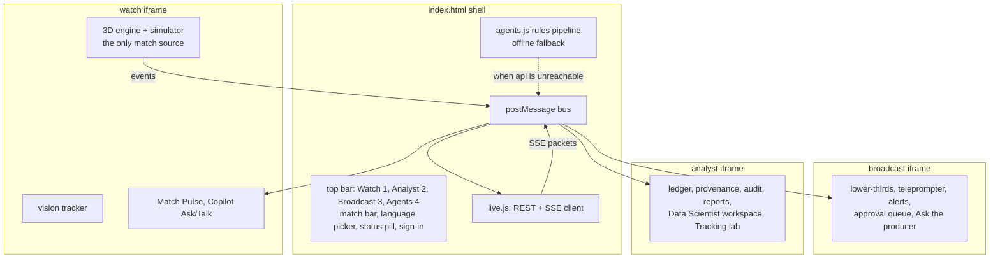

# 11 Front end (unified app)

Status: **Agreed design**. Last reviewed 22 Oct 2026. Backlog: EXP-1 to EXP-17. Current build notes: `apps/unified/README.md` (on branch `feature/unified-app`, PR #4).

## 1. Structure

- Three views, each an iframe built from its source folder by `apps/unified/build.py`, plus the shell.
- **Watch is the only engine** (EXP-2). Broadcast and Analyst run in consumer mode and render from bus messages.
- `live.js` is the only code that talks to the network. Views never call the API directly. The one exception is the vision crop upload, which goes through a `live.js` helper too.

## 2. Bus messages

All messages are `{ type, v: 1, sk, payload }`. The shell accepts engine messages only from the Watch frame's origin and only for the shared match.

| Type | From → to | Payload |
| --- | --- | --- |
| `event` | Watch → shell | contract event |
| `events_ack` | shell → Watch | last_sequence |
| `claim`, `line`, `verdict`, `publication`, `audit`, `recap_ready` | shell → all views | the SSE packet |
| `state` | shell → all views | score, clock, possession |
| `status` | shell → all views | `live`, `rules_fallback`, `offline`, `warming_up` |
| `persona`, `language` | any view → shell | viewer's choice, sent upstream as SSE query parameters |
| `ask`, `talk` | any view → shell | request; reply arrives as `ask_reply`, `talk_reply` |
| `approve`, `edit`, `kill` | Broadcast or Analyst → shell | line ID (ADR-0013) |

## 3. Connection behaviour

| Situation | What the viewer sees | What happens |
| --- | --- | --- |
| `MATCHCAST_API` empty at build | Status pill "Offline (simulated)" | `agents.js` rules in the page |
| API cold (first request pending) | "Warming up the match engine" | Retry `/ready` every 2 s up to 45 s (Q13); after that, "Rules fallback" |
| API live | "Live agents" | REST + SSE |
| SSE drops | "Reconnecting" for up to 10 s | `EventSource` reconnects with `Last-Event-ID`; the server replays from `publications` and `audit` |
| API down for over 30 s during a match | "Rules fallback" | Switch to in-page rules; switch back when `/ready` returns 200 |

## 4. Personalisation (stage e)

| Control | Values | Effect |
| --- | --- | --- |
| Watch mode | Casual, Analyst, My club, Player focus, One metric | Persona sent to the agents; layout and density |
| My club | one of the two clubs | Lines framed from that club's angle |
| Player focus | any player on the pitch | Lines lead with that player; their name tag is highlighted |
| One metric | xG, pass quality, pressure, speed, control | Only that metric's lines |
| Language | English, Spanish, Hindi | Captions, voice, Ask and Talk replies |
| Voice | on or off | TTS playback |
| Playback | 0.25x to 2x | Live passages; quiet spells always fast-forward |

## 5. Rules for every view

1. Anything not connected is labelled "Simulated" (or the specific label in [08-analytics-and-ml.md](08-analytics-and-ml.md) §3).
2. Every published line shows its verdict mark (green tick verified, amber dot awaiting review) and a "How was this made?" link to the trace panel (EXP-6).
3. Rules-made lines show the "Rules fallback" chip.
4. Accessibility: keys 1, 2, 3 switch views; Tab order through cards; Enter opens a trace; Esc closes; an `aria-live="polite"` region reads each published line; WCAG AA contrast.
5. Performance: Watch interactive in ≤ 4 s cold on 50 Mbps; other views load on first switch; `players.json` and match files served compressed with long cache headers.
6. No secret, key or token is ever placed in the page, except the 10-minute Speech token, held in memory only.

## 6. Build and hosting

- `python3 apps/unified/build.py --api https://<api-fqdn>` writes `dist/`. The API base URL is injected as `window.MATCHCAST_API`.
- The `web` container (`nginx:1.27-alpine`) serves `dist/` with brotli/gzip, `Cache-Control: public, max-age=31536000, immutable` for hashed assets and `no-cache` for `index.html`.
- Content Security Policy: `default-src 'self'; script-src 'self' https://cdn.jsdelivr.net; connect-src 'self' https://<api-fqdn> https://*.tts.speech.microsoft.com https://*.stt.speech.microsoft.com wss://*.stt.speech.microsoft.com; img-src 'self' data: blob:; media-src 'self' https://<api-fqdn> blob:`.

### Analyst Data platform page (EXP-13)
`apps/unified/analyst-pages/10_data_platform.js` adds Platform > Data platform. It shows the Fabric clip/screenshot and the Databricks model card from `shared/` (copied from `apps/unified/platform-assets/` by `build.py`). Until DAT-8 / DAT-6 supply the files each block is labelled Planned. The card moves to a Blob read through the api when DAT-6 lands.

### Broadcast instant replay (AB#360)
`apps/unified/embed/replay.js`, appended to the Broadcast view after `broadcast.js`. A capture listener on the `frame` bus message keeps the last 60 s of Watch's frames in the page (not persisted). The producer can replay the last 10, 20 or 30 s at normal or half speed; the view then shows the buffered player and ball positions while clock, score and stats stay live, with a REPLAY tag, and returns to live by itself or on Back to live. Events and agent lines are never replayed. Overlays for this view must sit inside `#bc-view` (the desk's CSS hides other children of `body`).

### Broadcast action poses (AB#361)
Watch's 4 Hz `frame` message carries a sixth element per player, `actOf(p.act)` in `embed/watch.js`: the current action (type, kind, power, timing, foot, side and so on) or 0. Broadcast's `consumerStep` takes the action when a new frame arrives, replaces its own only when the type changes or the clocks differ by more than 0.35 s, and runs the action clock itself between frames because the desk never calls `stepSim`. The pose code is the engine's own `animate`. The frame also carries the referee and assistants (position, yaw, current signal or flag); Broadcast places them, takes the signal once per frame and runs its clock.

### Broadcast on-air log (AB#362)
`apps/unified/embed/onair.js` keeps the lines the shell sent as `air` (approved lines only, from the shell window) and exports them as `matchcast.onair/1` JSON for external graphics tools, with the file's SHA-256 shown. The content is marked `simulated: true` while the agents are the in-page rules.
