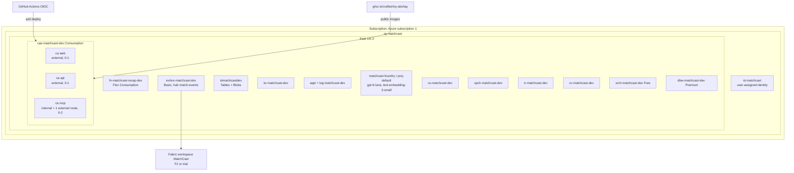

# 13 Deployment, identity and operations

Status: **Agreed design**. Last reviewed 22 Oct 2026. Backlog: PLT-1 to PLT-11. Cost plan: `/mnt/project-files/matchcast-v2/plan/full-3-day-plan.md` (about $49 worst case; about $60 with the Translator, Vision and Content Safety caps in PLT-10, accepted 22 Oct).

## 1. Azure topology

Exported image: [img/4-azure-deployment.png](img/4-azure-deployment.png) (regenerate with `scripts/export_diagrams.sh`).

Everything except the Foundry resource (created by hand on 21 Oct) and Fabric is in Bicep as the target design. Today the Bicep modules cover monitoring, identity, Key Vault, storage, Event Hubs, Container Apps (web, api, mcp), Content Safety, AI Search Free, the recap Function app, alerts, workbook and roles; the Speech, Translator, Vision and Databricks boxes are not in Bicep yet; their stories add them, so the diagram shows the target design. Region parameter `location` defaults to `eastus2`; the resource group stays in East US.

## 2. Infrastructure as code

| File | Creates |
| --- | --- |
| `azure.yaml` | azd services `web`, `api`, `mcp`, `recap` with their Dockerfiles or Functions project |
| `infra/main.bicep`, `infra/main.parameters.json` | Parameters: `location`, `environmentName`, `foundryProjectEndpoint`, `foundryResourceId`, `githubPrincipalId` |
| `infra/modules/monitoring.bicep` | Log Analytics (30-day retention, 0.5 GB daily cap) and App Insights |
| `infra/modules/identity.bicep` | `id-matchcast` |
| `infra/modules/keyvault.bicep` | Key Vault, RBAC mode, soft delete, purge protection off (so `azd down --purge` works) |
| `infra/modules/storage.bicep` | Account (shared key off), 9 tables, 10 containers, lifecycle rules from [07-data-and-storage.md](07-data-and-storage.md) §5 |
| `infra/modules/eventhubs.bicep` | Basic namespace, hub `match-events`, local auth off |
| `infra/modules/ai.bicep` | Content Safety, Speech, Translator, Vision (custom subdomains, local auth off), AI Search Free |
| `infra/modules/containerapps.bicep` | Environment, apps `web`, `api`, `mcp`, scale rules, Easy Auth, Key Vault secret references |
| `infra/modules/function.bicep` | Flex Consumption plan and `fn-matchcast-recap-dev` |
| `infra/modules/databricks.bicep` | Workspace and access connector |
| `infra/modules/roles.bicep` | Every role assignment in §3 |

Rules: no output, parameter default or app setting holds a key or connection string; `az bicep build` must pass with no warnings in CI; a second `azd up` with no changes replaces nothing.

## 3. Identity and access (RBAC matrix)

| Identity | Scope | Role |
| --- | --- | --- |
| `id-matchcast` (used by `api`, `mcp`, `fn-recap`) | Foundry project | Azure AI User |
| | Storage account | Storage Table Data Contributor, Storage Blob Data Contributor |
| | Event Hubs namespace | Azure Event Hubs Data Sender, Azure Event Hubs Data Receiver |
| | Key Vault | Key Vault Secrets User |
| | Content Safety, Speech, Translator, Vision | Cognitive Services User |
| `matchcast-github` (OIDC, branch `main`) | `rg-matchcast` | Contributor; Role Based Access Control Administrator limited to the roles in this table |
| | Key Vault | Key Vault Secrets User (for `srch-admin-key` during KB ingestion) |
| Databricks access connector | Storage containers `scenes`, `season`, `models` | Storage Blob Data Contributor |
| Fabric workspace identity | Event Hubs namespace | Azure Event Hubs Data Receiver |
| Entra app `matchcast-web` (Easy Auth on `web`, `api` and `/mcp`) | its own app roles | App roles `Viewer`, `Producer`, `Admin`; the judge account gets `Producer` (PLT-5) |
| Akshay (Entra user) | Subscription | Owner (existing) |

Key Vault secrets (the only ones): `srch-query-key`, `srch-admin-key`. Each is documented in `docs/infra.md` with the reason managed identity is not possible (AI Search Free tier).

## 4. Container settings

| Setting | `api` | `mcp` | `web` |
| --- | --- | --- | --- |
| Image | `ghcr.io/crafted-by-akshay/matchcast-api:sha-<sha>` | `…-mcp:sha-<sha>` | `…-web:sha-<sha>` |
| CPU / memory | 0.5 vCPU / 1 GiB | 0.5 / 1 GiB | 0.25 / 0.5 GiB |
| Replicas | min 0, max 1 | min 0, max 2 | min 0, max 1 |
| Scale rules | HTTP 20 concurrent; KEDA `azure-eventhub` on `match-events`, `$Default`, threshold 50 | HTTP 20 concurrent | HTTP 50 concurrent |
| Ingress | external, port 8000 | internal port 8001 + external path `/mcp` behind Easy Auth | external, port 8080 |
| Probes | liveness `/health`, readiness `/ready` | `/health` | `/` |

Environment variables for `api` (no secrets except the Key Vault reference):
`MATCHCAST_MODE=cloud`, `MATCHCAST_AGENT_MODE=live|rules`, `MATCHCAST_TOOLS=inproc|mcp`, `MATCHCAST_ORCHESTRATOR=af|native`, `MATCHCAST_STATE_WRITER=workflow|reducer` (ADR-0017, default `workflow`), `AZURE_CLIENT_ID`, `FOUNDRY_PROJECT_ENDPOINT`, `FOUNDRY_MODEL_DEPLOYMENT=gpt-6-luna`, `FOUNDRY_EMBEDDING_DEPLOYMENT=text-embedding-3-small`, `STORAGE_TABLE_URL`, `STORAGE_BLOB_URL`, `EVENTHUB_FQDN`, `EVENTHUB_NAME=match-events`, `MCP_URL`, `SEARCH_ENDPOINT`, `SEARCH_INDEX=kb-matchcast-v1`, `SEARCH_QUERY_KEY` (secretRef to `srch-query-key`), `CONTENT_SAFETY_ENDPOINT`, `SPEECH_ENDPOINT` (custom-domain `https://<name>.cognitiveservices.azure.com`), `SPEECH_REGION=eastus2`, `TRANSLATOR_ENDPOINT` (custom domain), `TRANSLATOR_REGION`, `TRANSLATOR_MAX_CHARS=500000`, `VISION_ENDPOINT`, `APPLICATIONINSIGHTS_CONNECTION_STRING`, `CORS_ORIGINS=https://<web-fqdn>`. The old `MATCHCAST_MODEL_ENDPOINT` and `MATCHCAST_MODEL_API_KEY` are removed (PLT-2).

## 5. CI/CD

Exported image: [img/7-ci-cd.png](img/7-ci-cd.png) (regenerate with `scripts/export_diagrams.sh`).

```mermaid
flowchart LR
  pr[pull request] --> ci[ci.yml]
  subgraph ci_jobs[ci.yml jobs]
    c1[checks: make lint typecheck test build<br/>Azurite service for store tests]
    c2[e2e: make e2e, Playwright Chromium<br/>report uploaded on failure]
    c3[bicep: az bicep build]
    c4[secrets: gitleaks]
    c5[openapi: schema drift]
    c6[gates on changed paths:<br/>ask_eval, compare smoke; check_realism is Planned]
  end
  ci --> ci_jobs
  ci_jobs --> rev[review gate: reviewer session + Akshay merges]
  rev --> main[merge to main]
  main --> dep[deploy.yml]
  subgraph dep_steps[deploy.yml]
    d1[build 3 images, tag sha-short]
    d2[push to GHCR, public]
    d3[azd deploy via OIDC]
    d4[smoke: /ready 200, scripts/smoke_pipeline.py full fixture to settled claims]
    d5[on failure: previous revision keeps traffic]
  end
  dep --> dep_steps
```

- Branch protection on `main`: the CI jobs must pass and one approving review is required.
- PR titles start with the Azure Boards ID (`AB#123`), so work items link.
- Container Apps use single revision mode. Rollback: `az containerapp revision activate` on the previous revision (runbook).

## 6. Environments

| Environment | Where | Mode | Data |
| --- | --- | --- | --- |
| `local` | Mac mini or CI | `MATCHCAST_MODE=local`, `MATCHCAST_AGENT_MODE=rules`; Azurite for Tables and Blobs; in-memory bus instead of Event Hubs | Fixtures |
| `dev` | Azure (`azd env dev`) | cloud, live agents | Live demo, judged |

There is one cloud environment, so every merge to `main` is a production deploy. That is why the review gate and the smoke test exist.

## 7. Runbooks

| Runbook | When | File |
| --- | --- | --- |
| Demo day | Before recording and before judging windows: set `api` min replicas to 1 for the session, run the release check | `docs/runbook-demo.md` |
| Release check | After each deploy that touches the demo; logged-out browser | `docs/release-check.md` |
| Shutdown | Pause Fabric after filming; stop Databricks after training; on 11 Nov `azd down --purge` | `docs/runbook-shutdown.md` |
| Incident | `api` not ready, Foundry 429s, Search deleted, budget alert | `docs/runbook-incident.md` |
| Cost check | Daily during the build | `scripts/cost_today.sh` |
