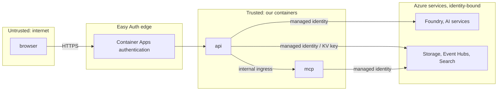

# 14 Security and responsible AI

Status: **Agreed design**. Last reviewed 22 Oct 2026. Backlog: PLT-4, PLT-5, AGT-12, QUA-7.

## 1. Security rules (non-negotiable)

1. No secret in the repo, the browser, chat, logs, prompts or the video. gitleaks runs before every commit (hook) and in CI.
2. Managed identity for every Azure call that supports it. The only stored secrets are the two AI Search keys, in Key Vault.
3. Unauthenticated users may view and ask; only the Producer or Admin role may approve, edit or kill. The role is checked in `api`, not only in the UI.
4. All model output is untrusted until the Verifier and Content Safety pass it. The text of a line Content Safety refused is withheld from `GET /lines`, the stream's `line` events and the other line routes once it is refused (status and `reason_code` stay; the store keeps the text for the audit). A line that has not yet passed its checks (drafted, verifying) is shown with a placeholder, so unchecked text never reaches a stream either.
5. All user text (Ask, Talk, edits) and all retrieved text is untrusted input to the models.

## 2. Trust boundaries

Exported image: [img/6-identity-and-security.png](img/6-identity-and-security.png) (regenerate with `scripts/export_diagrams.sh`).

## 3. Threat model (STRIDE)

| Threat | Example | Control | Tested by |
| --- | --- | --- | --- |
| Spoofing | Calling producer routes without the role | Easy Auth principal header, role check in `api`; header stripped if it arrives from outside | Unit test: 403 without Producer |
| Spoofing | Forged recap trigger | `/internal/v1/*` requires a token issued to `id-matchcast` | Unit test: 401/403 |
| Tampering | Editing an audit record | Hash chain, `verify_chain()` in the Analyst view | AGT-2 fixtures |
| Tampering | Sending fake events to change the score | Events only change the viewer's own stream key (`session_id` is per browser); the demo fixture uses its own session | Contract tests |
| Repudiation | "I didn't approve that" | Audit record with actor kind, Entra object ID and display name | EXP-11 |
| Information disclosure | Keys in the page or env vars | Managed identity; Key Vault references; CSP; no secrets in SSE | PLT-4 checks |
| Information disclosure | Personal data in Ask history | 24-hour deletion; fictional players only | Sweep test |
| Denial of service / cost | Flooding Ask, Talk, OCR, events | Rate limits and the model cost guard (daily call cap, rules matches past an address's live allowance, `MATCHCAST_MODEL_OFF` kill switch; [12-api.md](12-api.md) §7); max replicas; budget alerts | Load smoke |
| Elevation of privilege | Prompt injection makes an agent call a write tool | Agents have no write tools; MCP tools are read-only and time-scoped; Data Scientist SQL is SELECT-only on allowed views | Red-team set in `eval/` |

## 4. AI safety controls

| Control | Where | Setting |
| --- | --- | --- |
| Prompt Shields | `/ask`, `/talk`, Producer edits, retrieved chunks | Block on detected attack, 400 `prompt_attack` |
| Content Safety text analysis | Every line before publication; every translated variant | Block at severity ≥ 2 in hate, sexual, violence or self-harm |
| Grounding | Verifier checks 1 to 8 ([04-agents.md](04-agents.md) §5) | Numbers recomputed; names from the roster; citations required in Ask |
| Human in the loop | Producer mode | Lines wait for approval |
| Transparency | Every line | Verdict mark, trace panel, "Rules fallback" and "Simulated" labels |
| Abstention | Ask, recap | "I can't confirm that from the match data yet."; failing recap sentences dropped |
| Scope | Ask router | Out-of-scope questions refused politely |

Red-team set: `eval/redteam.jsonl` with 20 prompts (instruction override, request for keys, abuse of a fictional player, real-player impersonation, SQL write attempts). CI expects 20 of 20 blocked, refused or abstained.

## 5. Responsible AI notes (`docs/responsible-ai.md`)

The public page covers:
1. Synthetic data only; no real people, clubs or simulated matches. National team names and real past results are allowed as reference facts (ADR-0020).
2. What the Verifier checks, and what it cannot check (for example, whether a tactical opinion is wise).
3. Content Safety settings and thresholds.
4. Human approval in producer mode.
5. Known failure modes: abstentions, rules fallback wording, translation dropped when numbers differ, vision identity errors.
6. Languages: English, Spanish and Hindi; Tamil off until reviewed.
