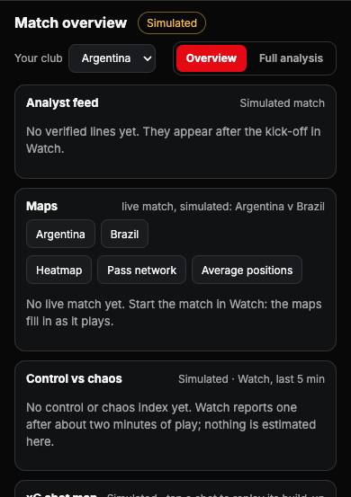
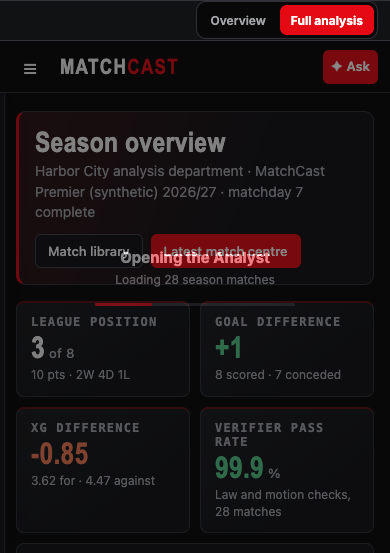
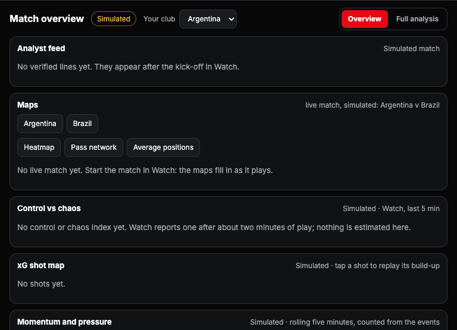
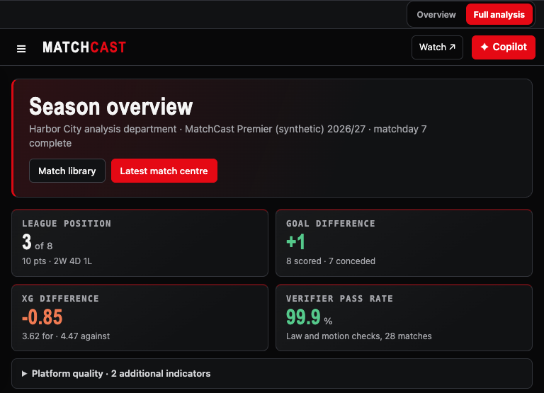
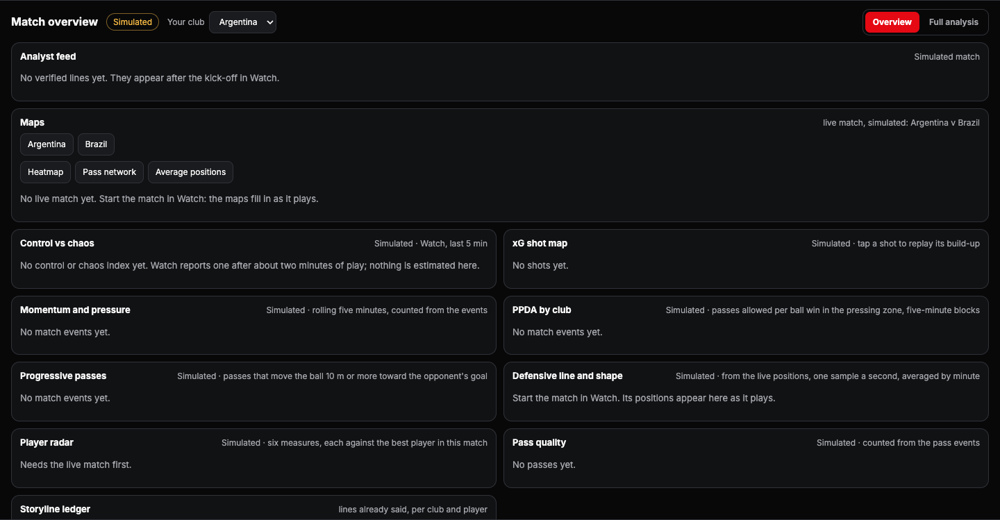
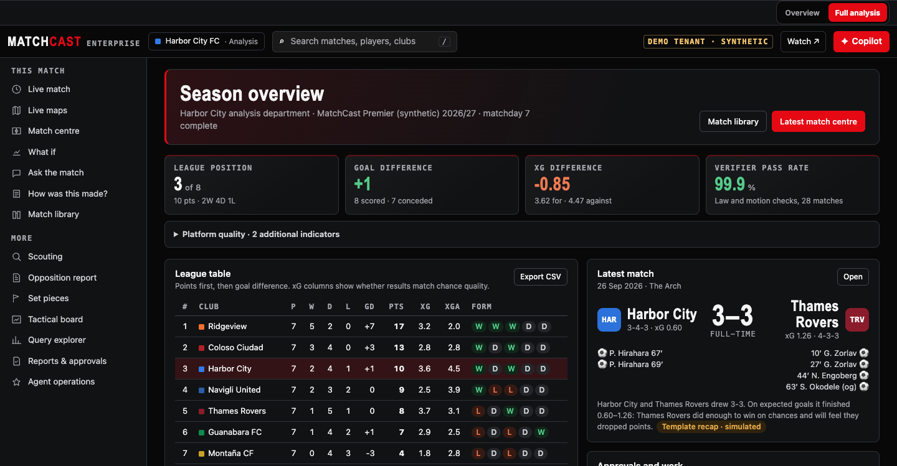

# Analyst overview and full-analysis screenshots

Captured from the local synthetic tenant in Chromium. The Analyst view now has a two-way Overview / Full analysis switch. Overview keeps the match live view easy to scan; Full analysis keeps the complete console. Users & access, Audit log, and tenant DATA details are hidden from this match-focused workflow. These screenshots show both modes at the requested viewport widths.

| Viewport | Overview | Full analysis |
| --- | --- | --- |
| 390 px |  |  |
| 768 px |  |  |
| 1440 px |  |  |
