# Browse release screenshots

Captured from the local build on 28 October 2026 in Chromium at 900 px height. The fixtures are synthetic; the app ran without the agent API. Home, Matches and My Club stay inside each viewport and do not load the Watch iframe. The stadium cover is illustrative; the highlight cards label it as artwork rather than a saved match frame.

| View | 390 px | 768 px | 1440 px |
| --- | --- | --- | --- |
| Home | 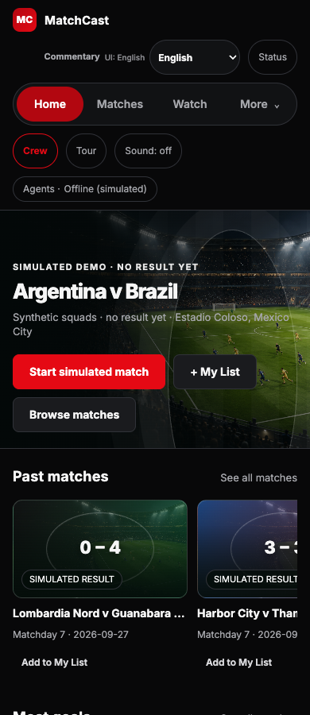 | 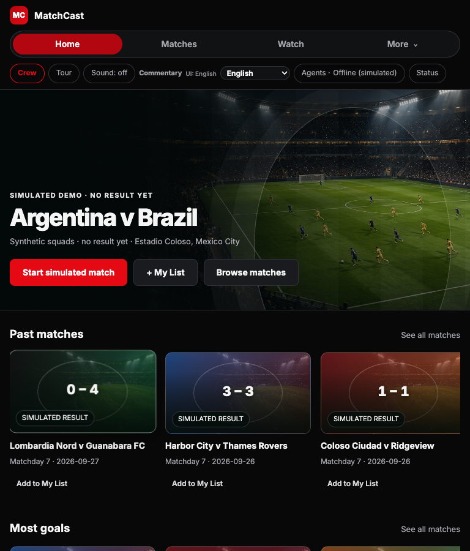 | 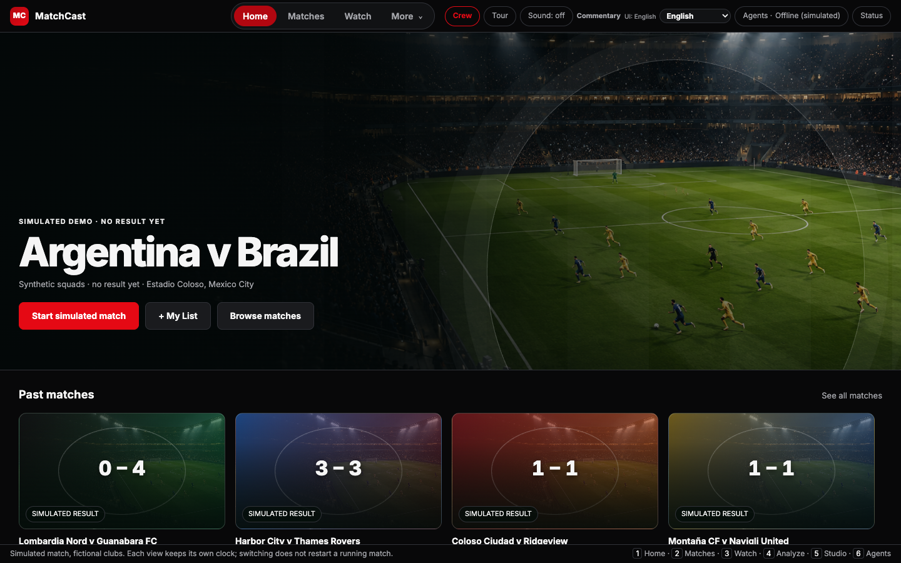 |
| Matches | 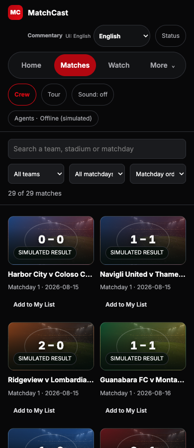 | 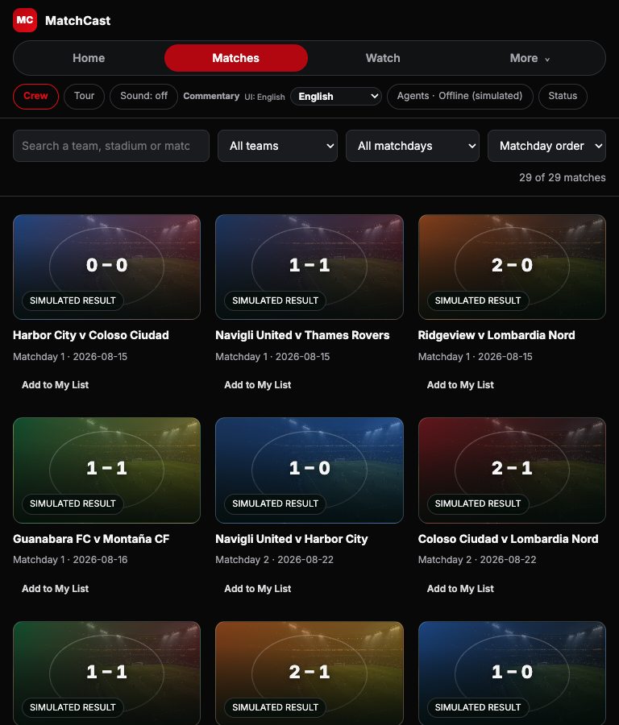 | 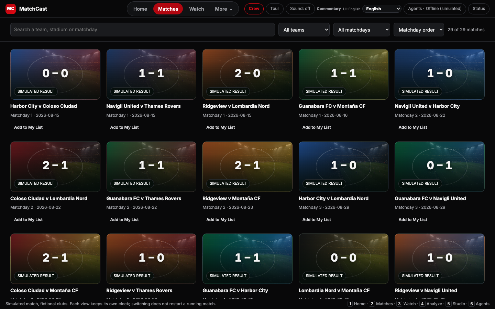 |
| My Club | 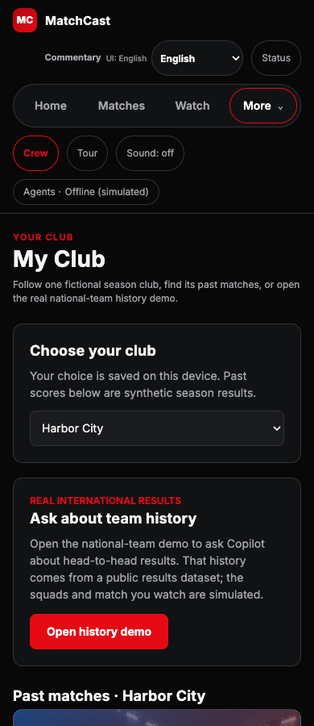 | 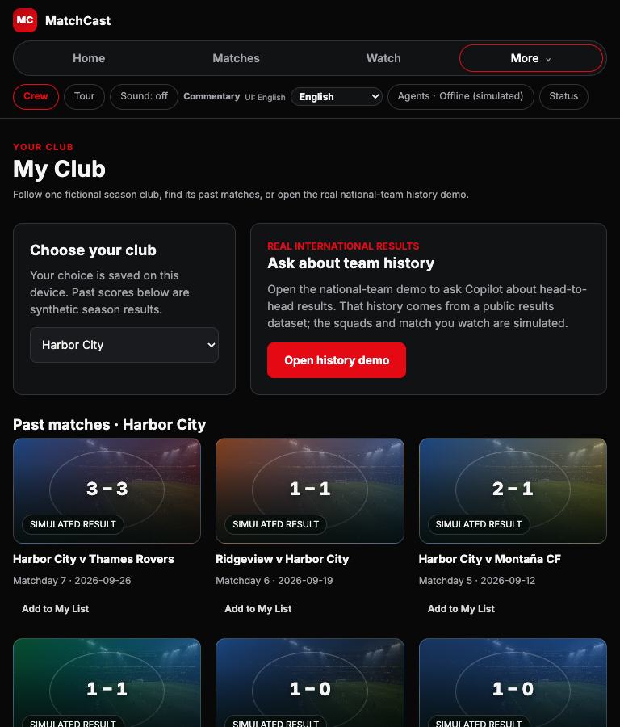 | 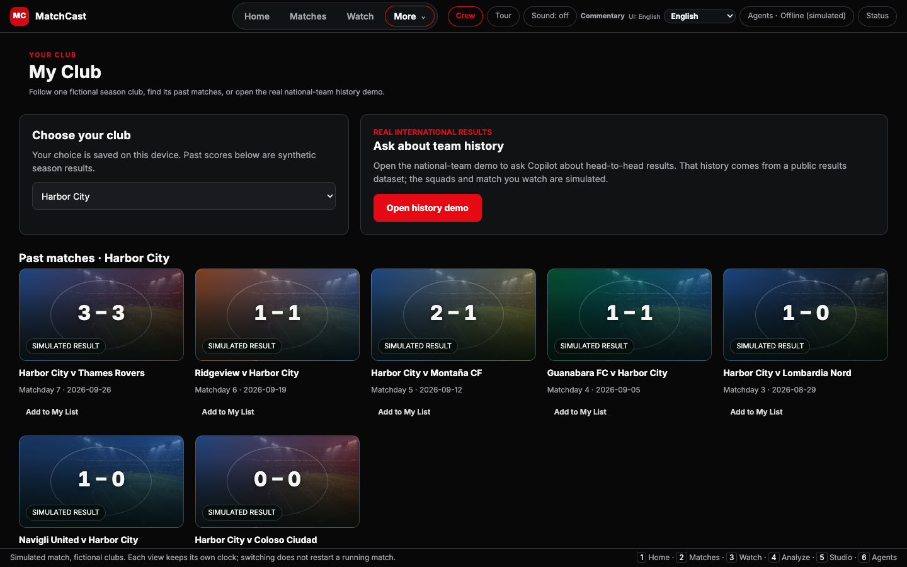 |
| Match record | 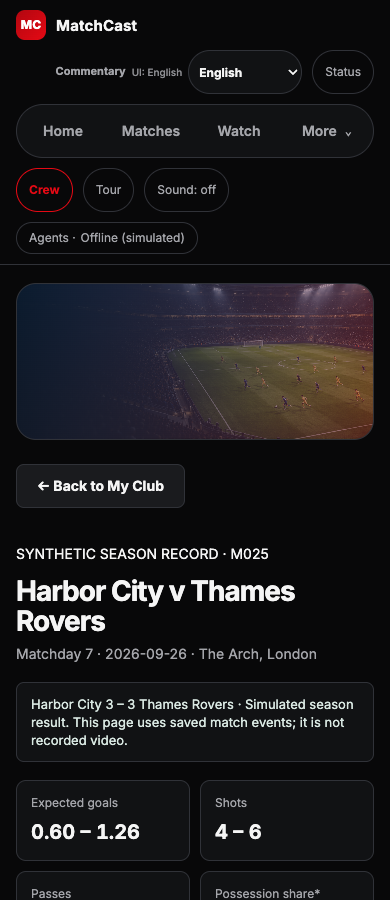 | 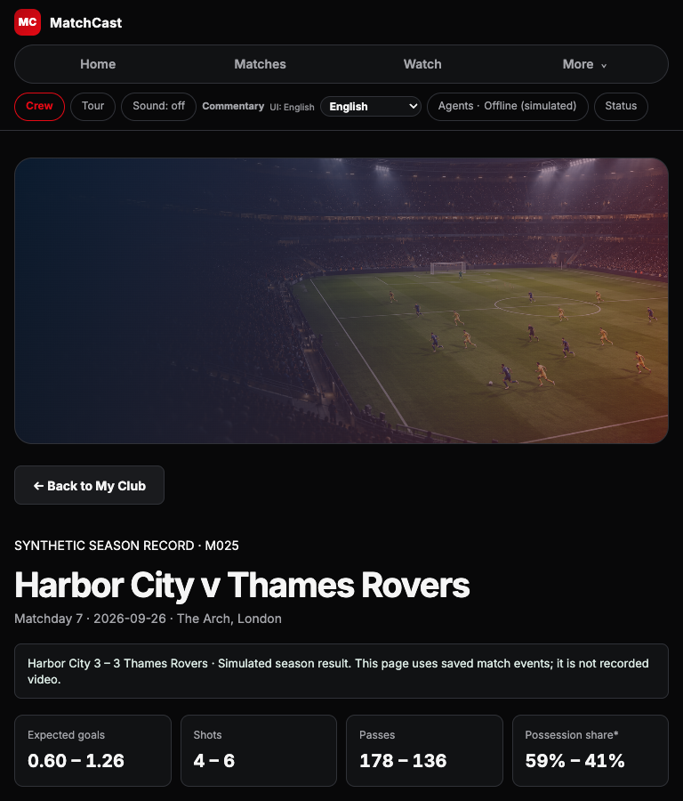 | 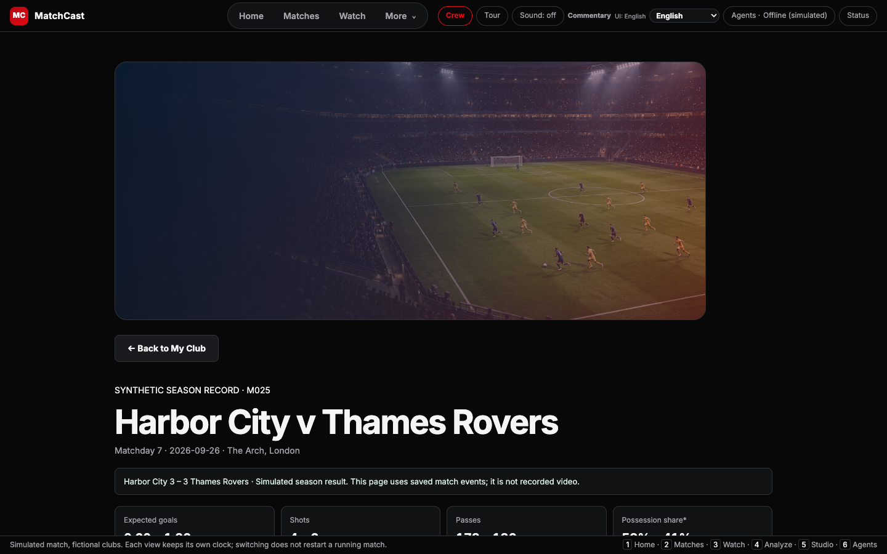 |
