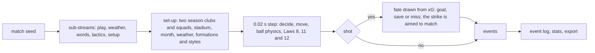

# MatchCast match simulator (DAT-9)

Design background: [architecture 06](architecture/06-simulation.md), [ADR-0004](architecture/adr/0004-condensed-broadcast-clock.md), [ADR-0012](architecture/adr/0012-synthetic-data-and-licences.md). Data sources and licences: [dataset-card.md](dataset-card.md).

## Pipeline

Source of truth is the engine in `apps/unified/sources/3d-source/v2` (Watch) and the identical copy in `broadcaster-console/engine`. `services/simulation/run.cjs` drives the same engine in Chromium without rendering: `stepSim(0.02)` in a loop until full time.

## What is random and what is fixed

| Thing | Source |
| --- | --- |
| Match seed | The only unseeded draw is `newSeed()` in `setup.js` (a new match). Rain drops (`worldvis.js`) and animation phase (`main.js`) stay unseeded because they change no event, number or sentence |
| `play` stream | `mulberry32(hash32(seed + ":play"))`: every decision, error, duel and foul in the engine |
| `weather` | `subStream(seed, "weather")` through `world.js` |
| `words` | Player replies in `talk.js` |
| `tactics`, `setup` | "Auto" formation and style picks, stadium, month, kick-off in the surprise handler |
| Step | Fixed 0.02 s in the headless runner. The browser steps with the frame time, so a browser replay is statistically the same match, not byte-identical |
| Clubs in calibration runs | `run.cjs` draws two different season clubs, a stadium and a month from the seed |

`services/simulation/tests/checks.cjs` fails if `Math.random` appears anywhere else, if the engine's xG constants differ from `data/calibration/xg.json`, or if the same seed does not give byte-identical event JSON.

## Shots, xG and goals

xG is the logistic curve fitted on Wyscout open-play shots (`scripts/fit_xg.py`, constants in `data/calibration/xg.json`): `xG = 1/(1+e^-(b0 + b1·angle + b2·distance))` with b0 = -1.4646, b1 = 1.4138, b2 = -0.0891 (log-loss 0.2889 against 0.3344 for a constant, 43,078 shots). The engine shows a defender within 2 m as x0.7 and a header as x0.8.

At every strike the engine draws the shot's fate from the play stream: goal with probability `sigmoid(logit(xG) + finisher shift − keeper shift)` (each shift at most ±0.5; penalties 0.76), a further 20% saved, the rest missed. The strike is then aimed to match: a goal goes into a corner the keeper cannot reach, a save goes at the keeper, a miss goes wide or over. A shot drawn as a miss or a save cannot become a goal off a deflection in the next 5 s. Defenders can still block shots, so a drawn goal is sometimes blocked and the goals-per-shot figure comes out slightly under the mean xG.

## Action weights (tuned)

| Parameter | Value | Effect |
| --- | --- | --- |
| `shotThr` | 0.06 | A player shoots when xG exceeds this plus 0.03 × risk |
| `longShot` | 0.05 | Chance per decision of an unforced shot from 16–27 m under no pressure |
| `passBias` | 1.5 | A pass must beat the dribble option by this much |
| `holdScale` | 1.5 | Scales how long a player holds the ball before a forced pass |

Starting from the prototype values (0.04, 0.09, 0, 1) the engine produced about 34 shots and 1,014 passes a match. The values above come from 16-seed sample runs against the targets; the final check numbers are in the next section. Override for experiments with `?tune=shotThr:0.05,passBias:1` in the Watch URL or `--tune` on the runner.

## Realism check

`uv run python scripts/check_realism.py --matches 200` (targets in `data/calibration/targets.json`, sources and licences next to each). Engine "duel" = aerial duel + slide tackle + take-on + possession turnover. Each match is a different pair of season clubs.

RESULTS_PLACEHOLDER

## Match clock decision (option A or B)

**Option A (condensed broadcast) stays.** Measured on this build environment (a 4-core cloud container, four matches at once): 90 match minutes headless take 94 s alone and 99 to 115 s with four running, over the 60 s target from ADR-0004. The Mac mini measurement is still to do because it is offline. Reason for keeping A: the 60 s limit protects batch generation, not live play. Watching a match needs the engine to step 20 times faster than real time during a fast-forward, and the measured 57 times real time on one core leaves room for that. The batch jobs (200-seed check, scenes) run at full density regardless. If DAT-10 cannot hold 30 fps at 20x in the browser, the live view falls back to option B and the dataset stays at full density.

## Known limits

- Passes and duels in the engine are counted by our definitions, not Wyscout's.
- Goals include a small share from rebounds and crosses that are not preceded by a shot event.
- Teams are drawn from 12 fictional clubs with squads rated 82 to 93, so scorelines have less spread between teams than a league with weak sides.
- A match takes about 100 s of CPU to simulate, so 200 seeds take about 90 minutes on 4 cores.
