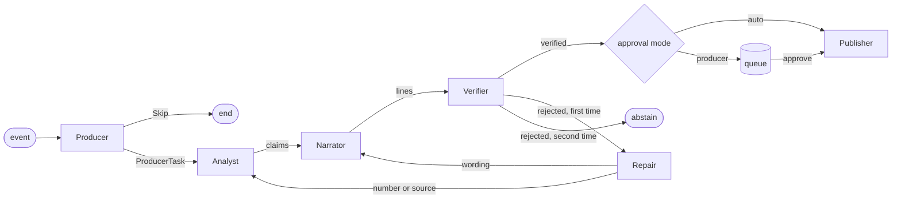

# matchcast-agents

The match workflow: four agents with one job each, handing typed packets to each other and
leaving a hash-chained audit record at every step. Design: `docs/architecture/04-agents.md`.

## Workflow graph



| Agent | Job | Rules implementation (this package) |
| --- | --- | --- |
| Producer | Picks moments, sets priority, skips quiet play | Score table, threshold 60, priority 1 for goals and red cards, one task per 8 s of match time |
| Analyst | Turns a moment into 1 to 3 claims with evidence | Counts from the rolling match state; claims are contract `claim` packets |
| Narrator | One line per persona from claim values and roster names | Templates for `casual`, `analyst`, `broadcast` |
| Verifier | Checks sources, freshness, numbers, names, persona limits | Checks 1 to 5 and the adversarial pass (8a) from `04-agents.md` §5, recounted from the stored events |

## Modes

`MatchWorkflow` takes an `AgentSet`. `rules_agents()` is the deterministic set and the fallback
for every agent (ADR-0014). Live agents on Foundry (AGT-4 onwards) implement the same four async
methods and drop in without changing `workflow.py`. Nothing here calls a model.
`rules_agents(seed_bad_claim=True)` corrupts the first claim once so the Verifier rejection and
the repair path can be shown on cue.

## Try it

```sh
uv run python packages/agents/tests/make_match_short.py   # regenerate the 10-minute fixture
uv run pytest packages/agents/tests
```

Known limits in this version: corrections and retractions are stored but not replayed into
state; only the in-memory store exists (`TableStore` is later work); checks 6 to 8 are AGT-7 and AGT-12.

## Resilience (AGT-9) and repair (AGT-8)

`ResilientAgent(live, rules)` wraps a live agent and its rules twin. Per call: 20 s timeout, one
retry on 429 honouring `Retry-After`, a circuit breaker that opens after 3 failures in 60 s and
lets one probe through after 30 s. A failed call runs the rules twin, the workflow audits
`fallback_used` with `fallback_reason` (`timeout`, `rate_limited`, `model_error`, `circuit_open`,
`tool_error`) and publishes an SSE `status` event (`rules_fallback`, then `live` on recovery).
Tool failures are not model failures and are never retried as one.

Deviation from the story text: the claim's `derivation_version` is not suffixed `+rules`, because
the contract pattern allows only `x.y.z`. The fallback is recorded in the audit log, in the line
audit `mode`, and in the stream status instead.

A rejected line gets exactly one repair (number, source or freshness errors go to the Analyst;
wording errors to the Narrator); a second rejection is `line_abstained` and nothing is published.
`seed_bad_claim` corrupts the first claim at or after `seed_bad_claim_at_ms` (default minute 12);
the api takes it from the match-create body or the `X-MatchCast-Seed-Bad-Claim: 1` header.

## Checkpoint and resume (AGT-13)

After every event the workflow writes a checkpoint (`processed_sequence`, the match state, and the
Producer's memory). A new `MatchWorkflow` on the same store restores it, and the next `ingest`
first finishes any stored event beyond the checkpoint, so a client that re-sends its batch after a
crash gets the same claims, lines and publications as an uninterrupted run, with no claim id twice.
Claim, line and publication writes are idempotent by id; a replayed step can append extra audit
records, and the chain stays valid. The Table Storage checkpoint store (`checkpoints`, RowKey
`<moment_id>:<executor>`) comes with DAT-2; the memory store is the reference implementation.
